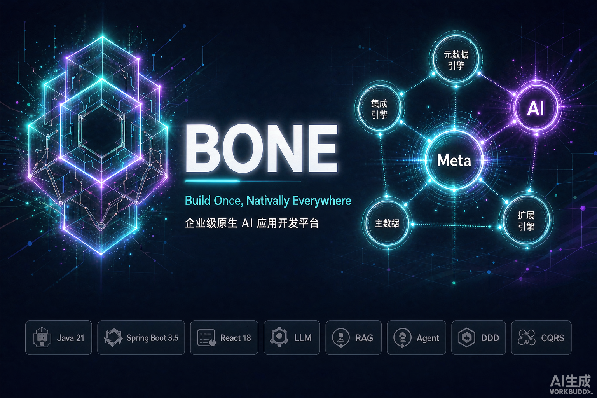
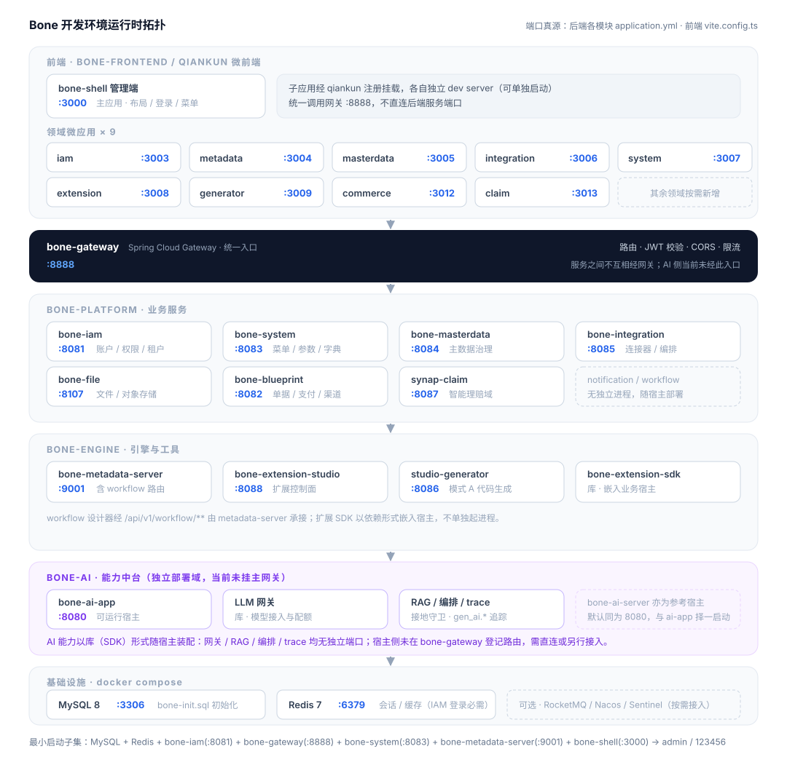

# Bone — Build Once, Natively Everywhere

**Enterprise AI-Native Application Development Platform** — Metadata-driven · Four Engines · AI-Native




**Model once, deliver two kinds of applications.** Bone connects *modeling → data structure → access behavior* through a unified metamodel: it can generate auditable source code (Mode A) or expose CRUD/API dynamically at runtime (Mode B). On top of the enterprise foundation (master data / extension / integration), it ships the native **Bone AI Capability Platform** (LLM gateway · RAG · agent orchestration · AI observability), so a single model powers both traditional and AI-native applications.

> "Build reusable systems, create sustainable value." — Meishan

**Quick links**: [Quick Start](#quick-start) · [Capabilities](#capability-highlights) · [Why BONE](#why-bone) · [Architecture](doc/architecture/BONE-总体架构设计方案.md) · [Docs Index](doc/README.md) · [Contributing](CONTRIBUTING.md)

> **License**: free for personal learning / research / non-commercial evaluation; commercial production use requires a commercial license ([BSL 1.1](LICENSE), effective 2026-10-11), earlier versions remain under MIT. See [License](#license).

**English** | [简体中文](README.md)

## Reading Guide

| You want to know… | Start here |
|-------------------|------------|
| **Product positioning, current capabilities, roadmap** | This page |
| **Engineering, API, DDL, local debugging** | [doc/README.md](doc/README.md) → [Architecture](doc/architecture/README.md) · [Local build](doc/wiki/03-本地开发与构建.md) |
| **AI assistants / contributor gates** | [AGENTS.md](AGENTS.md) · [CONTRIBUTING.md](CONTRIBUTING.md) |

**Note**: This page is a quick overview, not a substitute for detailed design. Interfaces, schemas, ports and implementation status are authoritative in `doc/`, OpenAPI and the code; delivery status is tracked in the [P0 board](doc/wiki/07-P0-TODO看板.md).

---

## Capability Highlights

| 🧬 **Metadata-driven** | ⚙️ **Dual-mode delivery** | 🏛️ **DDD architecture** |
| Model once, drive data structure and access behavior; cut repetitive CRUD and boilerplate | Mode A code generation (source in Git, auditable) / Mode B runtime (dynamic CRUD/API), choose per scenario | Clean / hexagonal layering, module boundaries guarded by ArchUnit gates |

| 🔐 **Enterprise foundation** | 🔌 **Extension engine** | 🔗 **Integration engine** |
| RBAC · JWT · multi-tenancy · audit log; fine-grained permissions rolled out in stages | ExtPoint injects differentiating logic without forking the trunk | Multi-protocol connectors + flow orchestration + Outbox reliable delivery; idempotency / observability are first-class |

| 🤖 **AI-native** | 🧠 **RAG & grounding guard** | 🕸️ **Agent orchestration** |
| Built-in Bone AI Capability Platform (LLM gateway / AI tracing / governance), AI as a first-class citizen | Retrieval-augmented generation + GroundingGuard anti-hallucination + golden-set evaluation and negative-probe gates | Workflow / multi-agent orchestration on top of the metamodel and extension points, for AI-native business |

> The current **implementation status** of the four engines, the Bone AI Capability Platform and DDD investment categories is described below and tracked in the [P0 board](doc/wiki/07-P0-TODO看板.md); the roadmap is never written as if it were shipped.

---

## Table of Contents

- [Capability Highlights](#capability-highlights)
- [Why BONE](#why-bone)
- [Overview](#overview)
- [Design Principles](#design-principles)
- [Core Value](#core-value)
- [The Four Engines](#the-four-engines)
- [Bone AI Capability Platform (AI-Native Layer)](#bone-ai-capability-platform-ai-native-layer)
- [Collaborative Architecture](#collaborative-architecture)
- [Technology Stack](#technology-stack)
- [Roadmap](#roadmap)
- [Quick Start](#quick-start)
- [Docs & Community](#docs--community)
- [FAQ](#faq)
- [License](#license)

---

## Why BONE

| Differentiator | What it means |
|----------------|----------------|
| **One metamodel, two deliveries** | The same `meta_*` model can, per entity, either produce generated source (auditable, deeply customizable) or expose a dynamic runtime API (no generation, fast to ship) — no forced either/or. |
| **AI as a first-class citizen** | Not a bolt-on SDK: LLM gateway / RAG (with grounding guard) / agent orchestration / AI observability live in the same native stack and collaborate with metadata, master data, extension and integration on one model plane. |
| **Extend, don't fork** | Industry differences are injected via ExtPoint plugins; the trunk stays stable, so upgrades and customizations stay decoupled. |
| **Machine-verifiable architecture** | Layering and module boundaries are guarded by ArchUnit and [`./scripts/check.sh`](scripts/check.sh) gates — not just documentation. |
| **Honest, traceable status** | The README explicitly separates *implemented / planned / target*; capability status is grounded in the board, OpenAPI, code and tests. |
| **Enterprise foundation out of the box** | RBAC · JWT · multi-tenancy · audit · Outbox reliable delivery, plus a DDD reference implementation [`bone-blueprint/`](bone-blueprint/) to start from. |

---

## Overview

Bone's long-term vision is **"Build Once, Natively Everywhere"**: describe business with a **unified metamodel**, carry master data, extension and integration with **standardized engines**, and ship a **native AI capability platform** — so an enterprise can model once and deliver both traditional and **AI-native** applications, moving from "project-by-project rebuilding" to "platformized, AI-native evolution".

Externally the product is described as **"four engines + Bone AI Capability Platform"**; under DDD strategic classification, **metadata / modeling is the current core domain**, while master data, extension, integration and the AI capability platform are supporting domains. The two views serve different purposes and do not conflict.

This repository is an open reference implementation of that vision: metadata dual-mode, IAM, master data, extension management and integration already have code and startup entry points, at varying completeness; capabilities not yet delivered are explicitly marked as *planned* or *target*.

---

## Design Principles

These principles guide architecture and product decisions:

1. **Metadata-first**
   Entities, fields, relations and rules should be configurable and versionable; complex domain logic stays as explicit code, so maintainability is not sacrificed for configurability.

2. **Open-closed (ExtPoint)**
   Core flows stay stable; industry differences and customer customization are injected via extension points and plugins, avoiding a forked trunk.

3. **Single source of truth (Master Data)**
   Core objects such as customers, organizations and materials form authoritative master data and a unified view, distributed via standard REST APIs with replica consistency governed.

4. **Contract-based integration**
   Heterogeneous systems connect through connectors and orchestrated flows; protocol adaptation, idempotency, retries and observability are first-class.

5. **API-first**
   External APIs are unified under `/api/v1/{domain}/**`; error codes, logging and multi-tenancy follow [Bone API Spec](doc/architecture/Bone-API-规范.md).

6. **Traceable implementation status**
   The README is an overview only; actual status follows the [P0 board](doc/wiki/07-P0-TODO看板.md), module designs and tests.

---

## Core Value

### Development efficiency

- **Metadata-driven**: model once, drive both data structure and access behavior; cut repetitive CRUD and boilerplate.
- **Dual-mode delivery**: choose **Mode A · generation** (source in Git, auditable) or **Mode B · runtime** (dynamic CRUD/API, less standard code generation). See [Smart Metadata Engine](#smart-metadata-engine) for details.
- **Multi-target (vision)**: one model for web admin, mobile apps and mini-programs — **Web micro-frontend (Qiankun) is the current mainline**, mobile is planned.

### Enterprise capabilities

- **Identity & isolation**: RBAC, JWT and tenant context are in place; column-level permissions, SSO/MFA are being phased in.
- **Consistency strategy**: prefer local transactions, idempotency and Outbox; evaluate Seata (AT/TCC) only when cross-service strong consistency is truly required.
- **Observability**: audit logs and some metrics are live; tracing and unified monitoring are still evolving.

---

## The Four Engines

The four engines are a product capability view, not four DDD core domains. Below, current implementation and evolution targets are labeled separately, so the roadmap is not mistaken for the present. See [metadata capability comparison](doc/design/modules/元数据能力-实现映射与竞品对照.md) for module relationships.

### Smart Metadata Engine

**Position**: the platform's core domain. Describes business with a **unified metamodel (catalog) + pluggable extension-field storage**, and offers two complementary delivery modes:

> Glossary: **catalog** = the registry of entities, fields and relations; **extension fields** = dynamic attributes of an entity, with three storage modes in the SDK — **reserved columns (recommended default)**, **JSON columns**, and **EAV key-value** (rare, not the first choice); **SmartQL** = a query language over the metamodel; **escape hatch** = fall back to generated or hand-written code when standard capability is insufficient.

| Mode | Processing | Fit | Main modules |
|------|------------|-----|--------------|
| **A · Generation** | Metadata → auditable source → compile & deploy | Complex domain logic, source audit, deep customization | `bone-metadata-sdk` + `bone-metadata-server` + `studio-generator` |
| **B · Runtime metadata plane** | Metadata → runtime interpretation → dynamic CRUD/API | Config-driven entities, ops backends, SaaS standard objects | `bone-metadata-sdk` + `bone-metadata-engine` + `bone-metadata-server` |

```text
                    ┌── Mode A: generation (current mainline)
  meta_* model ─────┤     server(catalog) → generator → Java/TS project → sdk repository binds physical tables
                    │
                    └── Mode B: runtime (MVP delivered, evolving)
                          server(catalog) → engine → dynamic REST / SmartQL → sdk reads/writes DB directly
```

**Mode A (generation)** — for scenarios requiring source in the repo, complex domain logic, or deep integration with ExtPoint.

**Mode B (runtime)** — for ops backends, config-driven entities and multi-tenant SaaS standard objects. **Current status**: dynamic record read/write MVP is delivered (`JdbcRuntimeRecordService` + `/api/v1/runtime/entities/{code}/records`, gateway route configured, see [P0 board META-002B](doc/wiki/07-P0-TODO看板.md)); model publishing, hot reload and low-downtime changes are still evolving. Once Mode B matures, standard CRUD need not depend on the generator; the generator continues to produce DDD skeletons and deep-customization code.

**Shared capabilities (both modes)**:

| Area | Description |
|------|-------------|
| Platform data plane | **bone-metadata-sdk**: repositories, three extension-field modes (reserved column / JSON / EAV; default reserved column, auto-degrade to JSON on allocation failure), multi-datasource dialects (the JDBC execution base for Mode B) |
| Modeling control plane | **bone-metadata-server**: catalog REST + extension-field API (`:9001`) |
| Rules & dynamic access | **[bone-metadata-engine](bone-engine/bone-metadata-engine/)**: expressions / validation / SmartQL / dynamic CRUD (Mode B core, gradually replacing "generate code per table") |
| Permissions & multi-tenancy | Row-level tenant binding and column-level rules on metadata (unified policy across both modes) |
| Runtime evolution | Model publishing, hot reload, low-downtime changes (engine + release flow, phased) |
| Delivery-mode marker | `meta_entity.delivery_mode`: `GENERATIVE` / `RUNTIME` (already persisted) |

**Code**: [`bone-engine/bone-metadata-sdk`](bone-engine/bone-metadata-sdk/) · [`bone-engine/bone-metadata-server`](bone-engine/bone-metadata-server/) · [`bone-engine/bone-metadata-engine`](bone-engine/bone-metadata-engine/) (Mode B) · [`bone-engine/studio-generator`](bone-engine/studio-generator/) (Mode A) · frontend [bone-metadata-app](bone-frontend/apps/bone-metadata-app/) · [bone-generator-app](bone-frontend/apps/bone-generator-app/)

> Capability comparison: [metadata capability mapping](doc/design/modules/元数据能力-实现映射与竞品对照.md) §1.3, §3.3

---

### Master Data Platform

**Position**: establish authoritative records and a unified view for core master data.

| Status | Capability |
|--------|------------|
| **Current** | Master-data entity and record management, business-entity transformation, JSON export, quality report query |
| **Target** | Multi-domain governance, lineage, cleansing & quality scoring, data asset catalog, standard REST distribution |

**Code**: [`bone-platform/bone-masterdata`](bone-platform/bone-masterdata/) · [`bone-masterdata-app`](bone-frontend/apps/bone-masterdata-app/)

---

### ExtPoint Extension Engine

**Position**: inject differentiating logic through predefined extension points, avoiding changes to core flow code.

| Status | Capability |
|--------|------------|
| **Current** | Extension-point routing and caching, expression matching, execution guards; Studio CRUD, versioning, deploy and rollback |
| **Target** | Fuller plugin lifecycle, artifact isolation, sandbox execution, call-chain observability, dynamic parameter governance |

**Typical scenarios**: promotion stacking, government co-signing, industry BOMs, etc.

**Code**: [`bone-engine/bone-extension-engine/bone-extension-sdk`](bone-engine/bone-extension-engine/bone-extension-sdk/) · [`bone-engine/bone-extension-engine/bone-extension-studio`](bone-engine/bone-extension-engine/bone-extension-studio/) · frontend [bone-extension-app](bone-frontend/apps/bone-extension-app/)

---

### Integration Engine

**Position**: connect ERP / CRM / OA / collaboration and messaging systems into an enterprise digital ecosystem.

| Area | Goal | Current status |
|------|------|----------------|
| Multi-protocol | Extend protocol connectors as needed | **REST/HTTP** implemented; FTP/JDBC/MQ return 501 |
| Connector factory | Standardized connectors | CRUD + connection test (`int_connector`) |
| Flow orchestration | Branch, parallel, loop | **Linear** START→HTTP→END (INT-09) |
| Reliability | Retry, idempotency, dead-letter, eventual consistency | Execution log + domain events + **MQ Outbox relay** (INT-10 delivered; logs by default, enable RocketMQ relay via `BONE_INTEGRATION_OUTBOX_MQ_ENABLED`) |
| Camel orchestration | Visual DSL execution | **Camel compiler delivered** (INT-11): `int_flow_node` graph DSL → Camel route (choice/multicast); default execution remains linear (INT-09), Camel execution enabled via `integration.camel.execution-enabled` |

**Code** (the single integration service; do not confuse with the removed engine module):

- Backend: [`bone-platform/bone-integration`](bone-platform/bone-integration/) (Maven artifact `bone-platform-integration`, default `:8085`)
- Frontend: [`bone-integration-app`](bone-frontend/apps/bone-integration-app/) (`:3006`, loaded by Shell `:3000`)

Delivery progress: [P0 board · Integration](doc/wiki/07-P0-TODO看板.md#集成引擎bone-platformbone-integration) · Ops notes: [integration README](bone-platform/bone-integration/README.md) · Convergence decision: [ADR single integration module](doc/architecture/adr/0037-integration-engine-single-module.md)

---

## Bone AI Capability Platform (AI-Native Layer)

**Position**: a **Bone AI Capability Platform** at the same level as `bone-engine` / `bone-platform`, filling the gap in LLM runtime and AI governance, making AI a first-class citizen rather than a bolt-on.

| Module | Responsibility | Current status |
|--------|----------------|----------------|
| `bone-ai-gateway` | Unified LLM gateway: multi-model routing, rate limiting, token / latency / first-token metrics | Base delivered, multi-model governance evolving |
| `bone-ai-rag` | RAG retrieval + `GroundingGuard` (anti-hallucination) + golden-set evaluation gate + negative probes | Retrieval / grounding guard / evaluation gate delivered |
| `bone-ai-orchestration` | Agent / workflow orchestration, combined with metamodel and extension points | Orchestration base implemented, deeper agent work evolving |
| `bone-ai-trace` | AI tracing aligned with OpenTelemetry `gen_ai.*` semantic conventions | Mapping and self-checks delivered |
| `bone-ai-rules` / `-document` / `-notification` / `-integration` / `-ledger` / `-server` / `-app` | Rules, documents, notifications, integration, ledger (cost / quota), service and frontend | Modules established, maturing with the platform |

**Relation to the four engines**: the metadata engine provides a unified model and data plane for AI applications; master data, extension and integration collaborate with the AI platform in consumption paths; the AI Capability Platform sits above that foundation and provides an end-to-end chain of "model access → retrieval augmentation → orchestration → observability governance".

> The platform's own development also follows **Agentic Engineering** (a governable AI-native SDLC, see [doc/agenticx/](doc/agenticx/README.md)): intent is turned into contracts first, then CI and gates decide the output.

**Code**: [`bone-ai/`](bone-ai/) (artifact `bone-ai`, 11 submodules)

---

## Collaborative Architecture

- The **metadata engine** provides the unified model, repositories and two delivery paths.
- The **master data platform** governs authoritative records and data quality on top of metadata.
- The **extension engine** and **integration engine** are composable supporting capabilities — not a mandatory serial pipeline.
- The **Bone AI Capability Platform** adds AI-native capabilities (model access, RAG, orchestration, observability) above the four engines and collaborates with metadata / master data / integration in consumption paths.

Physical deployment does not require four separate processes. For example, integration runs in a single process (`bone-platform/bone-integration`), the extension SDK is embedded in the business host, and the AI Capability Platform can likewise be embedded per module or deployed independently.

---

## Technology Stack

| Layer | Current mainline | Direction |
|-------|------------------|-----------|
| Backend | Java 21, Spring Boot 3.5, DDD + Application Service | Strengthen module boundaries and contract tests |
| Data | Bone Metadata SDK, MySQL, Redis | Metadata publishing, hot reload, low-downtime change |
| API & Security | REST, OpenAPI, Spring Security, JWT, Gateway | Finer-grained permissions and unified governance |
| Integration & reliability | HTTP, Camel compiler, Outbox; RocketMQ optional | More connectors, flow runtime, observability |
| Frontend | React 18, TypeScript, Vite 5, Ant Design 5, Qiankun | Model-driven reuse and multi-target adaptation |
| AI-native | Bone AI Capability Platform (LLM gateway, RAG, orchestration, trace) | Multi-model governance, deeper agents, evaluation loop |
| Engineering quality | Spotless, ArchUnit, ESLint, Prettier, Vitest | Higher automated test and benchmark coverage |

Nacos, Sentinel, Seata, SkyWalking and similar are kept as options evaluated by deployment scale, not defaults for every scenario.

---

## Roadmap

| Stage | Positioning | Focus |
|-------|-------------|-------|
| **Current baseline** | Build Once, Web First | Mode A + Mode B runtime MVP; catalog/extension fields, IAM, master data, extension, integration implemented |
| **Next milestone** | Harden runtime and engineering loop | Model publishing/hot reload, connector expansion, data lineage, unified observability and end-to-end acceptance |
| **Subsequent** | Industry and multi-target reuse | Industry templates, multi-target adaptation, plugin ecosystem; delivered incrementally after real-project validation |

Scheduling is not promised in the README; delivery status and engineering debt are tracked in the [P0 board](doc/wiki/07-P0-TODO看板.md) and module designs.

---

## Quick Start

The **minimal runnable path** for contributors and evaluators: bring up "gateway + IAM + system + metadata + frontend Shell" and complete first login. The first full build takes a while (machine-dependent); to validate only integration, use the subset build command below. Full ports and troubleshooting: [Local development & build](doc/wiki/03-本地开发与构建.md).

**Dev topology** (ports are authoritative in each module's `application.yml`; minimal login path annotated below):



### Requirements

JDK 21+ · Maven 3.8+ · Node.js 18+ · MySQL 8+ · Redis 7.x (required for IAM login) · Git

### Common environment variables

`BONE_DB_URL` · `BONE_DB_USERNAME` · `BONE_DB_PASSWORD` · `BONE_SERVER_PORT` · `BONE_GATEWAY_PORT`

> `BONE_DB_PASSWORD` must match the MySQL root password. Database clients (IAM, metadata service, etc.) need it; the gateway does not connect to the database. Environment variables apply only to the current terminal and its children — re-export when opening a new terminal.

### Steps

```bash
git clone https://gitee.com/meishan315/bone.git
cd bone

# 0. Align the MySQL root password (shared by docker compose and backends; must match; current terminal only)
export BONE_DB_PASSWORD=<your-mysql-root-password>   # must equal MySQL root; docker compose falls back to bone_root_pass if unset

# 1. Database + cache (docker compose reads BONE_DB_PASSWORD above to init MySQL)
docker compose up -d mysql redis
#    With your own MySQL/Redis: mysql -u root -p < bone-init.sql

# 2. Full backend build (use the next line as a subset to validate only integration)
mvn clean install -DskipTests
# mvn clean install -pl bone-platform/bone-integration -am -DskipTests

# 3. IAM (new terminal; env vars don't cross terminals — re-export the same value)
export BONE_DB_PASSWORD=<your-mysql-root-password>
cd bone-platform/bone-iam && mvn spring-boot:run -Dspring-boot.run.profiles=dev

# 4. Gateway (new terminal; the Shell proxies to :8888 — login fails without it)
cd bone-platform/bone-gateway && mvn spring-boot:run

# 5. System service (new terminal; Shell home overview depends on :8083)
export BONE_DB_PASSWORD=<your-mysql-root-password>
cd bone-platform/bone-system && mvn spring-boot:run -Dspring-boot.run.profiles=dev

# 6. Metadata service (new terminal; gateway routing depends on :9001, recommended)
export BONE_DB_PASSWORD=<your-mysql-root-password>
cd bone-engine/bone-metadata-server && mvn spring-boot:run

# 7. Integration (optional, new terminal; access via gateway — see table below)
# export BONE_DB_PASSWORD=<your-mysql-root-password>
# cd bone-platform/bone-integration && mvn spring-boot:run

# 8. Frontend Shell (new terminal; Shell only — feature pages need their micro-apps)
cd bone-frontend && npm ci && npm run dev
```

> **One-command backend (optional)**: `docker-compose.yml` orchestrates `mysql · redis · iam · system · masterdata · gateway · metadata-server · integration`; images are built via a multi-stage `docker/Dockerfile`, so the first start compiles each module and takes a while; export `BONE_DB_PASSWORD` before `docker compose up` (step 0). The frontend still runs locally via `cd bone-frontend && npm run dev`.
> **Nacos is optional**: the default profiles of `iam · system · masterdata · integration · file` use `optional:nacos:...` in `spring.config.import`, so compose and local dev start fine without Nacos using each module's yml defaults; only the **prod** profile still requires shared config (fail-loud if Nacos is unreachable). Set `BONE_NACOS_ADDR` to enable Nacos shared config locally.<br>**RocketMQ (integration only) remains an external dependency**: default `localhost:9876`, lazy-connected (only on message delivery), so the service starts fine; when enabling delivery, provide `ROCKETMQ_NAME_SERVER` or add a `rocketmq` service in compose.

### Default endpoints (after starting the services)

| Entry | Address |
|-------|---------|
| Admin Shell | http://localhost:3000 |
| Integration micro-frontend | http://localhost:3006 (start `bone-integration-app` separately, or enter from the Shell menu) |
| API gateway (recommended) | http://localhost:8888/api/v1/... |
| IAM | http://localhost:8081 |
| System service | http://localhost:8083 |
| Integration API (direct) | http://localhost:8085/api/v1/integration/... |
| Metadata service | http://localhost:9001 |
| Studio generator | http://localhost:8086 (Mode A code generation) |

> Note: IAM and system service start with the `dev` profile; gateway, metadata service and integration start with the default `local` profile. See the table for ports.

- **Port cheat sheet**: integration `:8085` · studio-generator `:8086` · metadata-server `:9001` (both local/dev; `:8885` is deprecated and causes gateway circuit-breaking). Ports are authoritative in each module's `application.yml` and [Local development & build](doc/wiki/03-本地开发与构建.md).
- Default account: `admin` / `123456` (change after first login; consistent with `bone-init.sql`).
- **Password alignment**: `BONE_DB_PASSWORD` is injected into both docker compose (MySQL root init) and the backends. Set it **before** `docker compose up` and use the same value in all terminals; if the data volume was initialized with an old password, run `docker compose down -v` and rebuild.
- DDL policy: after editing [bone-init.sql](bone-init.sql), rebuild the database; see [Database dev guide](doc/architecture/数据库开发规范.md).
- There is **no** `bone-admin` module; online demo availability follows community announcements.

---

## Docs & Community

### Docs (in-repo · recommended)

- [doc/README.md](doc/README.md) — master index
- [BONE overall architecture](doc/architecture/BONE-总体架构设计方案.md)
- [Bone API spec](doc/architecture/Bone-API-规范.md)
- [Metadata three-module comparison](doc/design/modules/元数据能力-实现映射与竞品对照.md)
- [Main PRD](doc/prd/BONE产品需求文档正式版.md)
- [Engine index](bone-engine/README.md)

### Brand assets

- **Poster (portrait · dark)**: [doc/design/assets/bone-poster.png](doc/design/assets/bone-poster.png)
- **Poster (portrait · light)**: [doc/design/assets/bone-poster-light.png](doc/design/assets/bone-poster-light.png)
- **Hero banner (landscape)**: [doc/design/assets/bone-hero-banner.png](doc/design/assets/bone-hero-banner.png)

> These assets are for tech talks, community events and external promotion; commercial promotion must follow the [License](#license) terms.

### Contributing

- [CONTRIBUTING.md](CONTRIBUTING.md) — commit conventions and CI notes
- Issues / PRs: [Gitee repository](https://gitee.com/meishan315/bone)
- Welcome: core capabilities, connectors, plugins, docs and translation

### Community & support

- **Repository**: [https://gitee.com/meishan315/bone](https://gitee.com/meishan315/bone)
- **WeChat Official Account**: 梅山见道 (MeishanInsight)
- **Chat**: add WeChat `meishan-bone` to join the tech group

[](https://gitee.com/meishan315/bone)

---

## FAQ

**Q: How do I know whether a capability is implemented?**
A: Check the "current status" in this page first, then trust OpenAPI, code and tests; iteration scope is in the [P0 board](doc/wiki/07-P0-TODO看板.md).

**Q: Startup fails?**
A: Confirm JDK 21+, that MySQL has imported `bone-init.sql`, and that ports are free; see [Local development & build](doc/wiki/03-本地开发与构建.md).

**Q: API path convention?**
A: Unified under `/api/v1/{domain}/**`, see [Bone API spec](doc/architecture/Bone-API-规范.md).

**Q: Where is the integration service?**
A: Only in **`bone-platform/bone-integration`** (artifact `bone-platform-integration`); the frontend is **`bone-integration-app`**. The historical `bone-engine/bone-integration` has been removed, see [ADR single integration module](doc/architecture/adr/0037-integration-engine-single-module.md).

**Q: How do I develop an extension plugin?**
A: See the [Extension engine guide](bone-engine/bone-extension-engine/docs/使用指南.md) and the `bone-extension-sdk` samples.

**Q: Is there a DDD reference project?**
A: [`bone-blueprint/`](bone-blueprint/) is the official DDD reference (an order example, `:8082`, with ArchUnit gates); new modules should follow it. A Go reference implementation lives at [`bone-engine/go-engine/`](bone-engine/go-engine/) (experimental).

**Q: Production deployment?**
A: Each module is a Spring Boot executable JAR plus the gateway; environment variables in [config/env/README.md](config/env/README.md). A full production guide will be added under `doc/deployment/`.

**Q: How is BONE different from low-code / no-code platforms?**
A: Low-code is usually form-driven and hosts artifacts inside the platform; Bone centers on a **unified metamodel** and can either generate **auditable, repo-tracked source** (Mode A, good for deep customization and compliance review) or expose runtime APIs (Mode B), collaborating with extension points, integration and the AI platform on one model plane — oriented toward "platformized, continuous evolution" rather than a one-off build.

**Q: Does it support on-premises deployment and domestic (信创) environments?**
A: Yes. Backends are Spring Boot executable JARs plus the gateway, containerizable / deployable to K8s; the main stack is JDK 21 + MySQL + Redis. Domestic and compliance directions (Level-3 classified protection alignment, SM-crypto as needed) are described in the hard-constraints section of the [overall architecture](doc/architecture/BONE-总体架构设计方案.md).

---

## License

This repository uses **dual licensing**: free for personal learning, commercial production requires a purchased license.

### 1. Free use (no license, no fee)

Effective 2026-10-11, under the **Additional Use Grant** of [BSL 1.1](LICENSE), the following uses may use this software **free of charge** (including production):

The test is "what you use it for", not "who you are": an employee's personal learning is free; an individual / sole proprietor using it for commercial activity still needs a license.

| Scenario | Free | Constraint |
|----------|------|------------|
| Personal learning, self-study, practice, academic research | Yes | Performed by an individual |
| Teaching at accredited educational institutions | Yes | — |
| Technical evaluation, POC, demo, non-commercial validation | Yes | **≤ 90 days**, and must not serve/process data of end users other than the evaluator |
| Development, integration, testing, CI | Yes | Environment must not carry real business traffic or real end-user data |
| Any other non-commercial use | Yes | "Commercial purpose" = activity for profit or other consideration, regardless of entity type |

### 2. Commercial license required

The following **must** obtain a **written** commercial license from the Licensor first:

- An enterprise, organization, sole proprietor or individual using the software in **production** to support commercial activity (including internal business-system foundations);
- Providing products/services externally: SaaS, outsourcing delivery, resale, OEM integration, or distributing closed-source products built on this software;
- Removing BSL restrictions, or requiring indemnification, SLA and technical support.

The scope of a commercial license (per entity / per instance / per seat / term) is not defined in LICENSE and is subject to a signed written agreement.

For commercial licensing, contact the Licensor (**Meishan / 梅山**).

### 3. License files and effective boundaries

| File | Applies to |
|------|------------|
| [LICENSE](LICENSE) | Versions released on/after 2026-10-11 — **BSL 1.1**, Change License is **Mozilla Public License 2.0**, Change Date **2030-10-11** (automatically becomes MPL 2.0 thereafter, returning to OSI open source) |
| [LICENSE-MIT](LICENSE-MIT) | Versions publicly released **before** 2026-10-11 and their historical snapshots — **MIT** (irrevocable, original grant remains valid) |
| [NOTICE](NOTICE) | Relationship between brand and copyright holder, trademark boundaries, third-party dependencies and AI-assisted output attribution |

> BSL 1.1 is not an OSI-defined open-source license; it is "source available". Hence this repository no longer calls itself "open source" in promotional wording, but states **"source available: free for personal learning, commercial use requires a license"**. BSL guarantees each version automatically returns to MPL 2.0 after its Change Date.
>
> **Why MPL 2.0 as the Change License**: the BSL Covenant requires the Change License to be GPLv2 or a compatible license; this project relies heavily on Apache-2.0 (Spring Boot ecosystem), which is **incompatible with GPLv2** and only compatible with GPLv3. MPL 2.0 coexists with both Apache-2.0 and GPLv2+ (file-level copyleft; HashiCorp BUSL made the same choice), and is the only option that satisfies the Covenant without conflicting with the project's dependencies.
>
> The Chinese explanation is for convenience only; **the English text of LICENSE prevails**.
> For the full Chinese guide (FAQ, historical boundaries, Licensor to-do list), see [LICENSE.zh-CN.md](LICENSE.zh-CN.md).
