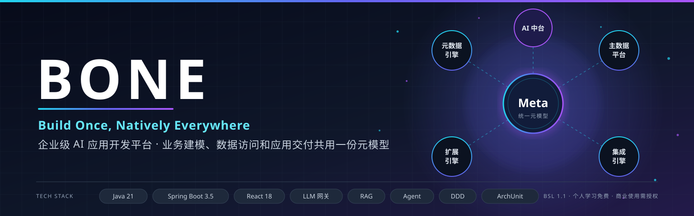
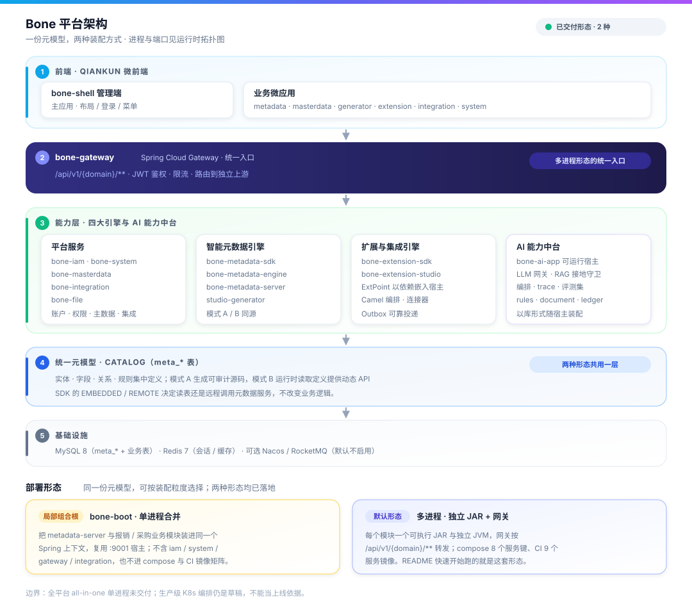
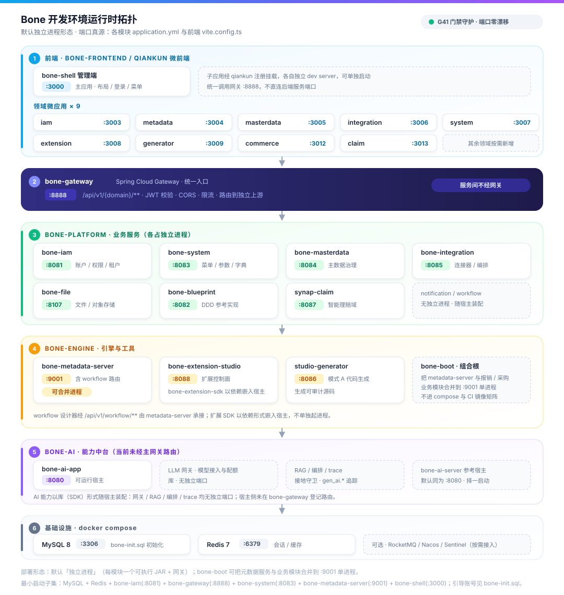

# Bone — Build Once, Natively Everywhere

An enterprise AI application platform. Modeling, data access and application delivery share one metamodel.

**English** | [简体中文](README.md)




Bone keeps entities, fields and relations in one metamodel. Each entity picks Mode A (`GENERATIVE`, generate auditable source) or Mode B (`RUNTIME`, CRUD and API at runtime). Master data, extension, integration and AI capabilities all build on that model.



<details>
<summary>Glossary</summary>

- Unified metamodel (catalog): the registry of entities, fields and relations, stored in `meta_*` tables.
- Mode A / B: `GENERATIVE` generates source, `RUNTIME` serves CRUD and API at runtime.
- LLM gateway: one entry point for multiple models, with rate limiting. RAG: retrieval-augmented generation.
- ExtPoint: extension-point plugins. Outbox: reliable message delivery. SmartQL: a query language over the metamodel.
- Qiankun: micro-frontend framework. DDD / ArchUnit: layered design and checked architecture constraints.
- BSL 1.1: source available, not an OSI open-source license. 信创: domestic (Chinese) hardware and software adaptation.

</details>

> Delivery currently focuses on the web (Qiankun micro-frontends). `Natively Everywhere` is the long-term goal; mobile apps and mini-programs are still on the roadmap.

> Licensing is judged by use, regardless of entity type. Personal learning, teaching at accredited institutions, non-commercial evaluation of up to 90 days, and development / testing / CI without real business traffic are free. Production use for a commercial purpose requires a written commercial license, as does removing BSL restrictions or requiring indemnification, SLA or technical support. Versions released on/after 2026-10-11 are under [BSL 1.1](LICENSE); earlier releases remain under [MIT](LICENSE-MIT). See [License](#license).

Contents: [Quick Start](#quick-start) · [Capability Snapshot](#capability-snapshot) · [Architecture and Deployment](#architecture-and-deployment) · [The Four Engines and Bone AI Capability Platform](#the-four-engines-and-bone-ai-capability-platform) · [Technology Roadmap](#technology-roadmap) · [Implementation Status and Roadmap](#implementation-status-and-roadmap) · [Design Principles](#design-principles) · [Docs and Community](#docs-and-community) · [FAQ](#faq) · [License](#license)

---

## Quick Start

These steps bring up the gateway, IAM, system service, metadata service and frontend Shell, then log in. Full walkthrough: [Local development & build (zh)](doc/wiki/03-本地开发与构建.md).

Ports come from each module's `application.yml` and each app's `vite.config.ts`. See [Architecture and Deployment](#architecture-and-deployment) for the processes and ports.

### Requirements

JDK 21+ · Maven 3.8+ · Node.js 18+ · Git · Docker Compose

MySQL 8+ and Redis 7.x come from compose containers, no local install needed. Redis serves the IAM token blacklist and authority cache, with graceful degradation when absent. A local `mysql` client is needed if you supply your own MySQL.

### Steps

```bash
git clone https://gitee.com/meishan315/bone.git
cd bone

# 0. Environment: .env is gitignored and read automatically by docker compose
cp .env.example .env
#    Edit .env: set BONE_DB_PASSWORD (must match the MySQL root password)
#    Set BONE_REDIS_PASSWORD= (empty): compose's Redis has no password, a non-empty value causes AUTH errors

# 1. Database + cache + backend (first start builds the images)
docker compose up -d --build mysql redis bone-iam bone-system bone-gateway bone-metadata-server
#    The gateway depends on bone-integration with service_healthy, so compose starts it automatically
#    With your own MySQL/Redis: mysql -u root -p < bone-init.sql (requires a local mysql client)

# 2. Frontend Shell (feature pages need their micro-apps)
cd bone-frontend && npm ci && npm run dev
```

Images in [`docker-compose.yml`](docker-compose.yml) are built by [`docker/Dockerfile`](docker/Dockerfile); compose injects the database password and profile from `.env`, so no manual `export` is needed.

Without containers, start the services below in separate terminals and set `BONE_DB_PASSWORD` once per terminal.

```bash
mvn clean install -DskipTests
# To validate only integration: mvn clean install -pl bone-platform/bone-integration -am -DskipTests
read -rs BONE_DB_PASSWORD && export BONE_DB_PASSWORD   # enter the value from .env; it stays out of shell history
(cd bone-platform/bone-iam && mvn spring-boot:run -Dspring-boot.run.profiles=dev)
(cd bone-platform/bone-gateway && mvn spring-boot:run)
(cd bone-platform/bone-system && mvn spring-boot:run -Dspring-boot.run.profiles=dev)
(cd bone-engine/bone-metadata-server && mvn spring-boot:run)
# (cd bone-platform/bone-integration && mvn spring-boot:run)   # optional
```

> `.env.example` defaults `SPRING_PROFILES_ACTIVE=dev`. Under compose all services except the gateway use `dev`, with the metadata service pinned to `dev`. Without `.env`, gateway and integration use the default configuration and the metadata service defaults to `local`.

`BONE_NACOS_ADDR` locates Nacos in both default and `prod` profiles. Default profiles use `optional:nacos:` and start fine when Nacos is unreachable; `prod` uses `nacos:`, and iam / system / masterdata / integration require shared config and fail-loud if it is unreachable, see the [Nacos config guide (zh)](doc/deployment/nacos-config-guide.md). RocketMQ for the integration service defaults to `localhost:9876` and connects lazily; only `prod` can override it via `ROCKETMQ_NAME_SERVER`.

### Default Endpoints

| Entry | Address |
|-------|---------|
| Admin Shell | http://localhost:3000 |
| API gateway (recommended) | http://localhost:8888/api/v1/... |
| IAM | http://localhost:8081 |
| System service | http://localhost:8083 |
| Metadata service | http://localhost:9001 |
| Integration API (direct) | http://localhost:8085/api/v1/integration/... |
| Integration micro-frontend | http://localhost:3006 (start `bone-integration-app` separately, or enter from the Shell menu) |
| Studio generator | http://localhost:8086 (Mode A code generation) |

- Ports: integration `:8085`, studio-generator `:8086`, metadata-server `:9001`. `:8885` is deprecated and causes gateway circuit-breaking. The DDD reference [`bone-blueprint/`](bone-blueprint/) uses `:8082`.
- The bootstrap account is in [`bone-init.sql`](bone-init.sql) and is for local/CI use only. When the password is weak or expired the login response carries `requirePasswordChange` and the frontend guides the user to change it. Change the default password and replace `BONE_JWT_SECRET` in `.env` before any production deployment; see [config/env/README.md (zh)](config/env/README.md) and [09-密钥与Git历史 (zh)](doc/wiki/09-密钥与Git历史.md).
- `BONE_DB_PASSWORD` initializes MySQL via compose and is read by the backends, so use the same value in all terminals. If the data volume was initialized with an old password, run `docker compose down -v` first.
- After editing [`bone-init.sql`](bone-init.sql), rebuild the database; see the [Database dev guide (zh)](doc/architecture/数据库开发规范.md). There is no `bone-admin` module.

### Verification and Troubleshooting

1. `curl -f http://localhost:8888/actuator/health` returns 200.
2. Opening http://localhost:3000 shows the login page; logging in with the bootstrap account means success.
3. Common failures: port conflicts; `BONE_DB_PASSWORD` unset in `.env` or differing between terminals; `bone-init.sql` not imported. More in [Local development & build (zh)](doc/wiki/03-本地开发与构建.md).

---

## Capability Snapshot

| Capability | Description |
|------------|-------------|
| Metadata-driven | Entities, fields and relations live in meta_* tables; Mode A and B read their definitions here |
| Dual-mode delivery | Mode A generates auditable source, Mode B serves dynamic API at runtime |
| Layer boundaries | Clean / hexagonal layering, module boundaries checked by ArchUnit |
| Tenancy and permissions | RBAC, JWT, multi-tenancy and audit log delivered; fine-grained permissions still in progress |
| Extension and integration | ExtPoint injects custom logic; connectors, flow orchestration and Outbox live in the integration engine |
| AI | LLM gateway, RAG with grounding guard, agent orchestration, AI tracing |

---

## Architecture and Deployment



The diagram shows the processes and ports a local development environment actually starts. Ports come from each module's `application.yml` and each app's `vite.config.ts`; gate G41 in [`scripts/check.sh`](scripts/check.sh) checks the diagram, so a changed port without a diagram update fails the check.

Both assembly modes share one metamodel:

| Mode | Carrier | Status |
|------|---------|--------|
| Merged process | [`bone-boot`](bone-boot/) puts the metadata server and expense / purchase business modules into one Spring context, reusing the `:9001` host | Local composition root, delivered; not in compose or the CI image matrix |
| Separate processes | One executable JAR and JVM per module, with [`bone-gateway`](bone-platform/bone-gateway/) routing | Default, delivered; 8 compose service keys and 9 CI service images |

The "four engines" are a product grouping, not four required processes: the extension SDK is embedded in the business host, the integration engine runs in one process, and the AI Capability Platform can be embedded per module or deployed on its own.

Boundary: packaging the whole platform into a single process (all-in-one) is not delivered; production-grade K8s orchestration is still a draft, see [Deployment and orchestration (draft, zh)](deploy/README.md) and [Operations runbook (draft, zh)](doc/deployment/operations-runbook.md). Do not treat them as production-ready.

---

## The Four Engines and Bone AI Capability Platform

The "four engines" are a product grouping: Smart Metadata Engine, Master Data Platform, Extension Engine and Integration Engine. The AI Capability Platform is separate and not counted as an engine. In DDD terms, metadata and modeling form the core domain and the rest are supporting domains. See the [metadata capability mapping (zh)](doc/design/modules/元数据能力-实现映射与竞品对照.md) for module relationships.

### Smart Metadata Engine

This is the core domain. It describes business with a unified metamodel (catalog), lets extension fields pick a storage mode, and offers two delivery modes.

> Extension fields have three storage modes: reserved columns (default), JSON columns, and EAV key-value (rarely used). When the standard capability is not enough, fall back to generated or hand-written code — the escape hatch. Other terms are in the Glossary at the top.

| Mode | Processing | Fit | Main modules | Status |
|------|------------|-----|--------------|--------|
| **A · Generation** | Metadata → auditable source → compile & deploy | Complex domain logic, source audit, deep customization | `bone-metadata-sdk` + `bone-metadata-server` + `studio-generator` | Delivered |
| **B · Runtime** | Metadata → runtime interpretation → dynamic CRUD/API | Config-driven entities, ops backends, SaaS standard objects | `bone-metadata-sdk` + `bone-metadata-engine` + `bone-metadata-server` | Evolving |

Mode A is the current mainline. The Mode B MVP for dynamic record read/write is delivered (`JdbcRuntimeRecordService` and `/api/v1/runtime/entities/{code}/records`, gateway route configured, see [P0 board META-002B (zh)](doc/wiki/07-P0-TODO看板.md)). Model publishing, hot reload and low-downtime changes are still in progress. Once Mode B matures, standard CRUD no longer needs the generator; the generator keeps producing DDD skeletons and deep-customization code.

Both modes share the following:

| Area | Description | Status |
|------|-------------|--------|
| Platform data plane | [bone-metadata-sdk](bone-engine/bone-metadata-sdk/): repositories, three extension-field modes (reserved column / JSON / EAV; default reserved column, auto-degrade to JSON on allocation failure), multi-datasource dialects | Delivered |
| Modeling control plane | [bone-metadata-server](bone-engine/bone-metadata-server/): catalog REST + extension-field API (`:9001`) | Delivered |
| Rules & dynamic access | [bone-metadata-engine](bone-engine/bone-metadata-engine/): expressions, validation, SmartQL, dynamic CRUD, gradually replacing "generate code per table"; MVP delivered | Evolving |
| Permissions & multi-tenancy | Row-level tenant binding and column-level rules on metadata, one policy for both modes; fine-grained rules still to add | Evolving |
| Runtime evolution | Model publishing, hot reload, low-downtime changes; engine and release flow rolled out in batches | Evolving |
| Delivery-mode marker | `meta_entity.delivery_mode`: `GENERATIVE` / `RUNTIME` | Delivered |

Code: [`bone-engine/bone-metadata-sdk`](bone-engine/bone-metadata-sdk/) · [`bone-engine/bone-metadata-server`](bone-engine/bone-metadata-server/) · [`bone-engine/bone-metadata-engine`](bone-engine/bone-metadata-engine/) (Mode B) · [`bone-engine/studio-generator`](bone-engine/studio-generator/) (Mode A) · frontend [bone-metadata-app](bone-frontend/apps/bone-metadata-app/) · [bone-generator-app](bone-frontend/apps/bone-generator-app/)

See the [metadata capability mapping (zh)](doc/design/modules/元数据能力-实现映射与竞品对照.md) §1.3, §3.3 for the comparison.

### Master Data Platform

Core objects such as customers, organizations and materials live here.

| Status | Capability |
|--------|------------|
| **Delivered** | Master-data entity and record management, business-entity transformation, JSON export, quality report query |
| **Target** | Multi-domain governance, lineage, cleansing & quality scoring, data asset catalog, standard REST distribution |

Code: [`bone-platform/bone-masterdata`](bone-platform/bone-masterdata/) · [`bone-masterdata-app`](bone-frontend/apps/bone-masterdata-app/)

### ExtPoint Extension Engine

Industry differences and customer customization are injected through extension points, leaving the core flow untouched.

| Status | Capability |
|--------|------------|
| **Delivered** | Extension-point routing and caching, expression matching, execution guards; Studio CRUD, versioning, deploy and rollback |
| **Target** | Fuller plugin lifecycle, artifact isolation, sandbox execution, call-chain observability, dynamic parameter governance |

Typical cases are promotion stacking, government co-signing and industry BOMs.

Code: [`bone-engine/bone-extension-engine/bone-extension-sdk`](bone-engine/bone-extension-engine/bone-extension-sdk/) · [`bone-engine/bone-extension-engine/bone-extension-studio`](bone-engine/bone-extension-engine/bone-extension-studio/) · frontend [bone-extension-app](bone-frontend/apps/bone-extension-app/)

### Integration Engine

Connects ERP, CRM, OA and messaging systems.

| Area | Capability goal | Status | Notes |
|------|----------------|--------|-------|
| Multi-protocol | Extend protocol connectors as needed | Evolving | REST/HTTP delivered; FTP/JDBC/MQ return 501 |
| Connector factory | Standardized connectors | Delivered | CRUD + connection test (`int_connector`) |
| Flow orchestration | Branch, parallel, loop | Evolving | Linear START→HTTP→END (INT-09) delivered |
| Reliability | Retry, idempotency, dead-letter, eventual consistency | Delivered | Execution log + domain events + MQ Outbox relay (INT-10; logs by default, enable RocketMQ relay via `BONE_INTEGRATION_OUTBOX_MQ_ENABLED`) |
| Camel orchestration | Visual DSL execution | Delivered | Camel compiler (INT-11): `int_flow_node` graph DSL → Camel route (choice/multicast); default execution remains linear (INT-09), enabled via `integration.camel.execution-enabled` |

Code (there is one integration service):

- Backend: [`bone-platform/bone-integration`](bone-platform/bone-integration/) (Maven artifact `bone-platform-integration`, default `:8085`)
- Frontend: [`bone-integration-app`](bone-frontend/apps/bone-integration-app/) (`:3006`, loaded by Shell `:3000`)

Progress is in the [P0 board (zh), Integration section](doc/wiki/07-P0-TODO看板.md); operations in the [integration README (zh)](bone-platform/bone-integration/README.md).

### Bone AI Capability Platform

The AI modules sit alongside `bone-engine` and `bone-platform`, providing model access, retrieval, orchestration and tracing.

| Module | Responsibility | Status | Notes |
|--------|----------------|--------|-------|
| `bone-ai-gateway` | Unified LLM gateway: multi-model routing, rate limiting, token / latency / first-token metrics | Evolving | Multi-model routing delivered, governance rules still to add |
| `bone-ai-rag` | RAG retrieval + `GroundingGuard` (anti-hallucination) + golden-set evaluation | Delivered | Retrieval / grounding guard / in-build golden-set regression gate and `--mode contract` self-check delivered; real-corpus recall-gate and negative probes are **Target**, see [eval/README.md (zh)](bone-ai/bone-ai-rag/eval/README.md) |
| `bone-ai-orchestration` | Agent / workflow orchestration, combined with metamodel and extension points | Evolving | Orchestration base delivered, multi-agent scheduling still in progress |
| `bone-ai-trace` | AI tracing aligned with OpenTelemetry `gen_ai.*` semantic conventions | Delivered | Mapping and self-checks delivered |
| `bone-ai-rules` / `-document` / `-notification` / `-integration` / `-ledger` / `-server` / `-app` | Rules, documents, notifications, integration, ledger (cost / quota), service and frontend | Evolving | 7 modules |

The metadata engine supplies the metamodel and data access, master data / extension / integration cooperate in business flows, and the AI platform adds model calls, retrieval, orchestration and tracing.

Code: [`bone-ai/`](bone-ai/) (artifact `bone-ai`, 11 submodules)

---

## Technology Roadmap

| Layer | Current mainline | Direction |
|-------|------------------|-----------|
| Backend | Java 21, Spring Boot 3.5, DDD + Application Service | Strengthen module boundaries and contract tests |
| Data | Bone Metadata SDK, MySQL, Redis | Metadata publishing, hot reload, low-downtime change |
| API & Security | REST, OpenAPI, Spring Security, JWT, Gateway | Finer-grained permissions and unified governance |
| Integration & reliability | HTTP, Camel compiler, Outbox; RocketMQ optional | More connectors, flow runtime, observability |
| Frontend | React 18, TypeScript, Vite 5, Ant Design 5, Qiankun | Model-driven reuse and multi-target adaptation |
| AI-native | Bone AI Capability Platform (LLM gateway, RAG, orchestration, trace) | Multi-model governance, deeper agents, evaluation loop |
| Engineering quality | Spotless, ArchUnit, ESLint, Prettier, Vitest | Higher automated test and benchmark coverage |

Nacos, Sentinel, Seata and SkyWalking are chosen by deployment scale and are not default dependencies. Cross-service consistency prefers local transactions, idempotency and Outbox; Seata (AT/TCC) is considered only when strong consistency is required.

---

## Implementation Status and Roadmap

Delivery status follows the [P0 board (zh)](doc/wiki/07-P0-TODO看板.md); the AI Capability Platform follows each module's README, evaluation gates and CI configuration, and interfaces, schemas and ports follow `doc/`, OpenAPI and the code. Layering and ports are checked locally by [`scripts/check.sh`](scripts/check.sh) (including the G41 topology port gate), ArchUnit and each module's `ArchitectureTest`; which gates are wired into CI is defined in [Bone-DDD-最终实践方案 §G-1.7 (zh)](doc/architecture/Bone-DDD-最终实践方案.md).

RBAC, JWT, multi-tenancy, audit logs and some metrics are delivered; column-level permissions, SSO/MFA, tracing and unified monitoring are still in progress.

| Stage | Positioning | Focus |
|-------|-------------|-------|
| **Current baseline** | Build Once, Web First | Mode A + Mode B runtime MVP; catalog/extension fields, IAM, master data, extension, integration implemented |
| **Next milestone** | Harden runtime and engineering loop | Model publishing/hot reload, connector expansion, data lineage, unified observability, end-to-end acceptance |
| **Subsequent** | Industry and multi-target reuse | Industry templates, multi-target adaptation, plugin ecosystem; delivered incrementally after real-project validation |

Details are in the [P0 board (zh)](doc/wiki/07-P0-TODO看板.md) and module designs.

---

## Design Principles

1. Metadata-first. Entities, fields, relations and rules are configurable and versionable where possible; complex domain logic stays as explicit code.
2. Open-closed. Core flows stay stable; industry differences and customer customization go through extension points and plugins, leaving the trunk untouched.
3. Single source of truth. Core objects such as customers, organizations and materials have one authoritative master-data record, distributed over REST APIs with replica consistency governed.
4. Contract-based integration. Heterogeneous systems use connectors and orchestrated flows; protocol adaptation, idempotency, retries and observability are implemented in the integration engine.
5. API-first. External APIs are unified under `/api/v1/{domain}/**`; error codes, logging and multi-tenancy follow the [Bone API Spec (zh)](doc/architecture/Bone-API-规范.md).
6. Engineering honesty. Targets live in the roadmap; implemented status follows OpenAPI, `bone-init.sql`, the code and the [P0 board (zh)](doc/wiki/07-P0-TODO看板.md).

---

## Docs and Community

- [doc/README.md (zh)](doc/README.md): master index. Engineering, API, DDL and local debugging start at [Architecture (zh)](doc/architecture/README.md) and [Local build (zh)](doc/wiki/03-本地开发与构建.md); see also [BONE overall architecture (zh)](doc/architecture/BONE-总体架构设计方案.md) and [Bone API Spec (zh)](doc/architecture/Bone-API-规范.md)
- AI assistant and contributor rules: [AGENTS.md (zh)](AGENTS.md) · [CONTRIBUTING.md (zh)](CONTRIBUTING.md). Other docs are in Chinese (中文).
- [Metadata three-module comparison (zh)](doc/design/modules/元数据能力-实现映射与竞品对照.md) · [Main PRD (zh)](doc/prd/BONE产品需求文档正式版.md) · [Engine index (zh)](bone-engine/README.md)
- Brand assets: [doc/design/assets/](doc/design/assets/). Commercial promotion must follow the [License](#license) terms.
- Contributing: [CONTRIBUTING.md (zh)](CONTRIBUTING.md); issues / PRs: [Gitee repository](https://gitee.com/meishan315/bone)
- Community: [https://gitee.com/meishan315/bone](https://gitee.com/meishan315/bone) · WeChat Official Account 梅山见道 (MeishanInsight) · WeChat `meishan-bone`

[](https://gitee.com/meishan315/bone)

---

## FAQ

**Q: How do I know whether a capability is implemented?**
A: Check the Status column, then follow [Implementation Status and Roadmap](#implementation-status-and-roadmap) to OpenAPI, code and tests.

**Q: Startup fails?**
A: Work through [Verification and Troubleshooting](#verification-and-troubleshooting); full steps are in [Local development & build (zh)](doc/wiki/03-本地开发与构建.md).

**Q: API path convention?**
A: Unified under `/api/v1/{domain}/**`, see the [Bone API Spec (zh)](doc/architecture/Bone-API-规范.md).

**Q: Where is the integration service?**
A: The backend is `bone-platform/bone-integration` (artifact `bone-platform-integration`) and the frontend is `bone-integration-app`. The historical `bone-engine/bone-integration` has been removed, see [ADR single integration module (zh)](doc/architecture/adr/0037-integration-engine-single-module.md).

**Q: How do I develop an extension plugin?**
A: See the [Extension engine guide (zh)](bone-engine/bone-extension-engine/docs/使用指南.md) and the `bone-extension-sdk` samples.

**Q: Is there a DDD reference project?**
A: [`bone-blueprint/`](bone-blueprint/) is the official DDD reference (an order example, `:8082`, with ArchUnit gates); a Go reference lives at [`bone-engine/go-engine/`](bone-engine/go-engine/) (experimental).

**Q: Production deployment?**
A: Each module is an executable JAR plus the gateway, orchestrated locally via [`docker-compose.yml`](docker-compose.yml); environment variables are in [config/env/README.md (zh)](config/env/README.md). Production-grade K8s orchestration and the operations manual are still drafts ([operations runbook (draft, zh)](doc/deployment/operations-runbook.md), [rollback record (zh)](doc/deployment/PR_0010_0011_rollback.md)) and cannot be used as a go-live basis yet.

**Q: How is BONE different from low-code / no-code platforms?**
A: Low-code is usually form-driven and keeps artifacts inside the platform. Bone starts from a unified metamodel: Mode A generates source you can commit and audit, Mode B serves runtime API, and extension points, integration and AI modules share the same model.

**Q: Does it support on-premises deployment and domestic (信创) environments?**
A: Backends are executable JARs plus the gateway, on JDK 21 + MySQL + Redis, so the prerequisites for on-premises deployment are in place; production-grade orchestration is still a draft. Domestic-stack adaptation, Level-3 classified protection alignment and SM-crypto are Target, see [overall architecture §1.6 (planning-level, zh)](doc/architecture/BONE-总体架构设计方案.md); status follows the [P0 board (zh)](doc/wiki/07-P0-TODO看板.md).

---

## License

Licensed by use. Personal learning and non-commercial use are free; commercial use requires a purchased license.

### 1. Free use (no license, no fee)

Effective 2026-10-11, the **Additional Use Grant** of [BSL 1.1](LICENSE) allows the non-commercial uses below free of charge, including deployment for those uses. The test is what you use it for, regardless of entity type; an employee's personal learning is free. Production use for a commercial purpose requires a written commercial license.

| Scenario | Free | Constraint |
|----------|------|------------|
| Personal learning, self-study, practice, academic research | Yes | Performed by an individual |
| Teaching at accredited educational institutions | Yes | — |
| Technical evaluation, POC, demo, non-commercial validation | Yes | **≤ 90 days**, and must not serve/process data of end users other than the evaluator |
| Development, integration, testing, CI | Yes | Environment must not carry real business traffic or real end-user data |
| Any other non-commercial use | Yes | "Commercial purpose" = activity for profit or other consideration, regardless of entity type |

### 2. Commercial license required

The following need a written license from the Licensor first:

- An enterprise, organization, sole proprietor or individual using the software in production to support commercial activity (including internal business systems);
- Providing products/services externally: SaaS, outsourcing delivery, resale, OEM integration, or distributing closed-source products built on this software;
- Removing BSL restrictions, or requiring indemnification, SLA and technical support.

The scope of a commercial license (entity / instance / seat / term) is not defined in LICENSE and is subject to a signed written agreement. Contact **914162692@qq.com** (Licensor: Meishan / 梅山, as stated in the [LICENSE](LICENSE) parameters); the agreement is executed under the Licensor's legal name.

### 3. License files and effective boundaries

| File | Applies to |
|------|------------|
| [LICENSE](LICENSE) | Versions released on/after 2026-10-11: **BSL 1.1**, Change License is **Mozilla Public License 2.0**, Change Date **2030-10-11**; conversion takes effect on the Change Date **or the fourth anniversary of that version's first public distribution, whichever comes first**, and the Change Date may vary per version |
| [LICENSE-MIT](LICENSE-MIT) | Versions publicly released **before** 2026-10-11 and their historical snapshots: **MIT** (irrevocable, original grant remains valid) |
| [NOTICE](NOTICE) | Relationship between brand and copyright holder, trademark boundaries, third-party dependencies and AI-assisted output attribution |

> BSL 1.1 is not an OSI-defined open-source license; it is source available. This repository does not call itself open source and states only that source is available, personal learning is free, and commercial use requires a license. Each version returns to MPL 2.0 once its conversion condition is met.
>
> The Chinese explanation is for convenience only; the English text of LICENSE prevails. The full Chinese guide and the Change License rationale are in [LICENSE.zh-CN.md (zh)](LICENSE.zh-CN.md).
