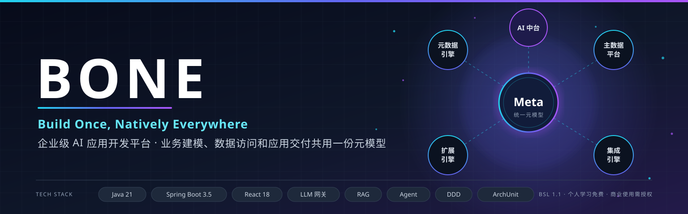
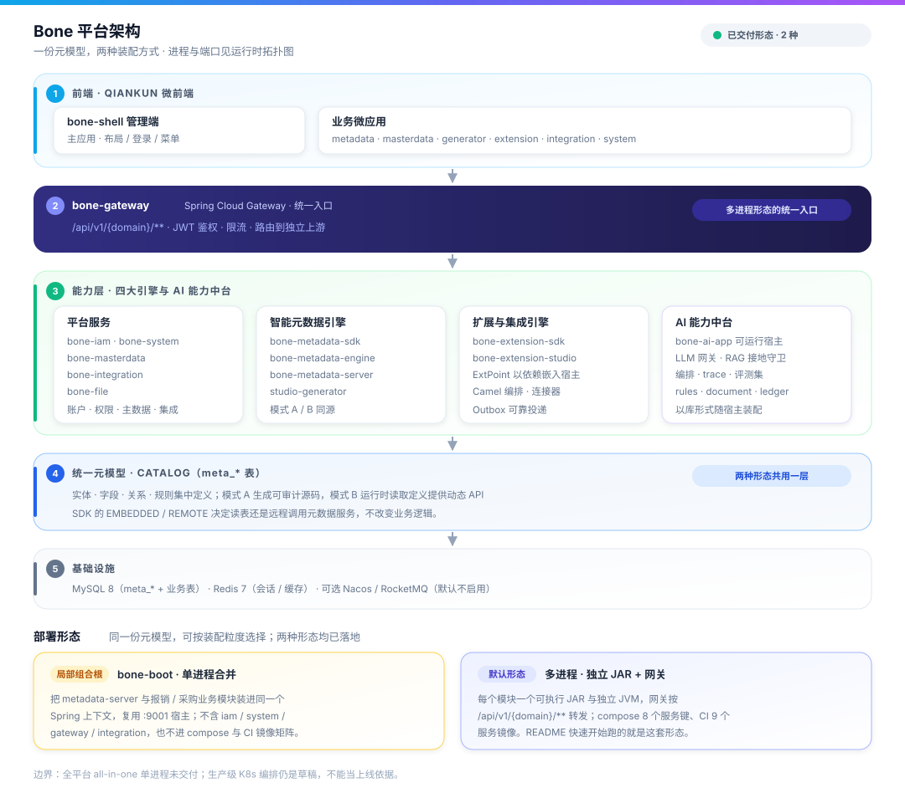
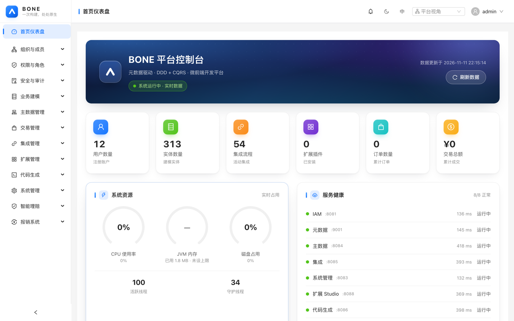
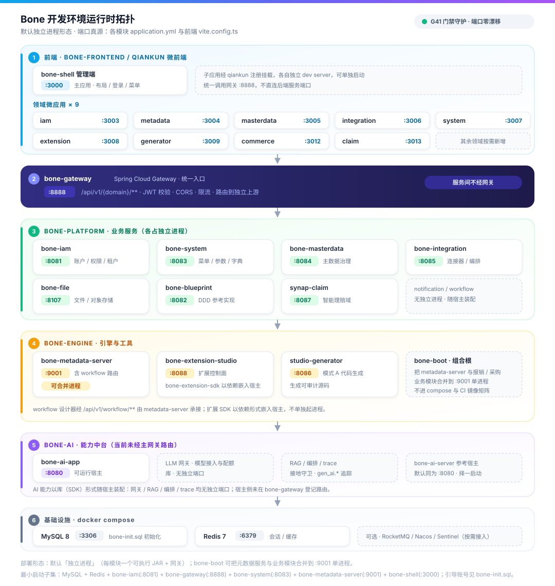

# Bone — Build Once, Natively Everywhere

元数据驱动的 AI 应用开发平台。业务建模、数据访问和应用交付共用一份元模型。

**简体中文** | [English](README.en.md)




Bone 用一份元模型描述业务：每个实体可走模式 A（生成可入库审计的源码）或模式 B（运行时直接提供 CRUD 与 API）。主数据、扩展、集成和 AI 能力都长在这份模型上——一次建模，代码和运行时 API 两种交付。



<details>
<summary>术语速览</summary>

- 统一元模型（catalog）：实体、字段和关系的登记册，库里是 `meta_*` 表。
- 模式 A / B：`GENERATIVE` 生成源码，`RUNTIME` 在运行时提供 CRUD 和 API。
- LLM 网关：统一接入和限流多家模型。RAG：检索增强生成。
- ExtPoint：扩展点插件。Outbox：可靠消息投递。SmartQL：面向元模型的查询语言。
- Qiankun：微前端框架。DDD / ArchUnit：分层设计与架构约束校验。
- BSL 1.1：源代码可得，不是 OSI 开源许可。信创：国产软硬件适配。

</details>

> 当前交付以 Web 端为主（Qiankun 微前端）。`Natively Everywhere` 是长期目标，移动端和小程序还在路线图上。

> 授权按用途判定，与主体性质无关：个人学习、教学、非商业评估、开发 / 测试 / CI 都免费，公司员工个人学习同样免费；商业生产使用需书面授权。许可文件与生效边界见 [License](#license)。

目录：[快速开始](#快速开始) · [能力快照](#能力快照) · [架构与部署](#架构与部署) · [四大引擎与 AI 能力中台](#四大引擎与-ai-能力中台) · [技术路线](#技术路线) · [实现状态与演进路线](#实现状态与演进路线) · [设计原则](#设计原则) · [文档与社区](#文档与社区) · [常见问题](#常见问题) · [License](#license)

---

## 快速开始

按下面几步可以跑起网关、IAM、系统服务、元数据服务和前端 Shell，并完成登录。跑通后访问 http://localhost:3000 即可登录管理后台，看到由元模型驱动的业务对象。完整说明见 [本地开发与构建](doc/wiki/03-本地开发与构建.md)。

端口以各模块 `application.yml` 和各前端 `vite.config.ts` 为准，进程与端口见[架构与部署](#架构与部署)。

### 环境要求

JDK 21+ · Maven 3.8+ · Node.js 18+ · Git · Docker Compose

MySQL 8+ 和 Redis 7.x 由 compose 容器提供，本机不用装。Redis 用于 IAM 黑名单和权限缓存，没有时降级运行。自备 MySQL 需要本地 `mysql` 客户端。

### 步骤

```bash
git clone https://gitee.com/meishan315/bone.git   # GitHub 镜像：https://github.com/trenhui/bone
cd bone

# 0. 环境变量：.env 已被 .gitignore 忽略，docker compose 会自动读取
cp .env.example .env
#    编辑 .env：设置 BONE_DB_PASSWORD（须与 MySQL root 口令一致）
#    把 BONE_REDIS_PASSWORD= 清空：compose 的 Redis 未开启密码，非空值会导致 AUTH 报错

# 1. 数据库 + 缓存 + 后端（首次会编译镜像）
docker compose up -d --build mysql redis bone-iam bone-system bone-gateway bone-metadata-server
#    网关以 service_healthy 依赖 bone-integration，compose 会自动一并启动
#    自备 MySQL/Redis 时：mysql -u root -p < bone-init.sql（需本地 mysql 客户端）

# 2. 前端 Shell（功能页需再启动对应微应用）
cd bone-frontend && npm ci && npm run dev
```

[`docker-compose.yml`](docker-compose.yml) 的镜像由 [`docker/Dockerfile`](docker/Dockerfile) 构建，compose 会从 `.env` 注入数据库口令和 profile，不需要手工 `export`。

不用容器时按下面启动，每个终端先设一次 `BONE_DB_PASSWORD`。

```bash
mvn clean install -DskipTests
# 仅验证集成：mvn clean install -pl bone-platform/bone-integration -am -DskipTests
read -rs BONE_DB_PASSWORD && export BONE_DB_PASSWORD   # 输入 .env 中的值，口令不进 shell 历史
(cd bone-platform/bone-iam && mvn spring-boot:run -Dspring-boot.run.profiles=dev)
(cd bone-platform/bone-gateway && mvn spring-boot:run)
(cd bone-platform/bone-system && mvn spring-boot:run -Dspring-boot.run.profiles=dev)
(cd bone-engine/bone-metadata-server && mvn spring-boot:run)
# (cd bone-platform/bone-integration && mvn spring-boot:run)   # 可选
```

> `.env.example` 默认 `SPRING_PROFILES_ACTIVE=dev`。compose 下除网关外都用 `dev`，元数据服务在 compose 里固定 `dev`。不加载 `.env` 时，网关和集成走默认配置，元数据服务默认 `local`。

`BONE_NACOS_ADDR` 在默认和 `prod` profile 都用来定位 Nacos。默认 profile 写的是 `optional:nacos:`，Nacos 不可达也能起；`prod` 写的是 `nacos:`，iam / system / masterdata / integration 这四个模块会强制拉取共享配置，不可达即 fail-loud，见 [Nacos 配置指南](doc/deployment/nacos-config-guide.md)。集成服务的 RocketMQ 默认 `localhost:9876` 且懒加载，只有 `prod` 能用 `ROCKETMQ_NAME_SERVER` 覆盖。

### 默认入口

| 入口 | 地址 |
|------|------|
| 管理后台 Shell | http://localhost:3000 |
| API 网关（推荐） | http://localhost:8888/api/v1/... |
| IAM | http://localhost:8081 |
| 系统服务 | http://localhost:8083 |
| 元数据服务 | http://localhost:9001 |
| 集成 API（直连） | http://localhost:8085/api/v1/integration/... |
| 集成微前端 | http://localhost:3006（需单独启动 `bone-integration-app`，亦可从 Shell 菜单进入） |
| Studio 生成器 | http://localhost:8086（模式 A 代码生成） |

- 端口：integration `:8085`、studio-generator `:8086`、metadata-server `:9001`。`:8885` 已弃用，配上去会导致网关熔断。DDD 样板 [`bone-blueprint/`](bone-blueprint/) 用 `:8082`。
- 引导账号在 [`bone-init.sql`](bone-init.sql)，只用于本地和 CI。弱口令或口令过期时登录响应返回 `requirePasswordChange`，前端会引导改密。上生产前要改掉默认口令并替换 `.env` 里的 `BONE_JWT_SECRET`，见 [config/env/README.md](config/env/README.md) 与 [09-密钥与Git历史](doc/wiki/09-密钥与Git历史.md)。
- `BONE_DB_PASSWORD` 同时给 compose 初始化 MySQL 和后端使用，所有终端要用同一个值。数据卷用旧口令初始化过就先 `docker compose down -v`。
- 改过 [`bone-init.sql`](bone-init.sql) 要重建库，见 [数据库开发规范](doc/architecture/数据库开发规范.md)。仓库里没有 `bone-admin` 模块。

### 验收与排错

1. `curl -f http://localhost:8888/actuator/health` 返回 200。
2. 打开 http://localhost:3000 能看到登录页，用引导账号登录成功即算通过。
3. 常见故障：端口占用；`.env` 没填 `BONE_DB_PASSWORD` 或各终端取值不一致；`bone-init.sql` 没导入。更多见 [本地开发与构建](doc/wiki/03-本地开发与构建.md)。

---

> **不是低代码平台。** 低代码通常按表单生成、产物留在平台内；Bone 从统一元模型出发，模式 A 生成可入库审计的源码，模式 B 直接提供运行时 API，扩展点、集成和 AI 模块共用同一份模型。一次建模，两种交付。

## 能力快照

| 能力 | 说明 |
|------|------|
| 元数据驱动 | 实体、字段和关系登记在 meta_* 表，模式 A/B 从这里取定义 |
| 双模式交付 | 模式 A 生成可审计源码，模式 B 运行时提供动态 API |
| 分层约束 | 整洁 / 六边形分层，模块边界由 ArchUnit 校验 |
| 租户与权限 | RBAC、JWT、多租户、审计日志已交付，细粒度权限还在做 |
| 扩展与集成 | ExtPoint 注入差异化逻辑，连接器、流程编排和 Outbox 投递在集成引擎里 |
| AI 能力 | LLM 网关、RAG 与接地守卫、智能体编排、AI 链路追踪 |



---

## 架构与部署



图上画的是本地开发环境实际会起哪些进程、走哪些端口。端口真源是各模块 `application.yml` 和前端 `vite.config.ts`，[`scripts/check.sh`](scripts/check.sh) 的 G41 校验这张图，改端口不改图会失败。

两种装配方式共用同一份元模型：

| 形态 | 载体 | 状态 |
|------|------|------|
| 合并进程 | [`bone-boot`](bone-boot/) 把元数据服务与报销 / 采购业务模块装进同一个 Spring 上下文，复用 `:9001` 宿主 | 局部组合根，已交付；不进 compose 与 CI 镜像矩阵 |
| 独立进程 | 每个模块一个可执行 JAR 和独立 JVM，[`bone-gateway`](bone-platform/bone-gateway/) 统一转发 | 默认形态，已交付；compose 8 个服务键、CI 9 个服务镜像 |

「四大引擎」是产品划分，不是四个必起进程：扩展 SDK 嵌在业务宿主里，集成引擎跑在一个进程，AI 能力中台可以嵌入业务模块，也可以单独部署。

边界：全平台打包成单一进程（all-in-one）尚未交付；生产级 K8s 编排仍是草稿，见 [部署与编排（草稿）](deploy/README.md) 与 [运维手册（草稿）](doc/deployment/operations-runbook.md)，不能当上线依据。

---

## 四大引擎与 AI 能力中台

「四大引擎」指智能元数据引擎、主数据平台、扩展引擎、集成引擎，是产品上的划分。AI 能力中台另算，不计入引擎数。DDD 战略分类里核心域是元数据和建模，其余是支撑域。模块关系见 [元数据能力对照](doc/design/modules/元数据能力-实现映射与竞品对照.md)。

### 智能元数据引擎（Smart Metadata Engine）

这个模块是平台核心域，用统一元模型（catalog）描述业务，扩展字段可以按需要选存储方式，同时提供两种交付模式。

> 扩展字段有三种存储方式：预留列（默认）、JSON 列、EAV 键值对（用得很少）。标准能力覆盖不到时可以退回生成代码或手写代码，这叫逃逸舱。其他术语见文首「术语速览」。

| 模式 | 处理方式 | 适用场景 | 主要模块 | 状态 |
|------|----------|----------|----------|------|
| **A · 生成式** | 元数据 → 生成可审计源码 → 编译部署 | 复杂领域逻辑、源码审计、深度定制 | `bone-metadata-sdk` + `bone-metadata-server` + `studio-generator` | 已交付 |
| **B · 运行时** | 元数据 → 运行时解释 → 动态 CRUD/API | 配置型实体、运营后台、SaaS 标准对象 | `bone-metadata-sdk` + `bone-metadata-engine` + `bone-metadata-server` | 演进中 |

模式 A 是当前主线。模式 B 的动态记录读写 MVP 已交付（`JdbcRuntimeRecordService` 和 `/api/v1/runtime/entities/{code}/records`，网关路由已配好，见 [P0 看板 META-002B](doc/wiki/07-P0-TODO看板.md)）。模型发布、热加载和低停机变更还在做。等模式 B 成熟，标准 CRUD 就不用走生成器，生成器继续做 DDD 骨架和深度定制代码。

两种模式共用下面几项：

| 能力方向 | 说明 | 状态 |
|----------|------|------|
| 平台数据面 | [bone-metadata-sdk](bone-engine/bone-metadata-sdk/)：仓储、扩展字段三模式（预留列 / JSON / EAV，默认预留列，分配失败自动降级 JSON）、多数据源方言 | 已交付 |
| 建模控制面 | [bone-metadata-server](bone-engine/bone-metadata-server/)：catalog REST + 扩展字段 API（`:9001`） | 已交付 |
| 规则与动态访问 | [bone-metadata-engine](bone-engine/bone-metadata-engine/)：表达式、校验、SmartQL、动态 CRUD，逐步替掉「为每张表生成代码」；MVP 已交付 | 演进中 |
| 权限与多租户 | 元数据绑定行级租户和列级规则，两种模式用同一套策略；细粒度规则待补 | 演进中 |
| 运行时演进 | 模型发布、热加载、低停机变更，引擎和发布流程分批做 | 演进中 |
| 交付模式标注 | `meta_entity.delivery_mode`：`GENERATIVE` / `RUNTIME` | 已交付 |

代码：[`bone-engine/bone-metadata-sdk`](bone-engine/bone-metadata-sdk/) · [`bone-engine/bone-metadata-server`](bone-engine/bone-metadata-server/) · [`bone-engine/bone-metadata-engine`](bone-engine/bone-metadata-engine/)（模式 B） · [`bone-engine/studio-generator`](bone-engine/studio-generator/)（模式 A） · 前端 [bone-metadata-app](bone-frontend/apps/bone-metadata-app/) · [bone-generator-app](bone-frontend/apps/bone-generator-app/)

竞品对照见 [元数据能力-实现映射与竞品对照](doc/design/modules/元数据能力-实现映射与竞品对照.md) §1.3、§3.3。

### 企业主数据平台（Master Data Platform）

客户、组织、物料这类核心对象在这里维护。

| 状态 | 能力 |
|------|------|
| **已交付** | 主数据实体与记录管理、业务实体转换、JSON 导出、质量报告查询 |
| **目标** | 多品类治理、血缘追踪、清洗与质量评分、数据资产目录、标准 REST API 分发 |

代码：[`bone-platform/bone-masterdata`](bone-platform/bone-masterdata/) · [`bone-masterdata-app`](bone-frontend/apps/bone-masterdata-app/)

### ExtPoint 扩展引擎（Extension Engine）

行业差异和客户定制通过扩展点注入，核心流程不用改。

| 状态 | 能力 |
|------|------|
| **已交付** | 扩展点路由与缓存、表达式匹配、执行防护；Studio CRUD、版本、部署与回滚 |
| **目标** | 更完整的插件生命周期、制品隔离、沙箱执行、调用链观测和动态参数治理 |

常见的场景有促销叠加、政务会签、行业 BOM。

代码：[`bone-engine/bone-extension-engine/bone-extension-sdk`](bone-engine/bone-extension-engine/bone-extension-sdk/) · [`bone-engine/bone-extension-engine/bone-extension-studio`](bone-engine/bone-extension-engine/bone-extension-studio/) · 前端 [bone-extension-app](bone-frontend/apps/bone-extension-app/)

### 集成引擎（Integration Engine）

对接 ERP、CRM、OA 和消息系统。

| 能力方向 | 能力目标 | 状态 | 说明 |
|----------|------|------|------|
| 多协议 | 按业务需要扩展协议连接器 | 演进中 | REST/HTTP 已交付；FTP/JDBC/MQ 返回 501 |
| 连接器工厂 | 标准化连接器 | 已交付 | CRUD + 连接测试（`int_connector`） |
| 流程编排 | 分支、并行、循环 | 演进中 | 线性 START→HTTP→END（INT-09）已交付 |
| 可靠性 | 重试、幂等、死信与最终一致性 | 已交付 | 执行日志 + 领域事件 + MQ Outbox 中继（INT-10，默认落日志，开启 `BONE_INTEGRATION_OUTBOX_MQ_ENABLED` 中继 RocketMQ） |
| Camel 编排 | 可视化 DSL 执行 | 已交付 | Camel 编译器（INT-11）：`int_flow_node` 图 DSL → Camel 路由（choice/multicast）；默认执行仍为线性（INT-09），经 `integration.camel.execution-enabled` 启用 |

代码（只有一个集成服务）：

- 后端：[`bone-platform/bone-integration`](bone-platform/bone-integration/)（Maven 构件 `bone-platform-integration`，默认 `:8085`）
- 前端：[`bone-integration-app`](bone-frontend/apps/bone-integration-app/)（`:3006`，经 Shell `:3000` 加载）

交付进度见 [P0 看板 · 集成章节](doc/wiki/07-P0-TODO看板.md)，运维见 [平台集成 README](bone-platform/bone-integration/README.md)。

### Bone AI 能力中台

AI 模块与 `bone-engine`、`bone-platform` 平级，提供模型接入、检索、编排和观测。

| 模块 | 职责 | 状态 | 说明 |
|------|------|------|------|
| `bone-ai-gateway` | 统一 LLM 网关：多模型路由、限流、token / 延迟 / 首字 metrics | 演进中 | 多模型路由已交付，治理规则还在补 |
| `bone-ai-rag` | RAG 检索 + `GroundingGuard` 接地守卫（防幻觉）+ 金标准评测 | 已交付 | 检索 / 接地守卫 / 构建内 golden-set 回归门禁与 `--mode contract` 自校验已交付；真实语料 recall-gate 与负向探针为**目标**，见 [eval/README.md](bone-ai/bone-ai-rag/eval/README.md) |
| `bone-ai-orchestration` | 智能体 / 工作流编排，结合元模型与扩展点 | 演进中 | 编排基础已交付，多 Agent 调度还在做 |
| `bone-ai-trace` | AI 链路追踪，对齐 OpenTelemetry `gen_ai.*` 语义约定 | 已交付 | 映射与自校验已交付 |
| `bone-ai-rules` / `-document` / `-notification` / `-integration` / `-ledger` / `-server` / `-app` | 规则、文档、通知、集成、账本（成本 / 配额）、服务与前端 | 演进中 | 7 个模块 |

元数据引擎提供模型和数据访问，主数据、扩展、集成在业务流程里配合，AI 能力中台接上模型调用、检索、编排和追踪。

代码：[`bone-ai/`](bone-ai/)（构件 `bone-ai`，含 11 个子模块）

---

## 技术路线

| 层面 | 当前主线 | 演进方向 |
|------|----------|----------|
| 后端 | Java 21、Spring Boot 3.5、DDD + Application Service | 持续强化模块边界与契约测试 |
| 数据 | Bone Metadata SDK、MySQL、Redis | 元数据发布、热加载与低停机变更 |
| API 与安全 | REST、OpenAPI、Spring Security、JWT、Gateway | 更细粒度权限与统一治理 |
| 集成与可靠性 | HTTP、Camel 编译器、Outbox；RocketMQ 可选 | 更多连接器、流程运行时和可观测性 |
| 前端 | React 18、TypeScript、Vite 5、Ant Design 5、Qiankun | 模型驱动复用与多端适配 |
| AI 原生 | Bone AI 能力中台（LLM 网关、RAG、编排、trace） | 多模型治理、深度 Agent、评测闭环 |
| 工程质量 | Spotless、ArchUnit、ESLint、Prettier、Vitest | 提升自动化测试和基准覆盖 |

Nacos、Sentinel、Seata、SkyWalking 按部署规模再决定要不要用，都不作为默认依赖。跨服务一致性优先本地事务、幂等和 Outbox，确需强一致时再评估 Seata（AT/TCC）。

---

## 实现状态与演进路线

交付状态以 [P0 看板](doc/wiki/07-P0-TODO看板.md) 为准，AI 能力中台看各模块 README、评测门禁和 CI 配置，接口、表结构、端口看 `doc/`、OpenAPI 与代码。分层和端口由 [`scripts/check.sh`](scripts/check.sh)（含 G41 拓扑图端口校验）、ArchUnit 及各模块 `ArchitectureTest` 本地校验；哪些门禁接进了 CI 见 [Bone-DDD-最终实践方案 §G-1.7](doc/architecture/Bone-DDD-最终实践方案.md)。

RBAC、JWT、多租户、审计日志和部分指标已交付，列级权限、SSO/MFA、链路追踪和统一监控还在做。

| 阶段 | 定位 | 重点 |
|------|------|------|
| **当前基线** | Build Once, Web First | 模式 A + 模式 B 运行时 MVP；catalog/扩展字段、IAM、主数据、扩展、集成已有实现 |
| **下一里程碑** | 强化运行时与工程闭环 | 模型发布/热加载、连接器扩展、数据血缘、统一可观测性和端到端验收 |
| **后续方向** | 行业与多端复用 | 行业模板、多端适配、插件生态；以真实项目验证后逐步交付 |

细节见 [P0 看板](doc/wiki/07-P0-TODO看板.md) 和各模块设计。

---

## 设计原则

1. 元数据先行。实体、字段、关系和规则尽量可配置、可版本化，复杂领域逻辑仍写成代码。
2. 开闭原则。核心流程保持稳定，行业差异和客户定制走扩展点与插件，不改主干。
3. 单一可信数据源。客户、组织、物料等核心对象只维护一份主数据，通过 REST API 分发，副本一致性统一治理。
4. 契约化集成。异构系统走连接器和流程编排，协议适配、幂等、重试和可观测性都在集成引擎里实现。
5. 契约化 API。对外统一 `/api/v1/{domain}/**`，错误码、日志、多租户见 [Bone-API-规范](doc/architecture/Bone-API-规范.md)。
6. 工程诚实。目标写进路线图，实现状态以 OpenAPI、`bone-init.sql`、代码与 [P0 看板](doc/wiki/07-P0-TODO看板.md) 为准。

---

## 文档与社区

- [doc/README.md](doc/README.md)：总索引。工程实现、API、DDL、本地调试从这里进 [架构规范](doc/architecture/README.md) 与 [本地构建](doc/wiki/03-本地开发与构建.md)；[BONE 总体架构](doc/architecture/BONE-总体架构设计方案.md)、[Bone-API-规范](doc/architecture/Bone-API-规范.md)
- AI 助手与贡献者规则：[AGENTS.md](AGENTS.md) · [CONTRIBUTING.md](CONTRIBUTING.md)。其余文档为中文。
- [元数据三模块对照](doc/design/modules/元数据能力-实现映射与竞品对照.md) · [主 PRD](doc/prd/BONE产品需求文档正式版.md) · [引擎索引](bone-engine/README.md)
- 品牌素材：[doc/design/assets/](doc/design/assets/)。商用宣发要遵守 [License](#license)。
- 贡献：[CONTRIBUTING.md](CONTRIBUTING.md)；Issue / PR：[Gitee 仓库](https://gitee.com/meishan315/bone) · [GitHub 仓库](https://github.com/trenhui/bone)
- 社区：[https://gitee.com/meishan315/bone](https://gitee.com/meishan315/bone) · 公众号「梅山见道（MeishanInsight）」 · 微信 `meishan-bone`

[](https://gitee.com/meishan315/bone)
[](https://github.com/trenhui/bone)

---

## 常见问题

**Q: 如何判断某项能力是否已经实现？**
A: 看表格的状态列，再按[实现状态与演进路线](#实现状态与演进路线)核对 OpenAPI、代码和测试。

**Q: 启动失败？**
A: 按[验收与排错](#验收与排错)逐项检查；完整步骤见 [本地开发与构建](doc/wiki/03-本地开发与构建.md)。

**Q: API 路径规范？**
A: 统一 `/api/v1/{domain}/**`，见 [Bone-API-规范](doc/architecture/Bone-API-规范.md)。

**Q: 集成服务在哪个目录？**
A: 后端只有 `bone-platform/bone-integration`（构件 `bone-platform-integration`），前端是 `bone-integration-app`。历史 `bone-engine/bone-integration` 已移除，见 [ADR-集成单模块](doc/architecture/adr/0037-integration-engine-single-module.md)。

**Q: 如何开发扩展插件？**
A: 见 [扩展引擎使用指南](bone-engine/bone-extension-engine/docs/使用指南.md) 与 `bone-extension-sdk` 示例。

**Q: 有可参考的 DDD 工程样板吗？**
A: [`bone-blueprint/`](bone-blueprint/) 是官方 DDD 参考实现（订单示例，`:8082`，带 ArchUnit 门禁）；另有 Go 对照实现 [`bone-engine/go-engine/`](bone-engine/go-engine/)（实验性）。

**Q: 生产部署？**
A: 各模块是可执行 JAR 加网关，本地可用 [`docker-compose.yml`](docker-compose.yml) 编排，环境变量见 [config/env/README.md](config/env/README.md)。生产级 K8s 编排和运维手册还是草稿（[运维手册（草稿）](doc/deployment/operations-runbook.md)、[回滚记录](doc/deployment/PR_0010_0011_rollback.md)），不能当上线依据。

**Q: BONE 与低代码 / 无代码平台有何不同？**
A: 低代码通常按表单生成、产物留在平台内；Bone 从统一元模型出发，模式 A 生成可入库审计的源码，模式 B 直接提供运行时 API，扩展点、集成和 AI 模块共用同一份模型。

**Q: 支持私有化部署与信创环境吗？**
A: 后端是可执行 JAR 加网关，主栈 JDK 21、MySQL、Redis，私有化部署的前提具备，生产级编排还在草稿阶段。信创适配、等保三级、国密是目标方向，见 [总体架构 §1.6（规划级）](doc/architecture/BONE-总体架构设计方案.md)；落地状态看 [P0 看板](doc/wiki/07-P0-TODO看板.md)。

---

## License

按用途授权。个人学习和非商业使用免费，商业使用要买授权。

### 1. 免费使用（无需授权，亦无需付费）

2026-10-11 起，[BSL 1.1](LICENSE) 的 Additional Use Grant 允许下列非商业用途免费使用，包含这些用途下的部署。按用途判定，与主体性质无关；公司员工个人学习同样免费。以经营为目的的生产使用需要书面商业授权。

| 场景 | 是否免费 | 限制条件 |
|------|----------|----------|
| 个人学习、自学、练习、学术研究 | 免费 | 由个人实施 |
| 经认证教育机构的教学活动 | 免费 | — |
| 技术评估、POC、功能演示、非商业验证 | 免费 | **≤ 90 天**，且不得服务 / 处理评估者以外终端用户的数据 |
| 开发、联调、测试、CI | 免费 | 环境不得承载真实业务流量或真实终端用户数据 |
| 其他任何非商业目的的使用 | 免费 | 「商业目的」＝为利润或其他对价进行的活动，主体性质不限 |

### 2. 需购买商业授权

以下情形要先取得 Licensor 的书面授权：

- 企业、组织、个体工商户或个人，将本软件用于生产环境支撑经营性活动（含内部业务系统）；
- 对外提供产品 / 服务：SaaS、外包交付、二次销售、OEM 集成、以本软件为基础分发闭源产品；
- 需要移除 BSL 限制，或需要赔偿条款（indemnification）、SLA 与技术支持保障。

商业授权的范围（主体 / 实例 / 席位 / 有效期）不在 LICENSE 里，以双方签署的书面协议为准。咨询邮箱 **914162692@qq.com**（Licensor：梅山 / Meishan，与 [LICENSE](LICENSE) 参数区一致），协议以 Licensor 的法定姓名签署。

### 3. 许可文件与生效边界

| 文件 | 适用对象 |
|------|----------|
| [LICENSE](LICENSE) | 2026-10-11 及之后发布的版本：**BSL 1.1**，Change License 为 **Mozilla Public License 2.0**，Change Date 为 **2030-10-11**；实际转换以 Change Date 或该版本首次公开发布四周年**孰早**为准，且 Change Date 可逐版本不同 |
| [LICENSE-MIT](LICENSE-MIT) | 2026-10-11 **之前**已公开发布的版本及其历史快照：**MIT**（不可撤销，原授权持续有效） |
| [NOTICE](NOTICE) | 品牌与著作权主体的关系、商标使用边界、第三方依赖与 AI 辅助产出的权利归属 |

> BSL 1.1 不是 OSI 定义的开源许可，属于源代码可得（Source Available）。本仓库不称自己为开源软件，只说明「源代码开放，个人学习免费，商业使用需授权」。每个版本满足转换条件后自动回到 MPL 2.0。
>
> 中文释义只作理解用，条款以 LICENSE 英文正文为准。完整中文说明和 Change License 选型理由见 [LICENSE.zh-CN.md](LICENSE.zh-CN.md)。
