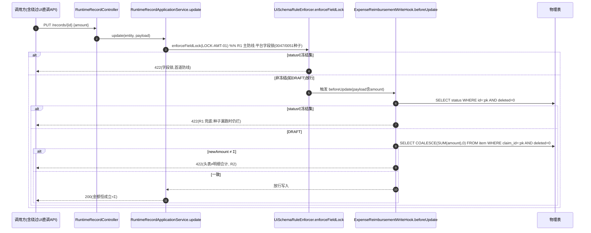
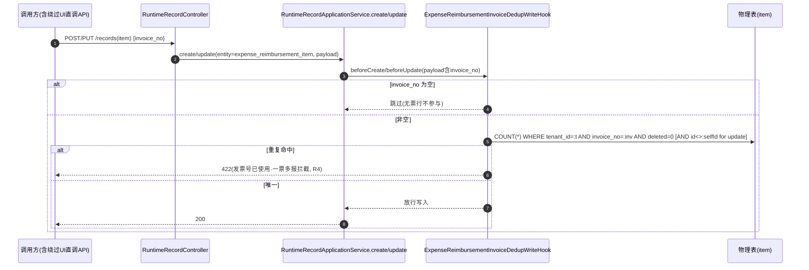
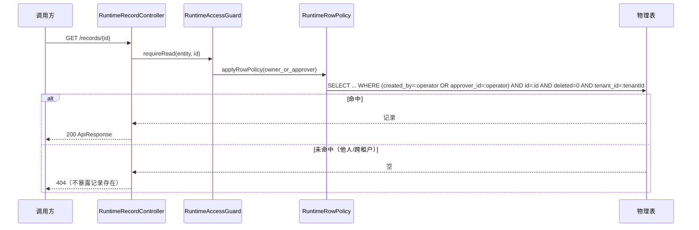
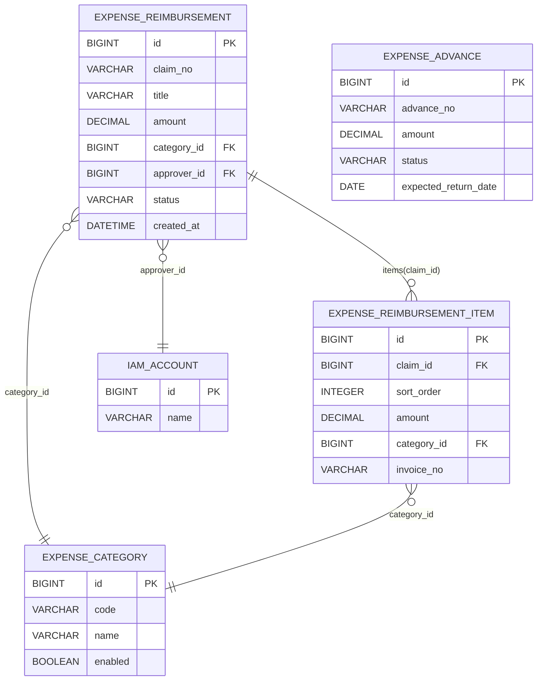

# 费用报销系统 · 设计文档

> **文档性质**：独立系统设计文档（非 lowcode 探针样例）。  
> **真源依据**：代码与迁移脚本真源（截至 2026-10-24），主要来源 `scripts/migration/0051_expense_production_templates.sql`（生产模板）、`0037_runtime_expense_l1_relations.sql`（实例级 L1）、`0052_rename_*`（改名）、`0056_expense_workflow_wf_tables.sql`（审批流六表 + 四动作逃逸 + 流程定义种子，已在本地 dev 库执行验证，团队环境执行待 L3 审批）、`bone-apps/bone-app-expense` 模块。  
> **关联文档**：`doc/design/lowcode/cases/费用报销系统-元数据建模方案.md`（早期 L0/L1 探针，部分口径已演进，见 §11）；`doc/design/modules/12. 工作流引擎设计.md`（审批流引擎设计，§8 的引擎侧真源）。

---

## 1. 定位与范围

费用报销系统是构建在 **BONE 低代码元数据运行时平台**（`bone-metadata-engine` + `bone-metadata-server`）之上的一个**企业报销域**。它通过平台提供的「实体 / 字段 / 关系 / 动作 / 行策略 / 界面资产」元数据驱动运行时 CRUD 与状态机，并辅以一个**业务能力模块 `bone-app-expense`**（jar 包，与平台同进程）承载资金副作用与领域规则。

系统覆盖两个核心业务对象：

| 对象 | 实体 code | 说明 |
|---|---|---|
| 报销单 | `expense_reimbursement` | 头 + 明细行 + 类别引用 + 发票影像；7 态状态机 |
| 借款单 | `expense_advance` | 单笔备用金借款；6 态状态机（与报销核销 v1.1） |
| 报销明细行 | `expense_reimbursement_item` | 报销单的 CHILD_TABLE 子实体 |
| 报销类别 | `expense_category` | REFERENCE 目标主数据（差旅/餐饮/办公/通讯/其他） |

**不在本系统范围（v1.0）**：真实出金通道、组织目录接入、额度校验、公式汇总计算、附件真上传（OSS）、限流压测、对公报账。见 §10 路线图。

---

## 2. 总体架构

```
┌──────────────────────────────────────────────────────────────┐
│  浏览器 / 前端 (bone-metadata-app · RuntimeDataManagement.tsx)  │
└───────────────┬──────────────────────────────────────────────┘
                │  REST: /api/v1/runtime/entities/{code}/records...
                │        /records/{id}/actions/{actionCode}
┌───────────────▼──────────────────────────────────────────────┐
│  BONE 元数据运行时 (bone-metadata-server)                       │
│   · 实体/字段/关系/动作 元数据解析                               │
│   · RuntimeActionDispatcher（动作分发 + 逃逸 Handler 装配）     │
│   · RuntimeWriteHook SPI（写前置钩子链）                        │
│   · 行策略 RLS（owner_or_approver）/ 字段锁 / 入参契约校验      │
│   · ui_schema 渲染 + 规则引擎（linkage / submitRules）         │
└───────────────┬──────────────────────────────────────────────┘
                │  SPI 回调（按 handler_bean 名定位）
┌───────────────▼──────────────────────────────────────────────┐
│  bone-app-expense（业务模块 jar · 与平台同进程 · 自动装配）      │
│   · ExpenseReimbursementConfirmPayoutHandler  (打款逃逸·stub)  │
│   · ExpenseAdvanceConfirmPayoutHandler       (放款逃逸·stub)  │
│   · ExpenseReimbursementWriteHook            (金额冻结/Σ/SoD)  │
│   · ExpenseAdvanceWriteHook                  (借款单金额冻结)   │
│   · ExpenseReimbursementInvoiceDedupWriteHook(一票多报拦截)     │
│   · 工作流接入（bone-workflow-engine · 2026-10-24）：           │
│     ExpenseWorkflowSubmitHandler / DecisionHandler /           │
│     WithdrawHandler（四动作逃逸）+ ExpenseWorkflowStatusPort    │
└───────────────────────────────────────────────────────────────┘
                │  引擎端口（7 必需 + 1 可选）
┌───────────────▼──────────────────────────────────────────────┐
│  bone-workflow-engine（core 内核 + spring-boot-starter 平台集成）│
│   · 流程定义/实例/任务 · 条件分支 · 指派冻结 · 三 CAS 原子推进     │
│   · wf_* 六表持久化（0056 · 本地已执行）+ 状态投影发件箱与中继    │
└──────────────────────────────────────────────────────────────┘
```

**分层说明**：
- 平台侧（`bone-metadata-server`）负责通用运行时能力，业务 Neutral。
- `bone-app-expense` 仅通过平台 **SPI**（`RuntimeActionHandler` / `RuntimeWriteHook`）注入领域行为，不直连平台内部；Handler 以 `handler_bean` 名（如 `expenseReimbursementConfirmPayoutHandler`）在 `meta_model_template_action` / `meta_entity_action_def` 中声明，由 `RuntimeActionDispatcher` 按名装配。
- 审批流（2026-10-24 起）经 `bone-workflow-spring-boot-starter` 接入：引擎对 `bone-metadata-engine` 零依赖，宿主（bone-boot）提供 7 个端口即自动装配；报销模块提供四动作逃逸 Handler 与状态投影端口（§8）。
- 模块入口：`ExpenseApplicationAutoConfiguration`（`@AutoConfiguration`，导入 `ExpenseComponentScanConfiguration` 扫描 `com.bone.app.expense`，排除 `boot` 包自扫描；`@AutoConfigureBefore(WorkflowBoneIntegrationAutoConfiguration)` 保证自定义状态端口先于 starter 默认实现注册）。

---

## 3. 领域模型

### 3.1 实体关系

| 关系 | 类型 | 外键 | 级联 |
|---|---|---|---|
| 报销单 1—N 明细行 | CHILD_TABLE | `expense_reimbursement_item.claim_id` | 软删 cascade |
| 报销单 N—1 类别 | REFERENCE | `expense_reimbursement.category_id` → `expense_category.id` | — |
| 明细行 N—1 类别 | REFERENCE | `expense_reimbursement_item.category_id` → `expense_category.id` | — |
| 报销单 审批人 | REFERENCE | `expense_reimbursement.approver_id` → `iam_account.id` | — |
| 借款单 `expected_return_date` / 报销单 `cost_center` | 辅助核算维度 | — | 组织目录/科目映射 v1.1 |

> 多对多、反向引用属 v1.1+（G5）。

### 3.2 报销单 `expense_reimbursement`（16 字段，0051 v2 生产模板）

| 字段 code | 类型 | 必填 | 约束/说明 |
|---|---|---|---|
| `claim_no` | STRING(32) | ✅ | 业务唯一（`uk` 同租户唯一） |
| `title` | STRING(200) | ✅ | 报销事由 |
| `applicant` | STRING(64) | — | 申请人（创建时由 `created_by` 填充） |
| `department` | STRING(64) | — | 部门（辅助核算） |
| `expense_start` / `expense_end` | DATE | — | 行程区间（end≥start 校验） |
| `expense_date` | DATE | ✅ | 费用发生日期 |
| `category_id` | REFERENCE | — | → `expense_category`，labelField=name |
| `amount` | DECIMAL(20,6) | ✅ | `min:0.01`；=Σ明细；审批链上冻结 |
| `currency` | ENUM | ✅ | 默认 CNY（CNY/USD/HKD/EUR/JPY/GBP），v1.1 迁 `reference:CURRENCY` |
| `approver_id` | REFERENCE | — | → `iam_account`（审批人须可登录）；SoD 禁=申请人 |
| `status` | ENUM | ✅ | 7 态（见 §4） |
| `attachment` | ATTACHMENT | — | JSON 清单（maxCount=10, maxSizeMB=10, image/pdf） |
| `items` | CHILD_TABLE | — | → `expense_reimbursement_item`，cascadeDelete |
| `cost_center` | STRING(64) | — | 成本中心 |
| `remark` | TEXT | — | 备注 |

> 物理存储：`amount` 存 DECIMAL(20,6)，界面按 scale=2 渲染（G20 精度口径）。`attachment` 物理列为 TEXT 存 JSON 数组 `[{name,url,size}]`，**真文件上传另立项（G1）**。

### 3.3 明细行 `expense_reimbursement_item`（11 字段）

| 字段 code | 类型 | 必填 | 约束 |
|---|---|---|---|
| `claim_id` | LONG | ✅ | CHILD_TABLE 外键 |
| `sort_order` | INTEGER | — | 行序（orderColumn） |
| `expense_date` | DATE | ✅ | 本行费用日期 |
| `category_id` | REFERENCE | — | → `expense_category` |
| `amount` | DECIMAL | ✅ | `min:0.01`，Σ 回填头表 |
| `invoice_type` | ENUM | — | 专票/普票/电子/无票 |
| `invoice_no` | STRING(64) | — | 专票必填；**跨单查重**（§5.4） |
| `tax_no` | STRING(64) | — | 专票必填 |
| `tax_rate` | DECIMAL | — | 价税分离 |
| `attachment` | ATTACHMENT | — | 行级发票影像（maxCount=5） |
| `remark` | TEXT | — | 本行备注 |

### 3.4 类别主数据 `expense_category`（4 字段）

`code`(唯一) / `name`(labelField) / `enabled`(BOOLEAN) / `sort_order`。初始 5 类：差旅 TRAVEL、餐饮 MEAL、办公耗材 OFFICE、通讯 COMMUNICATION、其他 OTHER。

### 3.5 借款单 `expense_advance`（7 字段，6 态）

`advance_no`(唯一) / `applicant` / `amount`(`min:0.01`) / `reason`(必填) / `expected_return_date` / `status`(6 态) / `remark`。放款动作 `confirmPayout` 从 `APPROVED`→`PAID`（借款无审票环节）。与报销核销 v1.1（G12）。

---

## 4. 状态机

### 4.1 报销单（7 态 10 动作）

| 动作 | from → to | 是否逃逸 | handler_bean | 入参契约 |
|---|---|---|---|---|
| `submit` 提交 | DRAFT → SUBMITTED | ✅ | `expenseWorkflowSubmitHandler` | — |
| `approve` 审批通过 | SUBMITTED → APPROVED | ✅ | `expenseWorkflowDecisionHandler` | `comment?` |
| `reject` 驳回 | SUBMITTED → REJECTED | ✅ | `expenseWorkflowDecisionHandler` | `reason!` |
| `audit` 财务审票 | APPROVED → AUDITED | 否 | — | `comment?` |
| `auditReject` 审票退回 | APPROVED → REJECTED | 否 | — | `reason!` |
| `withdraw` 撤回 | SUBMITTED → DRAFT | ✅ | `expenseWorkflowWithdrawHandler` | — |
| `reopen` 重新打开 | REJECTED → DRAFT | 否 | — | — |
| `cancel` 取消 | DRAFT → CANCELLED | 否 | — | — |
| `cancelRejected` 取消（驳后） | REJECTED → CANCELLED | 否 | — | — |
| `confirmPayout` 确认打款 | **AUDITED → PAID** | ✅ | `expenseReimbursementConfirmPayoutHandler` | `channel!`(PAYROLL/BANK_TRANSFER), `note?` |

> **职责分离（SoD）**：打款前置 `AUDITED`（先审票后打款），不可从 `APPROVED` 直打。退回链路统一进 `REJECTED` 再 `reopen` 回 `DRAFT`。
> **四动作逃逸（2026-10-24，0056）**：submit/approve/reject/withdraw 的副作用是驱动审批流引擎（§8）；状态流转仍由平台统一负责。逃逸动作受 `RuntimeAccessGuard.requireAction` 动作级细码门禁约束，withdraw 细码随 0056 注册授权。

### 4.2 借款单（6 态 8 动作）

动作集同报销（无 audit/auditReject），`confirmPayout` 放款从 `APPROVED → PAID`，handler=`expenseAdvanceConfirmPayoutHandler`。**借款单本期不接工作流引擎**（无 `approver_id` 字段、审批人来源依赖组织目录，与报销单同病；待 IAM 组织层级字段落地后同批接入）。

---

## 5. 业务规则

| # | 规则 | 实现位置 | 触发/效果 |
|---|---|---|---|
| R1 | **金额冻结** | 平台字段锁 `fieldLockRules`（LOCK-AMT-01）+ `ExpenseReimbursementWriteHook` / `ExpenseAdvanceWriteHook` 兜底 | status∈冻结集改 `amount` → 422 |
| R2 | **头表金额 = Σ明细** | `ReimbursementChildAmountAggregator`（替换子表服务端回填）+ ui_schema `submitRules` + `ExpenseReimbursementWriteHook` Rule2 | DRAFT 直改头表金额 ≠ Σ → 422；编辑态恒成立（G10） |
| R3 | **审批人 ≠ 申请人（SoD）** | `ExpenseReimbursementWriteHook` Rule3（create+update 写路径 422）+ ui_schema `linkageRules`（前端提示） | 同人 → 422 |
| R4 | **一票多报拦截** | `ExpenseReimbursementInvoiceDedupWriteHook` | 同租户内 `invoice_no` 非空重复（跨单/跨行，排除自身与软删）→ 422 |
| R5 | **大额必指定审批人** | ui_schema `linkageRules` | `amount > 5000` → `approver_id` 必填可见 |
| R6 | **明细合计一致性 / 单行下限 / 行程区间** | ui_schema `submitRules` | 提交时前端校验（服务端以 R1/R2 兜底） |
| R7 | **入参契约校验** | `RuntimeActionApplicationService.validateParams` | `confirmPayout` 缺 `channel` → 422 `RUNTIME_ACTION_INVALID_PARAMS` |
| R8 | **决策权 = 指派快照（任务级 SoD）** | `ExpenseWorkflowDecisionHandler` 待办匹配 | 非当前审批人调 approve/reject → 403 |

> 所有写钩子与决策匹配均为**服务端底线**：绕过前端直接调 API 同样被拦（R1/R4/R8 不依赖 UI）。

### 5.1 服务端写钩子触发时序（R1 / R2 / R4）

**更新报销单金额（R1 冻结 + R2 头表=Σ 兜底）**：



**新增/更新明细行（R4 一票多报）**：



> 设计要点（fail-closed vs fail-open）：R1/R2/R4 均为**服务端底线**，绕过前端直接调 API 同样被拦；R2 在子实体未发布（无明细可挂）时 fail-open 跳过不阻断，真实不一致场景 fail-closed 拒写。R3 由本次补齐服务端断言；R8 由工作流接入补齐（§8.1）；各规则强制层级与 create 路径缺口见 §5.2。

### 5.2 规则强制层级（服务端底线 vs 仅前端提示）

> 「绕过前端直接调 API 是否仍被拦」——按代码核实（`UiSchemaRuleEnforcer` / `UiSchemaRuleEngine` / 写钩子 / 工作流 handler）的真实边界：

| 规则 | 服务端强制 | 强制位置 | 绕过 API 能否逃逸 |
|---|---|---|---|
| R1 金额冻结 | ✅ 仅 update | `enforceFieldLock`（报销单 0051 / 借款单 0056）+ 两实体写钩子兜底 | update 否；create 无约束（新建即 DRAFT，语义无影响） |
| R2 头表=Σ明细 | ✅ 仅 update | `ExpenseReimbursementWriteHook` Rule2；create 不强制（见下） | create 无约束，但 **submit 动作会校验** |
| R3 审批人≠申请人（SoD） | ✅ create+update | `ExpenseReimbursementWriteHook` Rule3：载荷 `applicant` 优先，回退物理行 `applicant`，再回退审计列 `created_by`（不可伪造，防「applicant 字段后改写」绕过） | 否（原仅 linkage `notice` 提示，2026-10-24 补服务端 422） |
| R4 一票多报 | ✅ create+update | `ExpenseReimbursementInvoiceDedupWriteHook` | 否 |
| R5 大额必填审批人 | ✅ | `UiSchemaRuleEngine.runRequiredShortcuts`（linkage `required`） | 否 |
| R6 提交时校验 | ⚠️ 仅动作路径 | `RuntimeActionApplicationService.enforceBeforeAction`（submitRules） | **直接 POST 建单不触发** |
| R7 入参契约 | ✅ | `RuntimeActionApplicationService.validateParams` | 否 |
| R8 决策权=指派快照 | ✅ 动作路径 | `ExpenseWorkflowDecisionHandler` 待办匹配（操作人 = 任务 assignee） | 否（未接引擎的宿主除外；接入后持码也不能批他人的单） |

**关于 create 路径的设计决策（经代码核实，勿误判为缺口）**：
报销单 `amount` 带 `min:0.01` 校验（0051 模板 9179），而 create 时明细尚不存在、Σ=0。若在 `beforeCreate` 断言「头表 = Σ明细」，将要求 `amount = 0`，与 `min:0.01` **直接冲突导致建单恒失败**。故create 路径**有意不强制** Σ——这是字段约束下的合理设计，而非漏洞：

- 建单阶段金额为占位值（通常 0.01 或 0），真实金额由 `replaceChildren → ReimbursementChildAmountAggregator` 服务端回填确立；
- **提交（submit）时 `submitRules`「明细合计一致」会服务端强制校验**（`RuntimeActionApplicationService.enforceBeforeAction`），Σ 在**提交闸门**闭环，而非在create 时闭环；
- 直接 PUT 头表改金额（绕过聚合器）由 `ExpenseReimbursementWriteHook` Rule2 拦截。

> ⚠️ **仍存在的真实缺口**：`submitRules` 仅在动作路径生效，绕过 submit 直接建单后**从不提交**的记录，Σ 无服务端闭环——但该记录无法流转到打款（`confirmPayout` 需先submit→approve→audit），故业务风险为「僵尸草稿」而非资金损失。根治仍建议把 submitRules 前移到写路径。

**真实缺口（需在生产前收口）**：
1. ~~create 路径无 Σ/冻结约束~~ → **非缺口**，见上方设计决策；冻结在 create 时无意义（新建即 DRAFT，金额本应可改）。
2. **R6 仅动作路径**——绕过 submit 动作直接 POST 建单，提交级校验（明细合计/单行下限/行程区间）不触发。影响面限于「从不提交的僵尸草稿」，不构成资金风险。根治：把 submitRules 前移到 create/update 写路径（见 §5.2）。

---

## 6. 权限模型

| 层级 | 机制 | 说明 |
|---|---|---|
| 实体级 | `runtime:expense_reimbursement:read/write` 等细码（0037 增 item/category 四条） | SUPER_ADMIN 通配 + demo 管理员（role 3）按角色授 |
| 动作级 | `meta_entity_action_def.permission_code`（0034 细码 9121–9124；0056 增 withdraw 9125） | `RuntimeActionApplicationService.invokeAction` 强校验（P0-1 已闭环）；**逃逸动作强制要求动作级细码**（submit/approve/reject/withdraw 2026-10-24 起全部逃逸，细码已配套） |
| 行级 RLS | `owner_or_approver` 策略：`created_by = :operator OR approver_id = :operator` | 非本人/非审批人枚举他人单据 → 404（0038） |
| 子实体旁路 | `listChildren`/`replaceChildren` 前置主行 ACL；`lookup-options` 候选行级过滤 | 防「知主行 id 枚举明细」「候选列表泄露」 |
| 字段级 | `fieldLockRules`（金额冻结，R1） | 审批链上 `amount` 不可变 |
| 任务级 | `wf_task.assignee_id` 匹配（R8） | 审批决策收敛到指派快照，持动作码亦不能批他人的单 |

### 6.1 权限模型矩阵（总览）

| 维度 | 机制 / 真源 | 适用对象 | 允许 | 拒绝/拦截 | 实现位置 |
|---|---|---|---|---|---|
| 实体级 | `iam_permission` 细码 `runtime:{entity}:{read\|write}` | 全部实体 + item/category 子实体 | 持码角色（SUPER_ADMIN 通配 / demo role3 部分） | 无码 → 403 | 0037 种子 + `RuntimeAccessGuard` |
| 动作级 | `meta_entity_action_def.permission_code`（0034 细码 9121–9124，0056 增 withdraw 9125） | 状态机动作（submit/approve/…/confirmPayout） | 持对应动作码 | 越权 → 403（P0-1 闭环） | `RuntimeActionApplicationService.invokeAction → requireAction(def)` |
| 行级 RLS | `meta_entity.row_policies = owner_or_approver`（`created_by=:operator OR approver_id=:operator`） | 报销单主实体 | 本人或指定审批人 | 他人/跨租户 → 404 | 0038 种子 + `RuntimeRowPolicy` 引擎 |
| 子实体旁路 | 主行行级 ACL 前置断言 | `listChildren` / `replaceChildren` | 主行可见者 | 枚举/替换他人明细 → 404 | Runtime §4.7.1 / §9.7 |
| 候选过滤 | `lookup-options` 行级过滤 | REFERENCE 候选（类别/审批人） | 操作者可见候选 | 他人私有行不外泄 | Runtime §4.7.1 |
| 字段级 | `fieldLockRules`（LOCK-AMT-01） | `amount` 字段 | 非冻结态可改 | 审批链上改金额 → 422 | `UiSchemaRuleEnforcer.enforceFieldLock` + 两实体写钩子兜底 |
| 任务级 | `wf_task.assignee_id` 匹配 | approve/reject 决策 | 指派快照内的审批人 | 非当前审批人 → 403 | `ExpenseWorkflowDecisionHandler` |

> 行级 RLS 的「策略即 WHERE」：解析仅支持「列 = `:operator`」+ AND/OR、列白名单 = 物理列、`operator` 参数化、未知列保守回退（Runtime §4.7.1）。

### 6.2 行级权限读取时序（RLS 生效）



> **租户隔离层次**：RLS 策略 `owner_or_approver` 只生成行归属条件（`RowPolicySpec.renderWhere`）；**租户隔离在应用层**——`JdbcRuntimeRecordService.buildTenantWhere` 追加 `AND tenant_id = :tenantId`，且**条件式**：仅当实体物理表确有 `tenant_id` 列。无该列的实体（系统表/部分主数据）无 SQL 级租户隔离，仅靠实体目录按租户选取。
> **行级 ACL 豁免**：`operatorId` 为 null / `"system"` / 非数值主体，或 `rowOwnerId` 为 null（平台管理员）时，行级 ACL 被跳过（`applyRowOwnerFilter` / `assertRowOwner`）——此类调用不受 owner_or_approver 约束，须依赖入口鉴权与审计兜底。

---

## 7. 动作与逃逸处理器

`confirmPayout` / 放款为**逃逸动作**（`is_escape=1`，`requires_idempotency=1`）：由 `RuntimeActionDispatcher` 分发到 `bone-app-expense` 中同名 bean。

- **补偿与幂等（P0-2 已闭环）**：dispatch 前先 `executionRepository.begin`（PENDING 留痕）；成功 `markSucceeded` / 失败 `markFailed`；orphan 态（status=3）拒绝自动重放（409 `RUNTIME_ACTION_ORPHANED`），杜绝二次出金。
- **当前实现状态（P0-3 未做）**：`ExpenseReimbursementConfirmPayoutHandler` / `ExpenseAdvanceConfirmPayoutHandler` 仍为 **stub**——仅生成 `PAY-`/`ADV-` + `System.nanoTime()` 模拟流水，非真实出金。真实支付 RPC、账户凭据、对账机制未接入（受密钥/凭据治理 L4 限制）。

---

## 8. 审批流（G2 · 2026-10-24 起接入 bone-workflow-engine）

审批流由平台级审批流引擎 `bone-workflow-engine`（`bone-workflow-core` + `bone-workflow-spring-boot-starter`）承载，报销是第一个接入场景。引擎对 `bone-metadata-engine` 零依赖、经 8 个端口与平台对话；设计见 `doc/design/modules/12. 工作流引擎设计.md`。

### 8.1 接线形态（四动作逃逸）

| 平台动作 | from → to | 逃逸 Handler（bean 名） | 引擎调用 |
|---|---|---|---|
| `submit` 提交 | DRAFT → SUBMITTED | `expenseWorkflowSubmitHandler` | `engine.start(...)` 启动流程实例 |
| `approve` 审批通过 | SUBMITTED → APPROVED | `expenseWorkflowDecisionHandler` | `engine.completeTask(taskId, APPROVE, comment, operator)` |
| `reject` 驳回 | SUBMITTED → REJECTED | `expenseWorkflowDecisionHandler` | `engine.completeTask(taskId, REJECT, reason, operator)` |
| `withdraw` 撤回 | SUBMITTED → DRAFT | `expenseWorkflowWithdrawHandler` | `engine.withdraw(instanceId, operator)` |

- 状态机的 `to_status` 流转仍由平台统一负责（Handler 只做副作用）；审批轨迹落在 `wf_task`（谁在何时批了什么），实例进度以 `wf_instance.phase` 为权威。
- **任务级 SoD（新增底线）**：decision handler 按操作人匹配其 PENDING 待办任务，匹配不到即 403——接入前任何持动作码的人都能批任何单，接入后决策权收敛到「节点进入时一次性冻结」的指派快照。
- **状态投影单一写者**：`ExpenseWorkflowStatusPort` 覆盖 starter 默认 outbox 端口，对全部意图只记录不调用动作（`action_code=null`）——人工动作的同链路平台流转已是 status 写者，中继再 invokeAction 会撞 `from_status` 校验产生 FAILED 死信。
- **幂等与并发**：重复提交复用既有实例；任务决策走 CAS；节点推进走存储层原子判定（会签不死锁）；终态不可回写。
- **挂起不是失败**：审批人解析不出（大额单未填审批人 / 组织目录未接入 `RoleMemberProvider`）⇒ 实例 `SUSPENDED` + 告警 + `assignTask` 人工指派出口，绝不静默放行。
- **引擎缺失的诚实失败**：三个 Handler 经 `ObjectProvider` 惰性解析引擎（starter 端口缺失 ⇒ 引擎不装配时执行期 500 + 可诊断文案，不打挂宿主上下文）。

### 8.2 流程定义（`wf_process_def` 种子，def_key=`expense_reimbursement` v1）

金额三档 CONDITION 分支（与已删除的 `ExpenseApprovalRouter` 口径逐条等价——该类 2026-10-24 删除，历史口径由本定义承载：≤1000 直属主管 / ≤5000 部门负责人 / >5000 财务负责人；金额缺失走 `isNull` 守卫落最高档，fail-safe）：

| 档位 | 条件 | 节点 | 指派规则（union 解析） |
|---|---|---|---|
| 缺失 | `amount isNull` | `finance` | FIELD `approver_id` + ROLE `FINANCE_HEAD` |
| > ¥5000 | `amount gt 5000` | `finance` | 同上 |
| > ¥1000 | `amount gt 1000` | `dept` | FIELD `approver_id` |
| ≤ ¥1000 | 默认边 | `mgr` | FIELD `approver_id` |

- v1 全部审批节点为 **SINGLE（单签）**：会签（ALL）与平台动作边「approve：SUBMITTED→APPROVED」存在语义冲突（首个会签人通过后单据即离 SUBMITTED，余人无法再审批），留待 v2 设计分叉（动作边自环 + 投影推进，或平台支持会签未齐不流转）。
- ROLE 策略依赖宿主 `RoleMemberProvider`（组织目录）；未接入时该规则解析不出但不阻塞（FIELD 命中即可派单），两条规则均落空才挂起。

### 8.3 已删除：ExpenseApprovalRouter + InMemoryApproverResolver

原内存路由类（三档纯逻辑 + 硬编码占位账户）已于 2026-10-24 **删除**（经用户授权的 L3 删码项）——三档口径搬进流程定义种子（§8.2），指派解析由引擎 `ApproverResolver` 端口（默认 `RecordFieldApproverResolver`，组织策略经 `RoleMemberProvider` 外接）承担。删除前已确认全仓零引用（仅两类自身），无测试与文档残留。

---

## 9. 界面与前端

- 平台自动生成界面：`RuntimeDataManagement.tsx` 提供明细弹窗（CHILD_TABLE）、REFERENCE 下拉、ATTACHMENT 清单三控件。
- 生产模板内置 `ui_schema_json` 基础资产（列表列 / 表单分区 / 详情 / `linkageRules` / `submitRules` / `actionBar` 10 动作 / `fieldLockRules` / `dataScope: owner_or_approver`）。
- 列表 Tab：待我审批（`approver_id=$me`）/ 我提交的 / 全部。
- **待办入口（v1.1）**：引擎待办落在 `wf_task`（`listTasksByAssignee` 我的待办），需前端接「待办中心」页（与 §8 同批规划）；v1 前端仍按 `approver_id=$me` 列表操作，功能等价（任务级 SoD 在服务端兜底）。

---

## 10. 待完成 / 路线图

| 项 | 优先级 | 现状 | 说明 |
|---|---|---|---|
| **真实出金通道（P0-3）** | 🔴 P0 | stub | Handler 仍为模拟流水；需真实支付 RPC + 账户凭据 + 对账（L4，AI 不代执行） |
| **审批人解析接组织目录** | 🟡 L3 | 占位 | v1 走 FIELD `approver_id`（表单选人，R5 保大额必填）；ROLE/LINE_MANAGER 策略待 IAM 组织层级字段（`leader_id`）+ `RoleMemberProvider` 接入 |
| **限流 / 成本上限（P0-5）** | 🟡 P1 | 未做 | 实体级 read 全表扫描 + size≤200 仅止血 |
| **性能实测（P0-4）** | 🟡 P1 | 未做 | P99≤200/300ms 仅目标值，无实测 |
| **额度校验（G4）** | 🟡 P1 | 未宣称可用 | 跟 RC-007 |
| **公式汇总（G3）** | ⚪ v1.2 | 编辑态兜底 | 完整 Σ 计算引擎未做 |
| **附件真上传（G1）** | ⚪ P2 | JSON 清单 | OSS/对象存储上传另立项 |
| **密钥/凭据治理、审计保留、Outbox、FLS** | ⚪ v1.1 | 规划 | 入 backlog |
| **借款单 R1 金额冻结** | ✅ 已补(双保险) | `ExpenseAdvanceWriteHook` + fieldLockRules | 兜底钩子 2026-10-24 新建（与报销单同构，6 态冻结集）；主防线 fieldLockRules（LOCK-AMT-01）随 0056 补种借款单模板（0051 只种了报销单——原文档「已补 0051 种子」表述不实，已纠正）。`R4` 对借款单 N/A（无 `invoice_no`） |
| **WriteHook 双副本漂移** | ✅ 已解决 | 已归并 | 权威源裁定为 `bone-app-expense` 完整版（6 态冻结 + Σ + SoD，经 `AutoConfiguration.imports` 注册覆盖）；已删除 `bone-metadata-server` 陈旧 3 态副本（无 Σ），消除同名 bean 冲突 |
| **R3 SoD 服务端强制** | ✅ 已解决 | `ExpenseReimbursementWriteHook` Rule3 | 原 linkageRules 仅 `notice` 提示、前后端均不阻断；2026-10-24 补写路径断言（`approver_id ≠ applicant`，回退 `created_by`），绕过 API 亦 422；含 5 项单测（此前文档声称已补但代码缺失，属写实偏差，已纠偏） |
| **审批流接入 bone-workflow-engine** | ✅ 已落地并本地验证 | 四动作逃逸 + 状态端口 + 流程定义种子 + H2 集成回归 | 接入代码与 64 项单测全绿（含 `ExpenseWorkflowDefinitionH2Test`：0056 种子 JSON 原样驱动真引擎，三档分支/守卫/union 指派/挂起/终态/幂等 11 用例）；0056 已在本地 dev 库执行验证（六表/种子/withdraw 授权落地）。**L3 待批**：团队环境执行 0056 并与新版同批发布 |
| ~~删除 ExpenseApprovalRouter + InMemoryApproverResolver~~ | ✅ 已删除 | 2026-10-24 | 用户授权的 L3 删码项；删除前全仓 grep 确认零引用，无测试/文档残留 |
| ~~create 路径无 Σ/冻结约束~~ | ✅ 非缺口 | 设计决策 | 经核实**不应修复**：`amount` 带 `min:0.01`（0051:9179），create 时 Σ=0，断言「头表=Σ」会要求 `amount=0`、与 `min:0.01` 冲突致建单恒失败。Σ 在 **submit 闸门**由 submitRules 闭环（见 §5.2） |
| **R6 submitRules 仅动作路径** | 🟡 P1 | 部分 | 仅 `RuntimeActionApplicationService.enforceBeforeAction` 触发；绕过 submit 直接建单不校验。影响面限于「从不提交的僵尸草稿」，无资金风险。根治：submitRules 前移到写路径（见 §5.2） |
| **聚合器错层（`ReimbursementChildAmountAggregator` 在平台模块）** | 🟡 P1 | 待重构 | 硬编码 `expense_reimbursement` 场景约定却置于 `bone-metadata-server`，违反「平台业务 Neutral」，且造成双向 javadoc 依赖；应下沉至 `bone-app-expense`。<br>⚠️ 注意：下沉需先把平台 `RuntimeRelationApplicationService` 对该类的构造器注入改为 **SPI 端口**（业务模块不能反向被平台依赖），属独立重构立项，勿夹带在审批包里 |
| **行级 ACL 系统主体豁免** | 🟡 P1 | 已记录 | `operatorId` 为 null/`system`/非数值，或 `rowOwnerId` 为 null（管理员）时跳过行级 ACL；需确认入口鉴权与审计兜底（见 §6.2） |
| **0051 linkageRule 补 `code`** | ✅ 已补 | 0051 种子 | R5 大额必填审批人补 `LINK-APPR-01`（与 0047 对齐），422 文案带规则码，可诊断性提升 |
| **0056 种子的结构回归** | ✅ 已防 | `ExpenseWorkflowDefinitionH2Test` | 种子 JSON 是迁移脚本里的手行长文本，形状错（键名/默认边末位/`when` 结构）只在生产 submit 时刻才炸；测试直接从 0056 文件解析 JSON 驱动真引擎（同源零漂移），并经 `WorkflowDefinitionValidator` 静态校验 |
| **金额精度口径（G10 Σ 一致性）** | ⚪ P2 | 待定 | 头表 `DECIMAL(20,6)` / UI `scale=2` / RPC `scale=2`；Σ 用 `compareTo` 精确相等。明细各行 6 位小数求和与支付取 2 位可能差分位 → 建议统一标度（取 MIN(头表,支付) 或后端四舍五入后再 Σ 校验） |
| **出金非原子窗口** | ⚪ P2 | 待定 | §13 时序把 `updateState(→PAID)` 与 `markSucceeded` 并列；真实 RPC 下「已扣款、状态未 PAID」是必然窗口，orphan 收口须由对账驱动（见 §14.4），非依赖自动重放 |

---

## 11. 与历史文档的关系及命名漂移

- **架构演进**：早期 case 文档（2026-10-11 v0.50）明确「**不新建微应用**」，走纯 platform Handler。当前代码已演进为 **`bone-app-expense` 业务能力模块（jar 包，与平台 metadata-server 同进程，经 Spring Boot 自动装配挂载）+ 平台 SPI 双轨**，case 文档该表述已过时，建议修订。
- **实体命名**：实例层物理表为 `t_expense_reimbursement` / `_item` / `t_expense_category`（0037 建表，0052 由 `t_expense_claim` 改名）；而 0051 生产模板注释期望实例化为 `expense_reimbursement` / `exp_*`（`exp_` 模块前缀、禁 `t_`）。二者**命名口径不一致**，以运行实例元数据 `meta_entity.table_name` 为准。
- **状态机演进**：case 文档为 5 态（无 `AUDITED`），当前生产模型为 7 态（新增审票 `AUDITED`，打款从 `AUDITED` 触发，强化 SoD）。
- **实体范围演进**：case 文档仅报销单；当前已含**借款单 `expense_advance`** 与发票查重、审批路由等超出原 probe 的能力。
- **审批路由演进（2026-10-24）**：内存路由类 `ExpenseApprovalRouter` + `InMemoryApproverResolver`（三档纯逻辑，从未接线进 submit）被平台级审批流引擎 `bone-workflow-engine` 取代并**已删除**——三档口径搬进 `wf_process_def` 流程定义种子（§8.2），指派解析走引擎 `ApproverResolver` 端口；`bone-app-expense` 以四动作逃逸 Handler + 状态投影端口接入（§8.1）。
- **写实纠偏（2026-10-24）**：本文档历史版本声称「R3 SoD 服务端断言已补」「借款单金额冻结双保险已补」与代码不符（钩子无 Rule3、`ExpenseAdvanceWriteHook` 不存在、0051 未种借款单 fieldLockRules）——本次已按代码事实补齐实现并修订文档。

---

## 12. 实体关系图（ER）



---

## 13. 确认打款时序图（confirmPayout）

```mermaid
sequenceDiagram
    autonumber
    participant FE as 前端/调用方
    participant CT as RuntimeActionController
    participant AS as RuntimeActionApplicationService
    participant DS as RuntimeActionDispatcher
    participant HK as ExpenseReimbursementConfirmPayoutHandler
    participant EXT as 外部资金系统(真实出金·TODO)

    FE->>CT: POST /records/{id}/actions/confirmPayout {channel,note}
    CT->>AS: invokeAction(def, params)
    AS->>AS: requireAction(permission_code)  %% P0-1 动作级强校验
    AS->>AS: validateParams(channel ∈ enum)  %% R7 入参契约
    AS->>AS: begin(execution, PENDING)       %% P0-2 补偿留痕
    AS->>DS: dispatch(handler_bean)
    DS->>HK: execute(RuntimeActionContext)
    Note over HK: 当前 stub: 生成 "PAY-"+nanoTime()
    HK->>EXT: 真实出金 RPC (TODO, 见 §14)
    EXT-->>HK: paymentSerial / 银行流水 / 凭证
    HK-->>DS: Map{ paymentSerial, channel, paidAt }
    DS-->>AS: result
    AS->>AS: updateState(AUDITED→PAID) + markSucceeded
    AS-->>CT: ApiResponse(actionResult)
    Note over AS: 失败→markFailed; orphan 态(status=3)拒绝自动重放(409), 杜绝二次出金
```

### 13.1 借款单放款时序图（confirmPayout · 无审票环节）

```mermaid
sequenceDiagram
    autonumber
    participant FE as 前端/调用方
    participant CT as RuntimeActionController
    participant AS as RuntimeActionApplicationService
    participant DS as RuntimeActionDispatcher
    participant HK as ExpenseAdvanceConfirmPayoutHandler
    participant EXT as 外部资金系统(真实放款·TODO)

    FE->>CT: POST /records/{id}/actions/confirmPayout {channel,note}
    CT->>AS: invokeAction(def, params)
    AS->>AS: requireAction(permission_code)  %% 动作级强校验
    AS->>AS: validateParams(channel ∈ enum)  %% R7 入参契约
    AS->>AS: begin(execution, PENDING)       %% 补偿留痕
    AS->>DS: dispatch(handler_bean=expenseAdvanceConfirmPayoutHandler)
    DS->>HK: execute(RuntimeActionContext)
    Note over HK: 当前 stub: 生成 "ADV-"+nanoTime()
    HK->>EXT: 真实放款 RPC (TODO, 见 §14)
    EXT-->>HK: paymentSerial / 银行流水 / 凭证
    HK-->>DS: Map{ paymentSerial, channel, paidAt }
    DS-->>AS: result
    AS->>AS: updateState(APPROVED→PAID) + markSucceeded
    AS-->>CT: ApiResponse(actionResult)
    Note over AS: 失败→markFailed; orphan 态(status=3)拒绝自动重放(409)
```

> 与报销打款差异：借款单 `from_status = APPROVED`（无 `AUDITED` 审票环节），handler 为 `ExpenseAdvanceConfirmPayoutHandler`，流水号前缀 `ADV-`（便于对账分流，见 §14.4）。

---

## 14. 真实出金 Handler 接口契约（设计，不出金）

> 目标：把 `ExpenseReimbursementConfirmPayoutHandler` / `ExpenseAdvanceConfirmPayoutHandler` 从 stub 升级为真实出金。**受 L4 限制，本期不实现代码，仅定义边界**。真实接入需密钥/凭据治理（§14.5）由人工/架构师授权执行。

### 14.1 入参（平台已强校验，R7）
- `channel`：`enum {PAYROLL, BANK_TRANSFER}`，必填
- `note`：`string`，可选

### 14.2 出金 RPC 契约（建议）
**请求**（资金中台 / 银企直连 / 薪酬系统）：
```json
POST /v1/payments
{
  "bizNo": "<expense_reimbursement.id 或 claim_no>",
  "channel": "PAYROLL | BANK_TRANSFER",
  "payee": { "accountId": "<收款人账户，由组织目录解析，禁硬编码>", "name": "..." },
  "amount": "<头表 amount，精度 scale=2>",
  "currency": "<currency>",
  "idempotencyKey": "<平台提供的动作执行幂等键>",
  "remark": "<note>",
  "attachments": "<发票影像清单，可选>"
}
```
**响应**：
```json
{
  "paymentSerial": "银行/渠道流水号",
  "status": "SUCCESS | FAILED | ACCEPTED",
  "paidAt": "ISO8601",
  "channel": "..."
}
```

### 14.3 幂等
- 平台已按 `Idempotency-Key` 去重 + execution orphan 态收口（P0-2）；真实 RPC **仍需透传幂等键**，避免渠道侧重复出金。

### 14.4 对账边界
- `paymentSerial` 前缀 `PAY-`（报销）/ `ADV-`（借款）区分；三方对账：`paymentSerial ↔ 银行流水 ↔ ERP 凭证号`。
- **非原子窗口（务必理解）**：§13 时序将「真实 RPC 出金成功」与「`updateState(→PAID)` + `markSucceeded`」并列呈现，但二者**不原子**——真实链路中「渠道已扣款、平台状态尚未 PAID」是**必然存在的窗口**（网络/超时/进程崩溃均可能）。因此：
  - 状态机靠 `AUDITED→PAID` 单向跃迁 + 幂等键兜底，确保**不会二次扣款**；
  - 该窗口的闭合**不靠自动重放**，而靠**对账作业**：以 `paymentSerial` 拉取渠道侧终态，对 orphan（status=3，已扣未记账）做人工/自动补偿，纠正「已扣款未 PAID」记录（§13 注记 `orphan 态拒绝自动重放` 即为此设）。
- 失败路径需补偿 / 冲正；orphan 态（status=3）已拒绝自动重放，需人工 / 对账作业介入。

### 14.5 凭据与安全（L4）
- 真实出金需密钥 / 凭据治理（KMS / Secret），**不在代码硬编码**；生产接入由人工 / 架构师授权，AI 不代执行。

---

## 15. 审批流接入的部署与对账（2026-10-24 · L3 检查单）

### 15.1 发布顺序（不可颠倒）

1. **先执行 0056 迁移**（架构师审批后 DBA/CI）：建 `wf_*` 六表、种流程定义与 binding、四动作改逃逸（模板层 + 实例层）、注册授权 withdraw 细码、补借款单 fieldLockRules。
   > 本地验证记录（2026-10-24）：已在本地 dev 库跑通——六表/租户 0 定义行/binding/withdraw 细码与授权落地。该库缺 0034/0037/0051 的报销实例链（陈旧环境），故「四动作改逃逸」「借款单 fieldLockRules」两段 UPDATE 在本地为预期 no-op，须在具备该链的团队环境生效；执行时修掉两个真 bug（`meta_entity` 列名是 `code` 非 `entity_code`、授权 id 硬编码 9209 撞既有行改派生）。
2. **再发布 bone-app-expense 新版本**（随 bone-boot）：工作流接入代码、引擎经 starter 自动装配（7 端口在位）。
3. 颠倒的后果：代码先行而表缺失 ⇒ `submit` 以 422「未找到已发布的流程定义」失败（引擎刻意不兜底：审批数据落错表比启动失败更危险）。

### 15.2 对账锚点

| 场景 | 判据 |
|---|---|
| 流程已通过但单据未 APPROVED | `wf_instance.phase='APPROVED'` 且 `wf_status_outbox` 无对应 DONE 意图（`SELECT_TERMINAL_INSTANCES_MISSING_PROJECTION`） |
| 挂起死单 | `wf_instance.phase='SUSPENDED'` 的实例列表 + 挂起告警日志；处置：`assignTask` 指派 / `resume` 恢复 / 发起人 `withdraw` |
| 幽灵待办 | `wf_task.status='PENDING'` 但实例已终态（引擎 `cancelPendingTasks` 应已作废；残留即为缺陷） |
| 定义与绑定漂移 | `wf_binding.def_key` ≠ handler 硬编码 `DEFINITION_KEY`（`expense_reimbursement`）——v2 让 handler 改读 binding 前以此脚本校验 |

### 15.3 回滚

撤销 `is_escape=1` + 回收 withdraw 细码即可回到纯平台状态机审批（`wf_*` 数据保留不影响业务；在途实例建议先 `withdraw` 收口再回滚）。

---

**一句话**：费用报销系统已在 BONE 平台真实落地——双实体（报销单/借款单）、头行类别附件关系、7 态状态机、行级权限、金额冻结/Σ/一票多报/SoD 规则均已可跑可演示；审批流自 2026-10-24 起接入平台级工作流引擎（任务/待办/指派冻结/原子推进/挂起干预，代码与 64 项单测全绿、0056 已在本地 dev 库执行验证，团队环境执行待 L3 审批后与新版同批发布）；**唯一生产硬门槛仍是真实出金为 stub**（接口边界见 §14），其余为 v1.1 组织目录接入/额度/公式/真上传/限流/压测等增强项。
