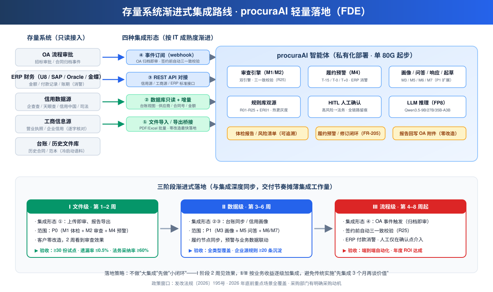

# 采购AI · 商业化卖点 · 技术壁垒 · 存量系统打通与 FDE 轻量落地交付方案

> **文档定位**：售前/商业化视角——回答三个问题：**企业为什么愿意买**（核心卖点）、**我们凭什么卖得动**（技术壁垒）、**怎么轻量落地**（存量系统打通 + FDE 交付）。
> **对应方案**：PRD v0.7（需求与成功口径）＋ 技术方案 v0.8（设计与实现）＋ 本方案（商业化与交付）。
> **FDE 定义**：Fast Deployment & Enablement——**快速部署 + 赋能交付**，以"轻咨询 + 标准部署包 + 角色赋能"替代传统重实施，目标 4–6 周交付 P0 试点闭环。

---

## 文档元信息

| 项目 | 内容 |
|------|------|
| 文档名称 | 采购AI 商业化卖点 · 技术壁垒 · FDE 落地交付方案 |
| 版本 | v0.2 |
| 状态 | Draft（待评审） |
| 阅读对象 | 售前/解决方案/交付团队、产品负责人、管理层 |
| 关联文档 | PRD v0.7、技术方案 v0.8（同目录） |

## 修订记录

| 版本 | 日期 | 作者 | 说明 | 状态 |
|------|------|------|------|------|
| v0.3 | 2026-10-12 | AI 助手 | 评审优化落位：①新增 §3.6 启动前排雷（许可合规：pg_search AGPL-3.0 / Qwen3.5-27B Qwen 许可 → POC 前法务评估；厂商实测口径以自建评测集独立复验）；②§3.2 补定价口径区隔注（招标侧 License 主轨 vs 投标侧 Bid SaaS 小单，防混用）；③对齐 Synap 总纲 Bid 载体定位（三线并行：procuraAI=造血线 / Claim=主攻线 / Equity=探索线，共用确定性分层底座） | Draft |
| v0.2 | 2026-10-12 | AI 助手 | 新增 §3 商业模式与定价（License+年费双轨/SaaS 补充，含版本梯度定价、论证、收入结构与 LTV、政策语境打法）；后续章节顺延；附录引用修正 | Draft |
| v0.1 | 2026-10-12 | AI 助手 | 初稿：核心卖点 6 项（政策刚需/提效/减损/可信/轻量/不出域）+ 技术壁垒 8 项 + 存量系统四形态打通 + FDE 三阶段交付 + ROI 模板 + 竞品对标 | Draft |

---

## 1. 一句话价值主张

> **让企业采购合同审查从"人工 1–3 天 + 漏检靠运气"变成"5 分钟 + 法定情形零漏检 + 每一条结论都能追溯到原文和法条"，且数据不出域、4 周内看到效果。**

---

## 2. 核心卖点（企业为什么愿意买）

### 2.1 政策刚需：踩准 195 号文合规窗口期（最强销售杠杆）

| 卖点 | 内容 | 依据 |
|------|------|------|
| 政策倒计时 | 发改法规〔2026〕195号（八部门）明确：**2026 年底前**招标文件检测、智能辅助评标、围串标识别等重点场景全覆盖；2027 年底前 AI 应用基本普及 | 政策原文：场景 3"招标文件检测（先体检、再发布）"、场景 11"中标合同签订风险提示"、场景 19"协同监管（标前标中标后）" |
| 落地压力 | 央国企/政务采购是政策执行主体，**AI 应用纳入考核**，采购部门有明确采购动机 | 八部门联合发文，落实主体责任 |
| 本方案契合度 | 覆盖 20 项场景中 6 项（检测/合同提示/协同监管/投标自查/信用管理/智慧问答），P0 即命中 3 项 | PRD §1.3 政策对标矩阵 |

> **为什么有效**：ToB 销售最难的"第一推动"在这里不存在——**政策替你把价值主张说完了**。企业不是"要不要 AI"，而是"2026 年底前必须落地，选谁"。

### 2.2 提效降本：审查从"天"到"分钟"

| 指标 | 现状（人工） | 本方案 | 依据 |
|------|------------|--------|------|
| 招标文件体检 | 1–3 天/份（50–200 页） | ≤5 分钟/份 | PRD §10 |
| 合同审查 | 0.5–2 天/份 | ≤3 分钟（解析+规则）+ ≤5 分钟（含 LLM 深审） | PRD §10 |
| 人工复核量 | 全文 | 仅高/中风险条目（低风险自动归档） | HITL 分级设计 |
| 审查人力 | 法务/采购逐份投入 | 单份人工耗时降 **80%+**（业界 CLM 实测周转降 83%） | Icertis 对标 |

### 2.3 风险减损：漏检是"真金白银"的赔付（ROI 引擎）

- **违约/排他条款漏检**：一份漏检的违约条款或排他性条款，一次纠纷的赔付/损失即可覆盖整套系统年费（采购额 1 亿的央企，单份合同风险敞口常达数百万级）；
- **"阴阳合同"堵漏**：三一致校验（R25，条例57条）在签约环节拦截合同对招标/中标文件的实质性背离——**这是审计必查、出事必追责的合规命门**，此前靠人工对照、漏查率高；
- **逾期履约损失**：履约预警（T-15/T-0/T+0）将"逾期才发现"变为"到期前拦截"，付款逾期违约金/验收拖延成本直接减损；
- **量化口径**：成功口径全部量化可验收（高风险遗漏率 ≤0.5%、履约预警准确率 ≥95%），ROI 可测算（见 §6.7）。

### 2.4 可信可审计：解决"AI 不敢用"的最后一道坎

- **条款级可追溯**：每条风险必带「原文引用 + 法规依据 + 修改建议」，无引用不出结果（FR-601）；法条引用经法规库实文核对（防"法条张冠李戴"幻觉）；
- **审查可复现**：review_snapshot 全链路留痕 + 引擎版本快照，同一份文档任何时候重放结果一致——**审计/监管可回放，责任可追溯**；
- **人机边界清晰**：AI 辅助、人工确认（HITL），**不改变法定责任主体**（对齐 195 号文辅助性定位）——这是法务敢用、审计敢放行的前提。

### 2.5 轻量快速 ROI：单 80G 起步、4–6 周试点闭环

- **硬件门槛低**：FP8 量化，Qwen3.5-9B/27B/35B-A3B 全量单 80G 卡承载，起步配置 1 CPU 节点 + 1 GPU 节点即可；
- **交付快**：P0 试点（招标体检+合同审查+履约预警）4–6 周，存量系统文件级对接**零改造**先行；
- **见效快**：试点 1 个月即可产出首批量化结果（审查耗时/规则命中分布/采纳率），支撑内部立项与预算追加。

### 2.6 数据不出域：私有化，政企合规底线

- 全栈私有化部署（模型/规则/数据均在内网），满足等保三级/密评要求；
- 文档原文加密存储，脱敏链路（敏感字段不完整进 LLM）+ 受控回填保可溯源；
- 模型供应链 SBOM 追溯 + 全链路审计日志，**央企/政务采购的准入前置条件**。

---

## 3. 商业模式与定价（如何变现）

### 3.1 商业模式选择：私有化授权（License）+ 年度服务订阅双轨，SaaS 为补充

| 轨道 | 模式 | 适用客户 | 定位 |
|------|------|----------|------|
| **主轨 A** | 私有化 License（一次性授权，按模块梯度）+ 年度服务费（维护 / 规则库更新 / 法规巡检 / 评测回归） | 央国企 / 政务 / 大型集团（政策执行主体） | 政策刚需客户，资产化采购 |
| **辅轨 B** | 公有云 SaaS 订阅（按席位 + 用量） | 非敏感行业 / 中小客户 | 补充覆盖，不主推 |
| **增值轨 C** | 实施与深度集成（按系统/项目计费）+ 行业规则包订阅 + 标注/评测运营服务 | 全部客户（按需） | 高毛利增长曲线 |

### 3.2 版本梯度与定价参考

| 版本 | 模块范围 | 目标客户 | 定价参考（业界对标） |
|------|----------|----------|----------------------|
| 基础版（P0） | 招标体检 + 合同审查（含三一致）+ 履约预警 | 试点 / 预算有限 | License 30–60 万 + 年费 15% |
| 标准版（P1） | 基础版 + 画像/自查/问答/投标响应/合同起草 | 主体客户 | License 60–120 万 + 年费 15–20% |
| 高级版（P2） | 标准版 + 评标辅助 + 流程级自动化 + SLA 优先 | 大型集团 | License 120–250 万 + 年费 20% |
| SaaS 版 | 全模块公有云 | 非敏感中小企业 | 10–50 万/年（席位 + 用量） |

> **定价依据（业界对标）**：国际 CLM 企业级（Icertis 等）年费 10–100 万美元区间；国内合同 AI 产品私有化单客户 30–150 万/年；本方案叠加 195 号文政策刚需，客户预算立项有明确政策依据，**政策窗口期（2026 年底前）定价有溢价空间**。

> **口径区隔（防混用）**：上表为 procuraAI **招标人视角**（央国企/政务采购·法务）的 License 主轨定价；投标人视角（Synap Bid：标书响应/防废标，卖给投标企业）为 SaaS 1999–29999 元/年 + 按次体检 500–2000 元/份，**客单价差约 100 倍、销售对象不同——两者是同一技术底座的两个入口，不是同一产品的两种价格**（售前材料须按客户视角取对应报价单）。

### 3.3 为什么是这个商业模式（论证）

1. **客户结构决定**：央国企/政务是 195 号文执行主体（考核压力），数据不出域是准入底线 → **私有化是唯一可行形态**；国企 IT 采购偏好"资产化买断 + 维保年费"而非费用化 SaaS——License + 年费与客户采购习惯天然匹配；
2. **政策窗口决定**：2026 年底前重点场景全覆盖是**抢单窗口**，License 模式匹配"年度预算立项 + FDE 快速交付（4–6 周试点）"的节奏，SaaS 的订阅评估周期反而不利于抢单；
3. **数据飞轮决定**：企业私有规则库（ER01+）沉淀越多，客户替换成本越高 → **必须年费制保证持续运营**，否则飞轮停在交付那天，License 后无后续触点；
4. **交付形态决定**：FDE 轻量交付（标准包复制）使实施费不是主要利润源，**收入结构应是 License（首年大头）+ 年费（持续）+ 增值服务（高毛利）**，而非项目制人天；
5. **风险对冲**：SaaS 轨覆盖政策外的中小企业市场；行业规则包（分行业预置规则）打开第二增长曲线，形成"私有化（主）+ SaaS（辅）+ 增值（利）"的结构。

### 3.4 收入结构与 LTV 逻辑

| 年份 | 收入构成 | 毛利特征 |
|------|----------|----------|
| 首年 | License（约 60%）+ 实施/集成（约 25%）+ 首年年费（15%） | License 高毛利，实施中毛利 |
| 次年起 | 年费（维护+规则更新+法规巡检）+ 行业规则包 + 运营服务 | 年费毛利高、续费即现金流 |

- **LTV 逻辑**：数据飞轮（企业规则沉淀 → 审查质量提升 → 采纳率上升 → 客户更依赖）→ 高续费率（对标 CLM 行业续费 90%+）；单客户 5 年 LTV ≈ 首年 License × 3–4；
- **毛利率**：标准包复制后边际成本趋近硬件折旧 + 运维人力，私有化毛利率目标 ≥70%（对标软件许可行业水平）。

### 3.5 商业化配套打法（政策语境）

- **政策合规故事**：交付物含"195 号文场景覆盖对照表"（6 场景逐项映射），作为采购立项的政策依据材料；
- **标杆案例打法**：首个央国企标杆客户**免/低价换案例**（换场景数据 + 联合署名 + 行业白皮书），验证后行业复制（对标业界"灯塔客户"打法）；
- **定价锚定**：对外报价锚定"风险减损金额"（ROI 测算模板 §6.7），而非锚定人天成本——ToB AI 产品定价权在价值不在成本。

### 3.6 启动前排雷（许可合规与数据口径）

> 对应《技术方案 v0.8》已标注项，升级为 **POC 意向签订前的强制检查清单**，防止"方案看着能卖、交付时翻车"。

| # | 项 | 现状 | 决策要求 |
|---|-----|------|----------|
| L1 | pg_search（BM25 载体）AGPL-3.0 | 技术方案已提示 + 双备选（Timescale pg_textsearch / BGE-M3 稀疏向量） | **POC 前完成法务许可评估**：私有化产品分发涉 AGPL 传染性，确定主选或切换备选后冻结选型 |
| L2 | Qwen3.5-27B 为 Qwen 许可（非 Apache 2.0） | 技术方案已标注（9B/35B-A3B/122B 为 Apache 2.0） | 27B 仅内部推理不对外分发时风险可控；如进入产品分发清单，纳入 SBOM 许可审计 |
| L3 | 厂商实测口径（遗漏率 0.3% / 采纳率 94% 等） | 技术方案 §2.3 声明"在 §7 自建评测集回归中复核" | POC 成功口径（漏检 ≤0.5%、采纳率 ≥60%）**必须基于自建评测集独立复验**，禁止直接引用厂商数字对外承诺 |
| L4 | 定价口径区隔 | §3.2 已加注 | 售前材料统一引用本表 License 主轨；投标侧 SaaS 走 Synap Bid 独立报价单 |

> **排雷节奏**：POC 意向签订前完成 L1/L2 法务评估 + L3 评测集基线；避免试点中途换检索组件或重测指标。

---

## 4. 技术壁垒（为什么别人做不了/做不好）

> 壁垒不是"用了大模型"——那是门槛，不是壁垒。以下 8 项是可防御、可举证、难以短期复制的工程壁垒。

| # | 壁垒 | 内容 | 可防御性（为什么难抄） |
|---|------|------|------------------------|
| B1 | **双引擎混合架构** | 规则引擎确定性兜底（法定情形零漏检）+ LLM 开放推理（语义风险）。**混合模式高风险遗漏率 0.3% vs 纯 LLM 12.7%，意见采纳率 94% vs 纯规则 21%**（厂商实测口径） | 需要"规则工程 × LLM 工程 × 领域知识"三重复合能力；纯 LLM 玩家没有规则沉淀，纯规则玩家没有语义覆盖 |
| B2 | **条款级可追溯 + 法条依据查证** | 每条风险三要素（原文引用/法规依据/修改建议），法条引用经法规库实文核对（编辑距离校验 + 不一致重生成 ≤2 次 + 降级"仅引用不出建议"） | 通用合同 AI 只给结论不给可核验依据；可审计是政企采购的**准入资格**而非加分项 |
| B3 | **审查可复现** | review_snapshot 全链路留痕 + 引擎版本快照 + 规则版本绑定，同一文档任何时候重放结果一致 | 需要为"可复现"专门设计存储与版本机制，多数产品只做了日志没做可重放 |
| B4 | **约束解码** | vLLM 默认 xgrammar 约束解码，审查结果 Schema 格式错误率 <0.1%（vs 纯提示 8–15%），校验器专注语义 | 与推理引擎深度集成（非提示工程能替代） |
| B5 | **规则库双源 + 热更灰度** | 法规源 R01-R25 + 企业源 ER01+，QLExpress 脚本存库热更、四级沙箱、版本灰度/回滚；**企业私有合规红线（playbook）可随制度变化分钟级更新** | 企业私有规则是"数据飞轮"型壁垒——客户用得越久，规则库越贴合其业务，替换成本越高 |
| B6 | **全链路 AI 安全** | 提示注入防御（OWASP LLM Top10 2025 + ASI 2026：GoalTheft/RecursiveHijacking/ToolOrchestrationAbuse）+ 脱敏受控回填 + 向量库分级隔离 + 模型 SBOM | 采购/合同场景是**对抗性输入重灾区**（招标文件可含隐藏指令），通用 LLM 应用未做纵深防御不敢用于合同场景 |
| B7 | **私有化轻部署** | FP8 量化单 80G 承载全量模型；单机 Docker Compose 起步、K8s 水平扩展；LLM 降级矩阵（纯规则兜底） | 工程化落地能力——模型再强，落不了私有化政企环境就是零 |
| B8 | **分层评测体系 L0–L5** | 规则单测 → 解析 → LLM 评测集 → 端到端 → 一致性 → 对抗；LLM-as-Judge 辅助回归（减 60–80% 标注量） | "你怎么证明它准"是政企采购必答题；评测集 + 标注指南 + Kappa 0.8 双人标注是**可举证的质量证明体系** |

---

## 5. 存量系统打通方案（与采购/合同系统集成）

### 4.1 集成原则（FDE 落地的前提）

1. **存量零改造优先**：先文件级对接（导入/导出），再 API/消息级对接——不要求客户先改造 OA/ERP；
2. **只读接入**：单向拉取，不做双写，不碰存量系统数据结构；
3. **标准字段统一**：合同号/金额/账期/供应商统一字典（多 ERP 口径不一的缓解，PRD R-03）；
4. **主键贯穿**：`contract_no` 贯穿 OA 审批 → 审查 → ERP 结算 → 台账履约（ADR-03），是跨系统追踪的锚。

### 4.2 五类存量源适配（技术方案 §3.5 适配器架构）

| 存量系统 | 适配方式 | 数据内容 |
|----------|----------|----------|
| OA（流程审批） | API + 流程事件订阅 | 招标审批、合同归档事件（触发审查/预警） |
| ERP 财务（U8/SAP/Oracle/金蝶） | 账套映射 + 只读拉取 | 合同金额/付款记录/账期（履约消警、三单匹配） |
| 信用数据源（企查查/天眼查/信用中国/司法裁判） | API 适配 | 工商/司法/失信/行政处罚（供应商画像） |
| 工商信息源 | API 适配 | 营业执照/企业信用（FR-712 逐字核对、FR-503 关联关系） |
| 内部台账/文件库 | 文件导入/同步 | 历史合同/招标文件/范本（冷启动语料 + 检索知识库） |

### 4.3 四种集成形态（按客户 IT 成熟度选择）

| 形态 | 适用客户 | 成本 | 时效 |
|------|----------|------|------|
| ① 文件导入/导出桥接（Excel/PDF 批量 + 标准模板） | 任意客户，**零改造最快落地** | 低 | 第 1–2 周 |
| ② 数据库只读（台账库视图 + 定时增量） | 有台账数据库 | 低 | 第 2–3 周 |
| ③ REST API 对接（OA/ERP/信用源标准接口） | 有 API 能力的客户 | 中 | 第 3–6 周 |
| ④ 消息/事件订阅（OA 流程事件 webhook，触发式审查预警） | IT 成熟客户 | 中高 | 第 4–8 周 |

### 4.4 渐进式打通路线（三阶段，与 FDE 交付同步）

| 阶段 | 集成深度 | 打通内容 | 客户收益 |
|------|----------|----------|----------|
| **Ⅰ 文件级（第 1–2 周）** | 形态 ① | 招标文件/合同上传即审；审查报告导出回 OA 附件 | **零改造见效果**，先跑通业务闭环 |
| **Ⅱ 数据级（第 3–6 周）** | 形态 ②③ | 台账同步（供应商/合同号/金额）；信用源画像；履约节点同步 | 预警/画像上线，审查与业务数据联动 |
| **Ⅲ 流程级（第 4–8 周）** | 形态 ③④ | OA 流程事件触发（归档即审、签约前自动三一致校验）；ERP 付款消警闭环 | **端到端自动化**，人工只在确认点介入 |

> **落地策略**：不做"大集成"，先做"小闭环"。Ⅰ 阶段让客户 2 周看到审查效果，Ⅱ/Ⅲ 阶段按业务收益逐级加集成——**把集成工作量摊到交付节奏里，避免传统实施"先集成 3 个月再谈价值"的死局**。



> 上图：五类存量源 → 四种集成形态 → procuraAI 平台 → 三阶段交付节奏（Ⅰ 文件级 1–2 周 → Ⅱ 数据级 3–6 周 → Ⅲ 流程级 4–8 周）。

---

## 6. FDE 轻量落地交付方案（Fast Deployment & Enablement）

### 5.1 交付理念：轻咨询 + 标准包 + 赋能，不做重实施

- **轻咨询**：1 名顾问 1 周内完成业务梳理（合同类型/审查流程/风险偏好/存量系统盘点）；
- **标准包**：部署包（容器化）、规则库包（R01-R25 预置 + 企业源 ER01 初始化）、评测集包（200+ 标注样本）、标注指南、角色培训课件——**可复制交付，不是项目型定制**；
- **赋能**：把"法务标注能力、规则维护能力、评测集演进能力"交给客户团队（Train-the-Trainer），交付后客户可自运营。

### 5.2 三阶段交付路线

| 阶段 | 范围 | 集成形态 | 工期 | 验收标志 |
|------|------|----------|------|----------|
| **P0 试点闭环** | M1 招标体检 + M2 合同审查（含三一致校验）+ M4 履约预警 | 文件级 ① | **4–6 周** | 单类型合同试点 ≥30 份；高风险遗漏率 ≤0.5%；审查耗时达标（≤5 分钟/份）；法务采纳率 ≥60% |
| **P1 扩展放量** | + M3 供应商画像/投标自查 + M5 智慧问答 + M6 投标响应 + M7 合同起草 | 数据级 ②③ | 8–12 周 | 全类型覆盖；画像/预警/问答月度报表达标；规则库企业源 ≥20 条沉淀 |
| **P2 深化集成** | + S1 评标辅助（可选）+ 流程级自动化 | 流程级 ④ | 按需 | 端到端自动化率（人工仅确认点介入）；年度 ROI 达成 |

> **工期依据**：P0 复用已预置的规则库/评测集/部署包，实施聚焦"数据接入 + 试点验证 + 培训"，4–6 周是业界轻量交付共识窗口（对标 CLM 类产品 PoC→生产 6–8 周）。**口径关系**：本表 4–6 周为 FDE 部署实施段；含前置商业验证的 POC 全周期以《立项评估》口径 6–8 周为准（见《POC 试点方案》）。

### 5.3 轻量部署形态

- **起步**：1 应用节点（8C32G）+ 1 GPU 节点（单 80G，FP8）+ PostgreSQL/pgvector + 对象存储——Docker Compose 一键起；
- **扩展**：K8s 化水平扩展（多副本、队列扩缩）；
- **降级**：GPU 不可用时纯规则兜底（规则层独立可运行，审查可用、精度略降）；
- **全部内网私有化**，不依赖公网模型服务。

### 5.4 交付物清单

| 交付物 | 内容 | 用途 |
|--------|------|------|
| 部署包 | 容器镜像 + 编排文件 + 安装手册 | IT 一键部署 |
| 规则库包 v1 | R01-R25 + ER01 初始化 + 测试集 | 合规基线开箱即用 |
| 评测集包 | 200+ 标注样本 + 标注指南（Kappa 0.8 流程） | 质量可证明 |
| 集成适配包 | 文件桥接 + 台账同步 + 信用源/工商源适配器 | 存量打通 |
| 角色培训 | 法务（标注/规则维护）、采购（审查确认/预警）、管理员（规则灰度/评测回归）、IT（部署运维） | 客户自运营 |
| 运营机制 | 月度法规巡检、规则灰度流程、评测集季度重标 | 持续治理 |

### 5.5 角色赋能矩阵（Train-the-Trainer）

| 角色 | 日常使用 | 需要掌握的自运营能力 |
|------|----------|----------------------|
| 法务 | 审查确认、改判、三一致复核 | 标注样本（双人 + Kappa）、企业规则 ER01+ 维护、依据复核 |
| 采购专员 | 体检报告、风险处置（FR-205 闭环）、预警处理 | 风险确认流、处置状态管理 |
| 合同管理员 | 台账、履约预警、消警 | 节点规则配置、ERP 消警核对 |
| IT/运维 | 部署、监控、升级 | 容器运维、评测回归触发、模型版本灰度 |
| 平台管理员 | 规则灰度、评测集演进、成本配额 | 版本管理、月度质量门禁 |

### 5.6 验收标准（与 PRD §10 基线对齐，防扯皮）

| 维度 | 基线 |
|------|------|
| 高风险遗漏率 | ≤0.5%（规则层法定情形零漏检） |
| 误报率 | ≤5% |
| 审查耗时 | 50–200 页体检 ≤5 分钟；合同审查 ≤3+5 分钟 |
| 条款级引用率 | 100%（无引用不出结果） |
| 履约预警准确率 | ≥95% |
| 三一致背离识别准确率 | ≥95% |
| 人工复核量 | 降 80%+（对比试点前基线） |

### 5.7 ROI 测算模板（售前可填）

```
年审查量：___ 份（招标+合同）
人工单份耗时：___ 小时（试点前基线）
人力小时成本：___ 元
→ 年人工成本基线 A = 份数 × 小时 × 成本

方案年费：___ 元
单份 AI 耗时 5 分钟 + 人工确认 20 分钟（高/中风险条目）
→ 年人工成本后 B ≈ A × (0.2~0.3)
→ 直接人力节省 = A − B

风险减损（附加，建议按最保守口径 0）：
漏检违约条款单次损失期望 ___ 万元 × 年漏检期望 ___ 起
政策合规价值：195 号文落地，规避考核/审计风险（定性）

ROI =（A − B + 风险减损）/ 方案年费
经验值：A ≥ 方案年费 3× 时进入可立项区间（业界 CLM 自助化后法务日常请求降 40–60%）
```

### 5.8 持续运营机制（交付不是终点）

- **月度法规巡检**：法规变更 → 规则库更新（法务确认 → 测试回归 → 灰度 → 全量）；
- **月度质量门禁**：采纳率/误报率/漏检率报表，不达标排调优项；
- **评测集演进**：生产反馈（驳回 reason_type）季度回流标注集重标 + L5 对抗样本更新；
- **模型/规则版本灰度**：shadow 观察 → A/B 采纳率 → 全量（LLM 网关统一管理）。

---

## 7. 竞品对标与差异化

| 维度 | 通用合同 AI（法大大/类 Chat 工具） | 国际 CLM（Icertis 等） | 本方案 |
|------|----------------------------------|------------------------|--------|
| 合规纵深 | 单文档语义识别 | 全球合同管理平台（重） | **双引擎 + 条款级可追溯 + 三一致校验（条例57条）** |
| 政策契合 | 无 | 非国内政策语境 | **195 号文 6 场景全覆盖（政策窗口期）** |
| 部署 | 多为 SaaS | 重实施、国际本地化弱 | **私有化单 80G 轻量落地，4–6 周试点** |
| 企业私有规则 | 弱 | 有（配置成本高） | **规则库双源 + QLExpress 热更，分钟级迭代** |
| 可审计性 | 结论型 | 有（贵） | **review_snapshot 可重放 + 法条实文核对** |
| 存量集成 | 文件级为主 | 全球化 ERP 生态 | **四形态渐进打通（文件→数据→流程）** |

> **差异化本质**：通用合同 AI 解决"单文档审得准"，本方案解决"**国内政企采购合规闭环**"——政策刚需（195 号文）+ 合规命门（三一致/法定情形零漏检）+ 可审计可信 + 轻量私有化，四者叠加是组合壁垒，单点均有替代、组合难以复制。

---

## 8. 附录：卖点 → 证据 → 壁垒 → 落地映射表

| 卖点 | 量化证据 | 支撑壁垒 | 落地章节 |
|------|----------|----------|----------|
| 政策刚需 | 195 号文 2026 年底全覆盖 | B1/B2（政策要求检测与提示） | §2.1 / §6.2 P0 |
| 提效降本 | ≤5 分钟/份；人工降 80%+ | B1/B4（双引擎 + 约束解码） | §2.2 / §6.6 |
| 风险减损 | 遗漏率 ≤0.5%；三一致准确率 ≥95% | B2/B3（可追溯 + 可复现） | §2.3 / §6.6 |
| 可信可审计 | 引用率 100%；snapshot 可重放 | B2/B3/B8（评测证明） | §2.4 / §6.6 |
| 轻量快速 ROI | 单 80G；4–6 周 P0 | B7（FP8 + 容器化） | §2.5 / §6.2 |
| 数据不出域 | 全栈私有化 | B6/B7（安全 + 部署） | §2.6 / §6.3 |
| 存量打通 | 五源四形态三阶段 | 适配器架构（技术方案 §3.5） | §5 / §6.2 |
