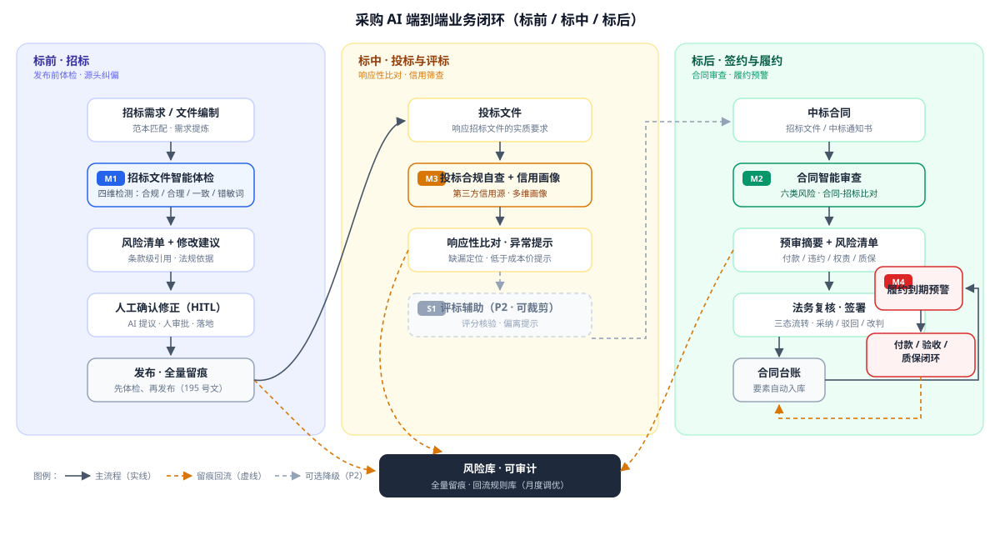
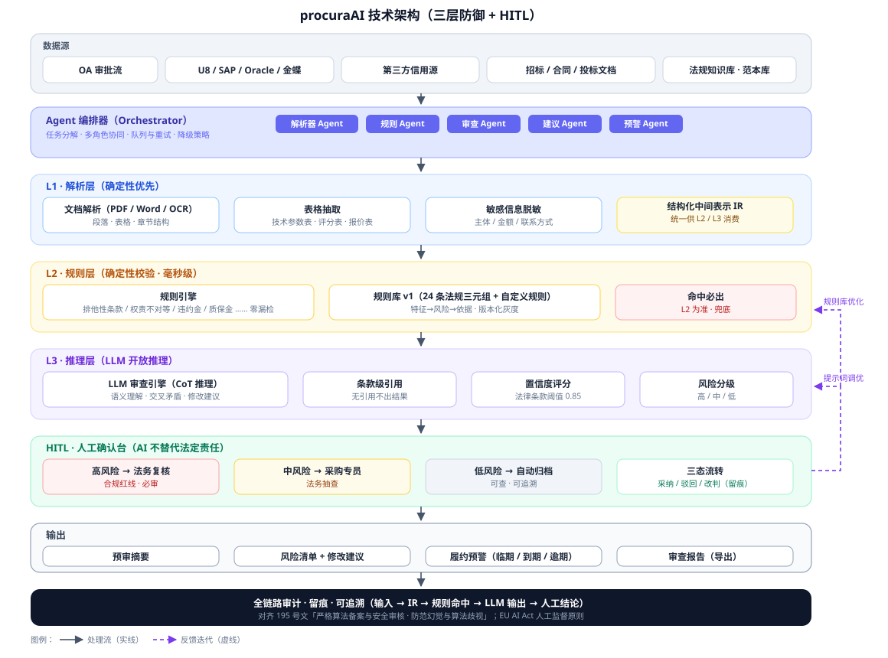

# 采购AI智能风险审查与合同智能处理 PRD

> **产品定位**：面向企业采购全流程的 AI 智能风险审查与合同智能处理**独立智能体**（ProcuraAI Agent）。
> **合规对标**：国家发展改革委等八部门《关于加快招标投标领域人工智能推广应用的实施意见》（发改法规〔2026〕195号，2026 年 2 月发布）。

---

## 文档元信息

| 项目 | 内容 |
|------|------|
| 需求名称 | 采购全流程 AI 智能风险审查与合同智能处理 |
| 产品 | procuraAI（独立智能体） |
| 文档版本 | v0.7 |
| 文档状态 | Draft（待评审） |
| 产品经理 | — |
| 技术负责人 | — |
| 关联模块 | 独立智能体；复用 Bone 元数据建模 / 低代码 Runtime / 文档解析能力 |
| 目标发布 | M 轮评审通过后进入原型验证 |

---

## 修订记录

| 版本 | 日期 | 修订人 | 核心变更 | 状态 |
|------|------|--------|----------|------|
| v0.7 | 2026-10-12 | AI 助手 | 终态复核补齐（企业真实场景）：①新增 FR-204 招标/中标/合同三一致校验（条例57条实质性背离，采购合规命门）；②新增 FR-205 审查处置闭环（修改建议→修订稿→重审→定稿）；③元信息版本对齐；对应技术方案 v0.8 | Draft |
| v0.6 | 2026-10-12 | AI 助手 | 复核修正 + 工程补齐：①修复 SVG 资产旧引用（Qwen2.5/FP16/SpEL → Qwen3.5/FP8/QLExpress）；②Qwen 许可表述修正；③新增 FR-503 围串标关联自查（集团多主体投标场景）；④新增 FR-803 审查结果交互（原文高亮锚点/风险面板/逐条确认）；⑤§6 补等保/密评合规、LLM 网关成本配额、法条依据查证；⑥评测补 LLM-as-Judge 辅助回归；对应技术方案 v0.6 | Draft |
| v0.5 | 2026-10-12 | AI 助手 | 对标业界 CLM 全生命周期趋势与 LLM 安全治理：新增 M7 合同智能起草（条款库沉淀/智能起草/起草稿回审，审查→起草闭环）；规则库双源（法规源 + 企业私有规则）；安全补提示注入防御（OWASP LLM Top10 2025）与数据分级；评测补对抗样本层 | Draft |
| v0.4 | 2026-10-12 | AI 助手 | 借鉴内部投标小助手案例补齐"投标响应侧"：新增 M6 投标响应助手（FR-711~714：拆解派发/响应模板生成/评分预估/变更对比）；人机边界补"AI 填充字段逐字核对"规则；发布路径补试点制；成功口径补 M6 基线 | Draft |
| v0.3 | 2026-10-12 | AI 助手 | 诊断优化：规则库法条引用修正（R01/R05/R10/R12/R13/R14/R20，经独立核验）；政策发布口径改"2026 年 2 月发布"；双引擎实测数据标注"厂商实测口径"；高风险遗漏率双口径分离（整体 ≤0.5% + 规则层 0 漏检）；规则依据加法务复核确认版本机制 | Draft |
| v0.2 | 2026-10-12 | AI 助手 | 业界最佳水平优化：手工精修 SVG 架构图（业务闭环/技术架构）、关键架构决策 ADR、指标定义字典（含 precision/recall/F1）、评测与质量保障体系、国际标准对标（NIST AI RMF / EU AI Act / ISO 37301）、迭代与治理机制、横切能力（任务编排/反馈闭环） | Draft |
| v0.1 | 2026-10-12 | AI 助手 | 初稿：对标 195 号文 + 业界最佳实践，输出 P0 闭环方案 | Draft |

---

## 摘要（一页纸）

| 维度 | 内容 |
|------|------|
| **问题** | 采购合同与招标文件数量多、条款复杂，人工审核易遗漏异常条款、排他性条款与合规风险；跨系统（OA/U8/SAP/Oracle/金蝶）数据割裂，履约风险事后暴露 |
| **方案** | 采购 AI 智能体：自动解析合同/招标文件 → 双引擎（规则+LLM）风险识别 → 输出预审摘要、风险清单与修改建议 → 人工确认（HITL）→ 到期履约预警闭环 |
| **对齐政策** | 195 号文 20 项场景中覆盖 6 项：招标文件检测、投标合规自查、智能辅助评标（P1）、中标合同签订风险提示、协同监管（履约预警）、智慧问答 |
| **P0 交付** | ① 招标文件智能体检（先体检、再发布）② 合同智能审查（付款节点/违约责任/技术参数/资质条件/评标规则/权责对等）③ 风险清单+修改建议输出 ④ 到期履约预警 |
| **核心指标** | 单份 50–200 页文件体检分钟级（分层口径：解析+规则 P95 ≤3 分钟、LLM 精审 P95 ≤5 分钟、全链路 P95 ≤8 分钟；人工 1–2 天）；高风险条款遗漏率 ≤0.5%；条款级引用率 100%；意见采纳率 ≥90% |
| **架构要点** | 规则引擎确定性兜底 + LLM 开放推理（混合模式高风险遗漏率 0.3%，见 §1.3）；置信度分级 + 人工确认，AI 不替代法定责任主体 |

---

## 1. 背景与目标

### 1.1 问题陈述

**现状（As-Is）**：

1. **审查强度与人力严重不匹配**：中大型企业年度采购合同数千份、招标文件数百份，单份招标文件 50–200 页、合同含付款、违约、验收、知识产权等 20+ 类条款。法务/采购人员按全文通读方式人工审核，单份耗时 1–2 天，易遗漏排他性条款、权责不对等、付款与验收过度挂钩等风险。
2. **跨系统数据割裂**：招标在 OA、预算与结算在 U8/SAP/Oracle/金蝶、供应商信用依赖第三方数据源，各系统数据不打通，无法在审查时关联供应商画像、历史合同、付款记录，风险识别缺少上下文。
3. **风险事后暴露**：付款节点、履约节点靠人工台账跟踪，到期未提醒，违约、逾期付款、验收争议等问题事后爆发，缺乏"标前审查—标中控制—标后履约"闭环。
4. **合规底线靠个人经验**：招标文件中排斥限制竞争的条款（指定品牌、区域歧视、业绩奖项门槛等）识别依赖审核人法规熟悉度，人工漏检率高，且审查结论无统一依据、无留痕。

**不做的代价**：合规风险（行政处罚、废标、合同无效）、资金风险（违约金、逾期付款）、效率损失持续累积；2026 年底政策要求招标文件检测等重点场景覆盖，不布局则企业合规竞争力落后。

### 1.2 政策驱动力（195 号文对标）

国家发展改革委等八部门 2026 年 2 月发布《关于加快招标投标领域人工智能推广应用的实施意见》（发改法规〔2026〕195号，发改委官网 2026-02-10 全文公开），核心要求：

- **总体目标**：2026 年底，招标文件检测、智能辅助评标、围串标识别等重点场景在部分省市实现全覆盖应用；2027 年底更多场景全国推广。
- **鼓励"先体检、再发布"**：对招标文件开展合规性、合理性、错敏词多维度检测，自动识别违法违规和排斥限制竞争问题，提示判断依据和修改建议。
- **中标合同签订**：自动提取签约要素、参考示范文本生成合同，对关键权利义务条款风险提示，减少"阴阳合同"、随意篡改。
- **协同监管**：贯通标前标中标后分析预警，识别转包违法分包、进度滞后、低中高结等问题。
- **安全与责任**：坚持技术**辅助性定位**，模型结论不替代招标人/代理机构/投标人/评标专家自主判断，不改变使用主体法定责任；严格算法备案与安全审核，防范模型黑箱、幻觉和算法歧视。

**本方案与 20 项场景的映射**：

| 195号文场景 | 本方案覆盖 | 模块 | 优先级 |
|------------|-----------|------|--------|
| 3. 招标文件检测 | ✅ 核心 | M1 招标文件智能体检 | P0 |
| 11. 中标合同签订（风险提示） | ✅ 核心 | M2 合同智能审查 | P0 |
| 19. 协同监管（标后履约预警） | ✅ 核心 | M4 履约到期预警 | P0 |
| 5. 投标合规自查 | ✅ 扩展 | M3 供应商合规自查 | P1 |
| 18. 信用管理 | ✅ 扩展 | M3 供应商信用画像 | P1 |
| 15. 智慧问答 | ✅ 扩展 | M5 采购智慧问答 | P1 |
| 5/8. 投标合规自查/智能辅助评标（响应侧） | ✅ 扩展 | M6 投标响应助手（内部实践对标） | P1 |
| 8/9. 智能辅助评标/评标报告核验 | 🟡 可选 | S1 评标辅助（降级项） | P2 |
| 业界趋势（非政策场景）：CLM 智能起草 | ✅ 扩展 | M7 合同智能起草（审查→条款库→起草闭环） | P1 |
| 10. 辅助定标决策 | ⭕ 不做 | — | — |
| 其余（开标/专家抽取/围串标执法/投诉处理等） | ⭕ 不做 | 属公共资源交易平台/监管侧 | — |

> **取舍说明**：围串标识别、专家抽取、投诉处理等属于公共资源交易平台与行政监管侧能力，企业采购侧（招标人视角）无对应数据与职责，不纳入本方案；如后续需要可在数据面扩展（见 §9 风险表 R-05）。

### 1.3 业界最佳实践对标

| 对标项 | 业界实践 | 本方案借鉴 | 依据 |
|--------|---------|-----------|------|
| **审查能力基准** | LawGeex 人机对测：AI 平均准确率 94% vs 20 名律师 85%，单份耗时 26 秒 vs 92 分钟 | 以准确率与耗时双指标作为验收基线（§10） | LawGeex 2018 对测 |
| **国际标准对标** | NIST AI RMF 1.0（2023-01 发布）：Govern/Map/Measure/Manage 四职能管理 AI 风险；EU AI Act（2024 生效）要求高风险 AI 落实人工监督（Art.14）；ISO 37301:2021 合规管理体系 | 方案对齐：规则库治理流程（GOV）、评测集+指标字典（MEASURE）、HITL 人工监督不替代法定责任（§4.6） | NIST / EU 官方文件 |
| **行业趋势** | Gartner 2025-08 预测：2026 年底 40% 企业应用将集成任务专用型 AI 智能体 | 独立智能体（单域任务聚焦）形态与趋势一致，避免大杂烩 Agent | Gartner 预测 |
| **产品形态** | 国际 CLM（Icertis/Evisort/ContractPodAi）偏法务专业工具；国内双轨：审查工具（幂律 MeCheck）+ 业务自助 CLM（MeFlow） | 面向采购业务人员自助使用，法务兜底复核；审查结果沉淀为合同要素库 | 幂律/致远等公开资料 |
| **招标文件体检** | 如皋公共资源交易大模型实验室：656 件文件、13815 监测点，发现疑点 813 个（错敏词 458/一致性 28/合规性 327） | 检测维度对齐：合规性、合理性、一致性、错敏词四类 | 如皋政府公开报道 |
| **引擎架构** | 规则引擎硬校验（毫秒级）+ LLM 精审（修订建议）；混合架构高风险遗漏率 0.3%（纯 LLM 12.7%），意见采纳率 94%（纯规则 21%） | **双引擎混合架构**（§4.3），规则引擎保证法定情形零漏检 | 厂商实测口径（CSDN 2026-05 实测文章）；上线后以自建评测集回归复核（§10） |
| **人工确认闭环** | HITL 动态置信度阈值（法律条款 0.85），低于阈值转人工；按风险分级分派人审，避免"AI 写人重写" | 置信度分级 + 风险分级分派（§4.6），与 195 号文"辅助性定位"一致 | 行业 HITL 实践 |
| **内部实践对标** | 金山办公·商务管理组投标小助手（Comate 场景案例）：4 个 Skill 流程节点化（拆解派发/响应模板/合规自审/知识问答）；AI 60% + 人工 40% 边界（AI 填充字段须与营业执照逐字核对、自审不可作最终结论）；单项目节省 10-23 小时、商务核心环节提效 75%，试点 15+ 直投项目 | 本方案补 M6 投标响应助手（拆解派发/模板生成/评分预估/变更对比）；人机边界与核对规则对齐；发布路径借鉴"试点→放量→方法论复制" | 金山办公内部案例（2026） |
| **CLM 全生命周期（业界趋势）** | Icertis Vera 套件："Agents execute + humans govern"，Engage（Agent 起草/红线条改）→ Review（风险审查）→ Operate（义务跟踪）→ Analyze（组合分析）；全球 CLM 市场年均 23.7% 增长，**智能起草成核心竞争点**；审查准确率 90%+、周转时间降 83%、自助创建协议占比 50%+ | 审查→条款库→**智能起草**闭环（M7）；法务定义规则、AI 执行（playbook）；业务自助生成标准协议 | Icertis 官方/CSDN 横评（2026-09） |
| **LLM 应用安全治理** | OWASP LLM Top10（2025）：LLM01 提示注入（**间接注入：文档/检索内容中隐藏指令**）、LLM02 敏感信息泄露、LLM07 系统提示泄露等；防御：外部内容视为不可信（分隔符封装）、输入校验/归一化、输出溯源校验、红队测试、最小权限 | 解析的招标文件/合同视为不受信任内容（分隔符封装 + 校验）；对抗样本入评测集；Agent 工具最小特权；安全评估按 OWASP 映射（§6） | OWASP LLM Top10 2025 / 阿里云安全支柱 |
| **幻觉防控** | 条款级引用原文 + 风险点原文高亮 + 置信度分级；工程原则：**漏检比幻觉更危险**，三层防御（解析→规则→LLM） | 全量风险条目带条款级引用与依据条文（§4.4） | 行业工程实践 |

### 1.4 目标与成功标准

| 目标 | 可验证指标（成功口径） | 优先级 |
|------|------------------------|--------|
| 招标文件体检提效 | 单份 50–200 页招标文件自动体检 ≤ 5 分钟；人工复核 ≤ 30 分钟（原 1–2 天） | P0 |
| 合同审查提效 | 单份合同风险检出 ≤ 3 分钟；人工复核 ≤ 20 分钟 | P0 |
| 高风险条款零漏检 | 规则库覆盖的法定情形（排斥限制竞争等）检出率 100%；**高风险条款遗漏率 ≤ 0.5%**（抽样复核口径） | P0 |
| 审查可追溯 | 风险条目**条款级原文引用率 100%**，依据条文引用率 100% | P0 |
| 审查结论可用性 | 抽样专家复核**意见采纳率 ≥ 90%** | P0 |
| 履约预警准确率 | 到期/临期预警准确率 ≥ 95%，无漏报（以合同台账比对） | P0 |
| 业务覆盖 | P0 上线 6 个月内覆盖当年新增采购合同 ≥ 80%、招标文件 ≥ 80% | P1 |
| 政策对齐 | 195 号文 6 项场景全部落地（含 P1/P2 项） | P1 |

---

## 2. 用户与场景

### 2.1 用户角色

| 角色 | 描述 | 核心诉求 |
|------|------|----------|
| 采购专员（招标经办人） | 编制/发布招标文件、组织评审 | 发布前快速体检，避免废标与质疑投诉 |
| 法务专员 | 合同审查、合规把关 | 高效产出风险清单与修改建议，有据可查 |
| 合同管理员 | 台账维护、履约跟踪 | 付款/验收/质保节点自动提醒 |
| 采购负责人/内审 | 合规监督、统计分析 | 风险分布与整改闭环的全局视图 |
| 系统管理员 | 数据接入、规则配置 | 规则库可维护、数据源可接入 |

### 2.2 用户故事

```gherkin
作为 采购专员
我希望 在招标文件发布前自动完成合规体检
以便 发现排他性条款与合规风险，避免废标、质疑与投诉

作为 法务专员
我希望 合同审查时 AI 输出带条款级引用的风险清单与修改建议
以便 我只需复核高置信度风险，把时间花在真正需要判断的地方

作为 合同管理员
我希望 付款、验收、质保等关键节点到期自动预警
以便 不再依赖人工台账，杜绝逾期付款与违约

作为 采购负责人
我希望 看到标前/标中/标后全链路风险分布与整改闭环
以便 量化风险管控成效，支撑内审与考核

作为 系统管理员
我希望 规则库与数据源可视化管理、可灰度发布
以便 审查规则随法规更新持续演进
```

---

## 3. 范围

### 3.1 In Scope（P0 + P1）

- **M1 招标文件智能体检**：合规性、合理性、一致性、错敏词四维检测，输出风险清单与修改建议，支持"先体检、再发布"。
- **M2 合同智能审查**：自动解析合同，识别付款节点、违约责任、技术参数、资质条件、评标规则、权责不对等问题，输出预审摘要、风险清单与修改建议。
- **M4 履约到期预警**：付款、验收、质保、知识产权期限等关键节点自动预警，对接合同台账。
- **M3 供应商信用画像与投标合规自查**：接入第三方信用数据源，投标文件响应性比对与风险提示（P1）。
- **M5 采购智慧问答**：政策法规/范本/历史审查结论检索问答（P1）。
- **M6 投标响应助手**：招标拆解与任务派发、响应模板生成（工商信息逐字核对）、评分预估、变更对比（P1，借鉴内部投标小助手实践）。
- **M7 合同智能起草**：审查结论沉淀受治理条款库，业务自助生成标准协议，起草稿自动回审（P1，对标业界 CLM 趋势）。
- 规则库管理、数据源接入、审查留痕与审计。

### 3.2 Out of Scope

- 围串标识别、专家抽取、开标自动化、投诉处理（监管/交易平台侧，195 号文非企业侧职责）。
- 辅助定标决策与数字人答辩。
- 合同在线签订与电子签章（可对接，不自建）。
- 评标过程自动化（S1 为 P2 可选降级项，见 §9 风险表 R-04）。

### 3.3 依赖与前置

| 依赖 | 说明 |
|------|------|
| 系统数据接入 | OA（审批流/招标流程）、U8/SAP/Oracle/金蝶（预算、采购订单、结算、付款）、第三方信用源（企查查/天眼查/信用中国/司法裁判数据）——需完成对接授权与数据字典 |
| 文档解析能力 | PDF/Word/扫描件 OCR 解析，表格抽取（复用 Bone 文档解析能力） |
| LLM 服务 | 企业内网可用的 LLM 服务（模型备案合规，见 §6 安全） |
| 规则库初始化 | 基于附录 §8 的 25 条法规三元组（R01–R25）初始化 v1 规则库，法务确认 |
| 台账数据 | 存量合同台账导入（用于履约预警基线） |

---

## 4. 方案总体设计

### 4.1 定位：独立智能体（ProcuraAI Agent）

- **独立可交付**：procuraAI 是独立智能体产品，不修改 Bone 核心（Clean Core：稳定封箱不动，易变外置隔离）。
- **职责边界**：AI 承担"解析、识别、提示、建议"四件事；"判断、决策、签字"始终由人完成（对齐 195 号文"技术辅助性定位，不改变使用主体法定责任"）。
- **AI 填充字段核对**：AI 生成的响应文件字段（公司主体/法人/授权代表/落款）**必须与营业执照/工商信息逐字核对**，核对不一致置人工确认、不得静默通过；AI 自审结果不可作为最终结论（借鉴投标小助手"法人信息必须与营业执照逐字核对"实践）。
- **多角色 Agent 编排**：一个智能体内部按任务编排为多个子角色：`解析器 Agent`（文档结构化）→ `规则引擎 Agent`（确定性校验）→ `审查 Agent`（LLM 开放推理）→ `建议 Agent`（生成修改建议）→ `预警 Agent`（履约节点跟踪）。

### 4.2 端到端业务闭环（标前 / 标中 / 标后）



- **标前**：招标文件智能体检（四维检测）→ 风险清单与修改建议 → 人工确认修正 → 发布留痕（先体检、再发布）；
- **标中**：投标响应助手（M6 · 拆解派发/模板生成/评分预估/变更对比）、投标合规自查 + 信用画像（P1）、评标辅助（S1 · P2 可裁剪降级）；
- **标后**：合同智能审查 → 预审摘要/风险清单 → 法务复核签署 → 合同台账 → 履约到期预警 → 付款/验收/质保闭环；
- **风险库回流**：各环节风险数据全量留痕进入风险库，回流规则库实现月度迭代（对齐 195 号文“持续迭代优化”）。

### 4.3 技术架构（三层防御）

| 层 | 组件 | 职责 | 说明 |
|----|------|------|------|
| L1 解析层 | 文档解析（PDF/Word/OCR）+ 表格抽取 + 敏感信息脱敏 | 将非结构化文档转为结构化中间表示（IR） | 小模型/确定性优先；脱敏后进 LLM |
| L2 规则层 | **规则引擎**（规则库 v1：25 条法规三元组 R01–R25 + 企业源 ER01+） | 确定性硬校验：排他性条款、权责不对等、违约金比例、质保金比例等 | 毫秒级、零漏检、全量命中带依据条文 |
| L3 推理层 | **LLM 审查引擎**（CoT 推理） | 开放推理：条款语义理解、交叉条款矛盾、风险分级、修改建议生成 | 输出条款级引用 + 置信度 + 风险等级 |
| HITL | 人工确认台 | 高风险/低置信度条目人工复核；一键采纳/驳回/改判 | 采纳结果回流规则库与模型调优 |



> 架构要点：规则层确定性兜底（L2 命中必出）、LLM 开放推理（L3 条款级引用）、HITL 人工确认（AI 不替代法定责任）；人工结论双通道回流——规则库优化（L2）与提示词调优（L3）。

**为什么双引擎**：纯规则覆盖不了开放语义（"苛刻参数组合"的识别），纯 LLM 有幻觉与漏检风险。行业实测：混合模式高风险遗漏率 0.3%、意见采纳率 94%；纯 LLM 遗漏率 12.7%、纯规则采纳率仅 21%（§1.3）。**规则兜底确定性、LLM 补足开放性**是本方案的核心架构决策。

### 4.4 幻觉防控与可追溯

| 机制 | 说明 |
|------|------|
| 条款级引用 | 每条风险必须携带原文引用（章节号+原文摘录），无引用不出结果 |
| 依据条文引用 | 每条风险必须携带法规依据（如《招标投标法实施条例》第32条(五)） |
| 法条依据查证 | LLM 引用的条文号经法规库实文核对（条文内容比对），不一致则修正或标注"依据待人工确认"（防法条张冠李戴） |
| 置信度分级 | 高（≥0.85，直接呈现）/ 中（0.7–0.85，标注需复核）/ 低（<0.7，仅提示不阻塞） |
| 风险等级分级 | 高（合规红线：排斥限制竞争/阴阳合同/权责失衡）/ 中（异常条款）/ 低（错敏词、格式一致性） |
| 双引擎交叉 | L2 命中必出、L3 出意见；L3 未命中而 L2 命中以 L2 为准（漏检比幻觉更危险） |
| 全量留痕 | 审查输入、中间 IR、规则命中、LLM 输出、人工确认结论全链路留存，可审计 |

### 4.5 数据集成架构

| 数据源 | 用途 | 接入方式 |
|--------|------|----------|
| OA | 招标流程、审批流、合同归档 | API / 流程事件订阅 |
| U8 / SAP / Oracle / 金蝶 | 预算、采购订单、结算、付款记录 | 适配器 + 数据字典映射（标准字段：合同号/金额/供应商/账期） |
| 第三方信用源 | 企查查/天眼查/信用中国/司法裁判文书 | API（工商、司法、失信、行政处罚、被执行） |
| 内部台账 | 合同台账、供应商库、历史审查结论 | 导入/同步 |

> 集成原则：**以合同为主键打通**（合同号贯穿 OA 审批 → ERP 结算 → 台账履约），数据只读接入、不做双写；脱敏后使用。

### 4.6 风险分级与置信度模型

- **置信度阈值**：法律条款类（排斥限制竞争、权责对等、违约金）阈值 0.85；错敏词/一致性类 0.7；低于阈值自动转人工复核。
- **分派规则**：高风险条目 → 法务；中风险 → 采购专员+法务抽查；低风险 → 自动归档，人工可查。
- **闭环指标**：采纳率、驳回率、改判率月度统计，回流规则库与 Prompt 调优（对齐 195 号文"以用户反馈驱动模型迭代优化"）。

### 4.7 关键架构决策（ADR）

| ID | 决策 | 备选方案（否决理由） | 依据 |
|----|------|---------------------|------|
| ADR-01 | **双引擎混合架构**：规则层确定性兜底 + LLM 层开放推理 | 纯 LLM（高风险遗漏率 12.7%，幻觉不可控）；纯规则（意见采纳率仅 21%，无法处理开放语义） | 行业实测：混合模式遗漏率 0.3%、采纳率 94% |
| ADR-02 | **HITL 人工确认**：AI 只提议不落笔，人工确认后才生效 | AI 自动修改文本（改变法定责任主体，违反 195 号文辅助性定位） | 195 号文（十一）健全应用机制 |
| ADR-03 | **以合同号为主键打通** OA/ERP/台账数据 | 各系统独立维护（无法关联履约与付款，履约预警无数据源） | 数据集成原则（§4.5） |
| ADR-04 | **规则库版本化 + 灰度发布** | 规则一次性全量更新（新规则未经验证全量上线，误报风险不可控） | 发布策略（§9.1） |
| ADR-05 | **LLM 不可用时降级为纯规则引擎** | 整体服务不可用（高风险审查链路不可中断） | 可用性 SLA ≥99.5%（§6） |
| ADR-06 | **低置信度/低风险自动归档、人工可查** | 全部人工复核（违背提效目标，审查人力不减反增） | HITL 业界实践（§1.3） |

---

## 5. 功能需求（MoSCoW）

> 每条需求含：**需求 ID + 用户故事 + 业务规则 + BDD 验收 + As-Is/Gap 标注**。As-Is 指现状（无 AI 前），Gap 指本需求补的差距。

### 5.1 M1 招标文件智能体检（P0 · 对标 195号文场景3"先体检、再发布"）

#### FR-101 招标文件解析与四维体检

- **用户故事**：作为采购专员，我希望上传招标文件后自动完成合规性/合理性/一致性/错敏词四维体检，以便发布前发现风险。
- **业务规则**：
  1. 支持 PDF/Word/扫描件，自动分段解析：招标公告、投标人须知、评标办法、合同条款、技术需求。
  2. 四维检测：合规性（排斥限制竞争等法定情形，走规则库+LLM）、合理性（参数苛刻、指标矛盾）、一致性（前后条款矛盾、报价口径不一）、错敏词（错别字、敏感词）。
  3. 检测结果按风险等级排序输出，每条带条款级原文引用与依据条文。
- **BDD 验收**：
  - Given 一份含"指定品牌 X 并提供原厂授权函"条款的招标文件 When 执行体检 Then 输出高风险条目，引用该条款原文并依据《招标投标法实施条例》第32条(五)；
  - Given 一份 200 页招标文件 When 执行体检 Then 全流程 ≤5 分钟且输出 ≥95% 已定位条款；
  - Given 含错敏词（如"招标文件"误写）的文件 When 执行体检 Then 低风险条目列出原文位置。
- **As-Is**：人工通读 1–2 天，依赖个人法规熟悉度，无留痕。**Gap**：自动化四维检测 + 全量留痕 + 发布前强制体检（可配置开关）。

#### FR-102 修改建议生成

- **用户故事**：作为采购专员，我希望每条风险附带可执行的修改建议，以便直接修订。
- **业务规则**：
  1. 高风险条目必出修改建议（给出建议改写文本）；中风险给出方向性建议；低风险仅提示。
  2. 建议改写文本必须基于原文片段，不得脱离条款语境生成新条款。
  3. 建议可一键采纳进修订稿（人工确认后生效，AI 不直接改文）。
- **BDD 验收**：Given 高风险条目 When 查看详情 Then 展示"原文 → 依据 → 风险说明 → 建议改写文本"四段式，且建议文本可溯源到原文。
- **As-Is**：修改靠法务逐条人工出意见。**Gap**：四段式结构化建议，采纳留痕。

### 5.2 M2 合同智能审查（P0 · 对标 195号文场景11"中标合同签订风险提示"）

#### FR-201 合同要素自动抽取与预审摘要

- **用户故事**：作为法务专员，我希望 AI 自动抽取合同要素并生成预审摘要，以便快速掌握合同全貌。
- **业务规则**：
  1. 抽取要素（契约级字段）：合同主体、金额（大小写一致性）、付款节点与比例、账期、履约期限、验收标准、质保金比例与期限、违约责任（双方）、知识产权归属、争议解决、保密条款、不可抗力。
  2. 生成预审摘要：一页式卡片（主体/金额/关键日期/付款节奏/风险计数），供签署前决策。
  3. 与招标文件/中标通知书比对，识别**合同背离招标实质性条款**（阴阳合同风险）。
- **BDD 验收**：
  - Given 一份 30 页采购合同 When 审查 Then ≤3 分钟输出预审摘要且关键要素字段填充率 ≥95%；
  - Given 合同付款条款为"验收合格后一次性付 100%"When 审查 Then 命中"付款与验收过度挂钩"风险（依据 87号令 74 条）并提示缺乏进度款。
- **As-Is**：合同要素人工逐条录入台账，比对靠人工。**Gap**：自动抽取 + 摘要卡片 + 合同-招标自动比对。

#### FR-202 六类风险智能识别

- **用户故事**：作为法务专员，我希望自动识别付款节点、违约责任、技术参数、资质条件、评标规则、权责不对等六类问题，以便不漏检。
- **业务规则**：六类识别分别映射规则库与 LLM 提示词（规则库 v1 见 §8）：
  1. 付款节点：全款锚定验收后/无进度款/账期超长（>90 天未约定利息）；
  2. 违约责任：违约金比例畸高（超损失 30% 参考线）、单向担责、不可抗力不对等；
  3. 技术参数：指定品牌/苛刻参数组合/排他性标准/与招标需求不一致；
  4. 资质条件：资格门槛过苛（规模条件、区域限制、业绩奖项门槛）；
  5. 评标规则：资格与评分重复计分、商务占比违规、基准价异常；
  6. 权责不对等：仅乙方担责、甲方免责、解除权单向。
- **BDD 验收**：
  - Given 合同约定"乙方逾期一天按合同总额 5% 支付违约金，甲方逾期付款无任何责任"When 审查 Then 输出两项高风险：违约金畸高（民法典 585 条参考线）+ 权责不对等（民法典 6/151 条）；
  - Given 合同含"如另行签订补充协议与本合同不一致，以补充协议为准"When 审查 Then 提示阴阳合同风险（招标投标法 46 条）。
- **As-Is**：六类风险靠法务经验逐条识别，漏检率高。**Gap**：规则库确定性覆盖 + LLM 开放识别，条款级引用可审计。

#### FR-203 审查结论流转与留痕

- **用户故事**：作为采购负责人，我希望审查结论可流转、可统计，以便形成整改闭环。
- **业务规则**：审查结论三态流转（待复核 → 已采纳/已驳回/已改判），全量留痕（输入/中间结果/结论/操作人/时间）；支持导出审查报告（含风险清单汇总）。
- **BDD 验收**：Given 一份审查完成的合同 When 导出报告 Then 报告含风险清单、依据、采纳状态、操作人；Given 法务驳回某条风险 When 完成操作 Then 状态更新且留痕可见。
- **As-Is**：审查结论在个人文档，无统一流转与统计。**Gap**：三态流转 + 全量审计。

#### FR-204 招标/中标/合同三一致校验（实质性背离识别）

- **用户故事**：作为采购负责人，我希望合同与招标文件、中标承诺自动对照，以便杜绝"阴阳合同"与实质性背离。
- **业务规则**：
  1. 对标《招标投标法实施条例》第57条：合同主要条款（标的/价款/质量/履行期限/违约责任等）应与招标文件和中标人投标文件内容一致，不得再行订立背离实质性内容的其他协议。
  2. 三文档 IR 对齐后逐项比对：标的物与规格、合同金额与中标金额、履行期限、质量/验收标准、违约责任分配；发现背离 → 高风险预警（R25 规则命中）。
  3. 关联项目号（project_no）将招标文件/中标文件/合同串联，签约环节自动触发校验。
  4. 校验结论随合同审查报告输出，人工确认后归档。
- **BDD 验收**：Given 合同金额高于中标金额或新增付款节点 When 签约审查 Then 输出"实质性背离"预警并引用条例57条；Given 合同条款与招标文件一致 When 审查 Then 无背离提示；Given 合同新增补充协议 When 审查 Then 补充协议独立校验并提示背离范围。
- **As-Is**：合同与招标/投标文件人工对照，漏查率高。**Gap**：三文档 IR 对齐 + 自动背离识别（采购合规命门）。
- **成功口径**：背离识别准确率 ≥95%（以人工复核为准）；三文档对照审查 ≤5 分钟。

#### FR-205 审查处置闭环（修改建议 → 修订稿 → 重审 → 定稿）

- **用户故事**：作为法务，我希望确认的风险修改建议能落地成修订稿并重审，以便形成处置闭环。
- **业务规则**：
  1. 审查报告中的修改建议按"采纳"状态汇集生成修订任务（按合同条款定位）；
  2. 修订稿可由起草 Agent（M7）或人工修订产生；修订稿自动触发**重审**（仅对变更条款增量审查，全量抽检 20%）；
  3. 重审通过 → 定稿归档；重审发现新风险 → 回到修订任务（最多 3 轮，超限转人工）；
  4. 处置状态全程留痕（FR-203 三态流转扩展：待修订 → 修订中 → 重审中 → 定稿）。
- **BDD 验收**：Given 采纳 3 条修改建议 When 生成修订任务 Then 任务含条款定位与建议原文；Given 修订稿提交 When 重审 Then 变更条款增量审查且新风险条目标注；Given 重审发现新风险 When 未解决 Then 修订任务回退（≤3 轮）；Given 定稿 When 归档 Then 处置链完整可审计。
- **As-Is**：修改建议人工逐条改，无重审闭环。**Gap**：修订任务 + 增量重审 + 定稿归档。

### 5.3 M4 履约到期预警（P0 · 对标 195号文场景19"协同监管·标后"）

#### FR-401 履约节点自动跟踪与预警

- **用户故事**：作为合同管理员，我希望付款、验收、质保等节点到期自动预警，以便杜绝逾期。
- **业务规则**：
  1. 从合同审查结果与台账抽取关键日期：付款日、验收日、质保到期日、知识产权期限、履约截止日。
  2. 预警规则：临期（T-15 天）提醒、到期（T-0）告警、逾期（T+0）升级；支持自定义提前天数。
  3. 预警触达：站内消息 + OA 待办；逾期自动上报采购负责人。
  4. 与 ERP 付款记录核对，已付款合同自动消警（避免误报）。
- **BDD 验收**：
  - Given 合同付款日为 2026-12-01 When 到达 2026-11-16 Then 生成临期预警且信息含合同号/金额/节点；
  - Given 某节点已完成付款 When 同步 ERP 记录 Then 该节点预警自动关闭，不重复提醒；
  - Given 逾期节点未处理 When 到达逾期日 Then 升级告警并抄送负责人。
- **As-Is**：人工台账跟踪，漏提醒普遍。**Gap**：自动抽取节点 + 多级预警 + ERP 消警闭环。

### 5.4 M3 供应商信用画像与投标合规自查（P1 · 对标 195号文场景5/18）

#### FR-501 供应商信用多维画像

- **用户故事**：作为采购专员，我希望在投标/签约前查看供应商信用画像，以便规避失信风险。
- **业务规则**：画像维度：工商（成立年限/注册资本/股权结构）、司法（涉诉/被执行/失信）、行政处罚、经营异常、关联关系（法人/股东交叉）；来源以第三方信用 API 为准，数据落库留痕并标注数据日期。
- **BDD 验收**：Given 供应商 A 有失信记录 When 查看画像 Then 高风险标红并给出提示与依据来源；Given 无记录 When 查看 Then 显示"未发现风险"。
- **As-Is**：人工查企查查/天眼查，信息散、无留痕。**Gap**：自动聚合 + 风险标注 + 审查关联。

#### FR-502 投标合规自查（响应性比对）

- **用户故事**：作为投标经办人（集团投标场景），我希望投标文件对照招标文件自动响应性比对，以便减少废标。
- **业务规则**：比对维度：资格条件响应、技术参数响应（逐条对表）、商务报价完整性、签字盖章齐全性；异常提示：低于成本价风险（报价偏离均值异常）、技术方案语义相似（围串标线索提示，仅提示不执法）。
- **BDD 验收**：Given 投标文件技术参数未响应某 ★ 条款 When 自查 Then 输出缺漏项并定位原章节；Given 报价显著低于同类均价 When 自查 Then 低风险提示。
- **As-Is**：人工逐条比对。**Gap**：自动响应性比对 + 缺漏定位。

#### FR-503 投标主体关联关系自查（围串标风险）

- **用户故事**：作为投标负责人，我希望集团多主体参与同一项目时自动提示关联关系风险，以便避免废标与合规风险。
- **业务规则**：投标前校验参与主体间股权/高管/实际控制人关联关系（对接工商数据源）；同一项目出现关联主体 → 提示围串标嫌疑并标黄预警；出具自查说明模板（供投标文件附上关联关系声明）；**预警不作为投标决策结论，仅提示人工确认**。
- **BDD 验收**：Given 集团下两家子公司同时投标同一项目且存在控股关系 When 提交自查 Then 输出关联关系预警与依据（股权结构）；Given 关联主体非控股但共享高管 When 自查 Then 标黄提示并提供声明模板；Given 无关联 When 自查 Then 提示"未发现关联关系"。
- **As-Is**：主体关联靠人工排查。**Gap**：自动关联校验 + 预警 + 声明模板。
- **成功口径**：关联关系识别准确率 ≥95%（以工商数据为准）；自查报告生成 ≤5 分钟。

### 5.5 M5 采购智慧问答（P1 · 对标 195号文场景15）

#### FR-601 政策法规与业务问答

- **用户故事**：作为采购人员，我希望随时问答政策法规与业务流程，以便少翻手册。
- **业务规则**：知识源：政策法规库（195号文、招标投标法及实施条例、政府采购法及实施条例、87号令、财库〔2021〕22号等）+ 范本库 + 历史审查案例；答案必须带出处链接；检索不到明确答复时如实说明（禁止编造条文）。
- **BDD 验收**：Given 提问"评标办法商务分占比有什么限制"When 问答 Then 返回 87号令 55 条相关内容并附原文出处；Given 提问知识库外问题 When 问答 Then 明确告知无依据来源。
- **As-Is**：法规靠人工记忆/翻文档。**Gap**：RAG 知识问答，带出处。

### 5.6 M6 投标响应助手（P1 · 对标 195号文场景5/8 + 内部实践：金山办公投标小助手）

> 借鉴内部落地案例（商务管理组·投标小助手：4 个 Skill 流程节点化，单项目节省 10-23 小时、商务核心环节提效 75%，试点 15+ 直投项目），补齐"投标响应侧"能力——本方案从"审查/风险"扩展到"响应/协作"。

#### FR-711 招标文件拆解与投标任务派发

- **用户故事**：作为投标项目负责人，我希望 AI 拆解招标文件并自动派发任务，以便多人协作不遗漏不延误。
- **业务规则**：自动提取项目名称/编号/截止日期/采购方式/资质要求等结构化要素并输出拆解报告；按角色自动创建任务（销售→报价/特价/保证金，合同BP→条款/知产/案例，售前→技术方案）；任务带责任人/截止时间，生成看板视图；定时推送提醒与日报（如 9:00/17:00）。
- **BDD 验收**：Given 上传 200 页招标文件 When 触发拆解 Then 5 分钟内输出拆解报告（项目要素 + 资质/评分/废标要求清单）；Given 拆解完成 When 确认派发 Then 自动生成角色任务且责任人/截止时间完整；Given 临近截止 When 未完成 Then 定时推送提醒。
- **As-Is**：商务人工逐页拆解、口头派活。**Gap**：自动拆解 + 结构化派发 + 定时跟进。
- **成功口径**：拆解报告 ≤5 分钟；任务派发零遗漏（每项资质/评分要求均有责任任务）。

#### FR-712 响应文件模板生成（含工商信息核对）

- **用户故事**：作为商务人员，我希望按招标文件格式自动生成响应文件模板，以便减少逐字抄写错误。
- **业务规则**：按招标文件"投标文件格式"章节逐字段生成投标函、授权委托书、声明函、报价表等模板；自动填充公司全称/统一社会信用代码/法人/授权代表/落款日期；**AI 填充字段必须与营业执照/工商信息逐字核对**（不一致置人工确认，不得静默通过）；模板排版按规范统一。
- **BDD 验收**：Given 招标文件含投标文件格式章节 When 生成模板 Then 投标函/授权书/报价表模板完整且占位符已填充；Given 填充法人姓名与工商信息不一致 When 核对 Then 标红提示并置人工确认；Given 模板生成 When 查看 Then 排版符合投标文件规范。
- **As-Is**：人工对照原文逐字抄写，易错填废标。**Gap**：模板自动生成 + 工商信息逐字核对。
- **成功口径**：模板生成 ≤10 分钟（对标内部案例"框架 10 分钟自动出"）；填充字段核对率 100%。

#### FR-713 评分预估与改进建议

- **用户故事**：作为投标负责人，我希望 AI 按评分规则预估得分并给出改进建议，以便投标策略决策。
- **业务规则**：自动抽取评分规则（分值权重/评分因素）；对照我方响应情况逐项预估得分并标注失分点；输出改进建议清单（哪些条款需补充材料/优化响应）；预估仅作决策参考，不作为最终结论。
- **BDD 验收**：Given 评分规则与响应文件 When 预估 Then 输出各项得分预估 + 失分点 + 改进建议；Given 客观分可精确计算 When 预估 Then 结果与人工核算一致。
- **As-Is**：人工估算，凭经验判断。**Gap**：规则化评分预估。
- **成功口径**：客观分预估与人工核算一致率 ≥95%。

#### FR-714 招标文件变更对比

- **用户故事**：作为投标负责人，我希望招标文件变更后自动对比差异，以便及时调整响应策略。
- **业务规则**：支持新旧版本招标文件差异对比（条款/评分/资质/截止时间等变更）；变更影响分析（命中规则库哪些条款、影响哪些已生成任务/响应模板）；变更确认后触发受影响项重审。
- **BDD 验收**：Given 招标文件发布变更版 When 对比 Then 输出变更清单（新增/删除/修改 + 影响分析）；Given 变更涉及资质要求 When 分析 Then 提示受影响任务并建议重审。
- **As-Is**：人工逐页核对变更，易漏。**Gap**：自动差异对比 + 影响分析。
- **成功口径**：变更识别召回 ≥95%；受影响项提示零遗漏。

### 5.7 M7 合同智能起草（P1 · 对标业界 CLM 趋势）

> 业界 CLM 已从"审查"走向"审查→起草→义务跟踪→组合分析"全生命周期（Icertis Vera：Agents execute + humans govern）。本模块让审查沉淀的结论反哺起草，形成"审查→条款库→起草→回审"闭环，法务定义规则、AI 执行。

#### FR-721 条款库沉淀与治理

- **用户故事**：作为法务，我希望审查结论自动沉淀为受治理的条款库，以便后续起草与审查复用标准条款。
- **业务规则**：审查中人工采纳/改判的条款结论回流条款库；条款分级（标准条款/备选条款/禁用条款）+ 合规状态 + 使用统计；**只有法务确认的条款可被起草使用**（playbook 概念：法务定义规则、AI 执行）；条款变更走版本化（v1.x）与灰度。
- **BDD 验收**：Given 审查中法务改判某付款条款 When 确认 Then 该条款入条款库并标记版本；Given 业务起草时引用禁用条款 When 组装 Then 阻止并提示使用备选条款；Given 条款库新增版本 When 发布 Then 旧版本保留可追溯。
- **As-Is**：条款经验散落个人/文档，不可复用。**Gap**：受治理条款库 + 版本化沉淀。
- **成功口径**：标准协议起草引用条款库覆盖率 ≥80%；禁用条款零放行。

#### FR-722 智能起草（业务自助）

- **用户故事**：作为采购业务人员，我希望自助生成标准协议初稿，以便减少等待法务起草的时间。
- **业务规则**：按合同类型（采购协议/框架协议/NDA/服务合同）引导填写必填要素（双方/金额/期限/交付物）；从受治理条款库智能组装条款（按场景推荐条款组合）；自动带出合规预检（复用规则库）；**起草稿标注"AI 初稿，需人工确认"**。
- **BDD 验收**：Given 填写采购协议必填要素 When 生成初稿 Then 条款完整且合规预检通过；Given 场景为框架协议 When 推荐 Then 组装结果含价格机制与结算条款；Given 生成初稿 When 打开 Then 带"AI 初稿需人工确认"标注。
- **As-Is**：业务提单等法务起草（1-3 天）。**Gap**：业务自助生成（分钟级初稿）。
- **成功口径**：标准协议初稿生成 ≤10 分钟（对标 Icertis 自助创建 50%+ 占比）；法务处理日常请求量降低目标 40-60%。

#### FR-723 起草稿回审

- **用户故事**：作为法务，我希望起草稿自动过审查引擎，以便把关质量并形成闭环。
- **业务规则**：起草完成自动触发 M2 审查（双保险）；回审发现风险条目标注"起草引入/历史沿用"；回审结论回流条款库（进一步沉淀）。
- **BDD 验收**：Given 起草稿生成 When 提交审查 Then 输出风险清单且标注来源；Given 回审发现某标准条款有问题 When 处理 Then 条款库版本更新并提示使用方。
- **As-Is**：起草与审查脱节。**Gap**：起草→回审闭环。
- **成功口径**：起草稿一次回审高风险遗漏率 ≤0.5%（同 M2 基线）。

### 5.8 S1 评标辅助（P2 · 可选降级项）

#### FR-701 评标要素提取与评分核验（降级可裁剪）

- **用户故事**：作为评标组织者，我希望 AI 提取评标要素并核验评分一致性，以便减少计算差错。
- **业务规则**：自动提取报价表、评分表；核验客观分计算、分值加总一致性；标注专家打分偏离度（仅提示复核，不替代专家判断）。
- **BDD 验收**：Given 评分表分值加总错误 When 核验 Then 标注错误位置与正确值；Given 某专家打分偏离同类均值过大 When 核验 Then 提示复核。
- **As-Is**：人工核算，差错率高。**Gap**：自动核验 + 偏离提示。
- **降级说明**：若 P0/P1 排期紧张，S1 可整体裁剪，不影响主闭环（§9 R-04）。

### 5.9 横切能力（跨模块）

#### FR-801 审查任务编排与批量处理

- **用户故事**：作为系统管理员，我希望大批量文件可排队审查、失败可重试，以便规模化使用。
- **业务规则**：支持批量上传（合同/招标文件）；任务队列（FIFO + 优先级）；失败自动重试（≤3 次）；任务状态可查（排队/解析/审查/完成/失败）；大文档切片审查、段落级合并结果。
- **BDD 验收**：Given 100 份合同批量上传 When 提交任务 Then 队列有序执行且单份结果独立可查；Given 某文件解析失败且重试仍失败 When 任务结束 Then 标记失败并保留原始输入供人工处理。
- **As-Is**：逐份人工处理。**Gap**：任务队列 + 自动重试 + 状态可视化。

#### FR-802 用户反馈与审查质量闭环

- **用户故事**：作为法务专员，我希望一键反馈审查质量（采纳/误报/漏检），以便驱动模型迭代。
- **业务规则**：风险条目支持"采纳/驳回/改判 + 理由"；驳回理由分类（误报/理由不充分/依据引用错误）；月度质量报表（采纳率、误报率、漏检率）自动生成，回流规则库与提示词。
- **BDD 验收**：Given 法务驳回某条风险并选择"误报" When 提交 Then 该样本进入评测集并参与下月规则回归；Given 月度报表生成 When 查看 Then 含采纳率/误报率/漏检率三指标。
- **As-Is**：无反馈通道。**Gap**：反馈采集 + 自动回归 + 报表闭环。

#### FR-803 审查结果交互（原文高亮锚点）

- **用户故事**：作为审查用户，我希望风险条目点击即可定位原文高亮位置，以便快速核对。
- **业务规则**：风险条目携带 section_ref + 原文 span（IR 定位）；前端渲染原文并高亮命中段落，侧边风险面板逐条展开；支持逐条确认（采纳/驳回/改判）与批量操作；高亮锚点随版本回滚保持一致（review_snapshot 定位）。
- **BDD 验收**：Given 审查完成 When 打开结果页 Then 风险面板列出条目且点击条目原文段落高亮定位；Given 修改建议 When 查看 Then 原文/依据/建议三区对照展示；Given 驳回某条 When 操作 Then 面板状态同步更新。
- **As-Is**：风险结论与原文脱节，核对需人工翻找。**Gap**：锚点定位 + 面板逐条确认（业界 CLM 标配体验）。

---

## 6. 非功能需求

| 类别 | 要求 |
|------|------|
| 性能 | 单份 ≤200 页文档解析+规则校验 P95 ≤3 分钟；LLM 精审 P95 ≤5 分钟；**全链路（解析+规则+LLM）P95 ≤8 分钟**；问答首响 ≤3 秒 |
| 质量 | 评测集 ≥200 条标注样本，回归基线：高风险遗漏率 ≤0.5%、**误报率 ≤5%（precision ≥95%）**、F1 ≥0.95；同一文档两次审查高风险条目一致性 ≥95%（定义见 §10.1） |
| 成本 | LLM 按文档切片 + 风险分级计费：低风险条目与规则命中条目不调 LLM；Token 消耗月度统计报表（业界实践：结构化任务用小模型、开放推理用大模型）；**LLM 网关统一配额与审计**（租户/部门月度 Token 配额，超配额降档或限速） |
| 安全 | 租户隔离（多企业部署）；敏感信息脱敏后进 LLM；数据只读接入、不留存 ERP 原始凭证明细；审查操作全量审计；模型与算法按要求备案、安全审核（对齐 195 号文"严格算法备案与安全审核"）；**提示注入防御与对抗评测**（OWASP LLM Top10 2025）；**等保三级/密评**：政务国企场景对齐定级备案、日志留存 ≥6 个月、双因素、数据加密 |
| 可用性 | 核心审查链路 SLA ≥ 99.5%；LLM 服务不可用时降级为纯规则引擎（规则层兜底仍可出清单，LLM 建议置灰） |
| 可观测 | 全链路日志（解析/规则/LLM/人工操作）；风险检出率、采纳率、漏检率月度报表 |
| 测试 | 规则库单测（每条规则 ≥1 正向 + 1 反向用例）；LLM 评测集（≥200 条标注样本，高风险遗漏率回归基线 ≤0.5%） |
| 合规 | 审查结论标注"AI 辅助意见，以人工审核为准"；法定责任主体不变（对齐 195 号文）；**法条依据查证**：LLM 引用条文经法规库实文核对，防"法条张冠李戴" |

---

## 7. 接口与数据（契约级）

### 7.1 对外接口

| 方法 | 路径 | 说明 |
|------|------|------|
| POST | /api/v1/documents/analyze | 上传文档（招标文件/合同），触发解析+审查，返回 task_id |
| GET | /api/v1/tasks/{task_id} | 查询审查进度与结果摘要 |
| GET | /api/v1/reviews/{review_id}/risks | 风险清单（含条款引用/依据/置信度/等级） |
| POST | /api/v1/reviews/{review_id}/risks/{risk_id}/decision | 人工确认（采纳/驳回/改判+理由） |
| GET | /api/v1/alerts?type=upcoming | 履约预警列表 |
| GET | /api/v1/vendors/{vendor_id}/profile | 供应商信用画像 |
| POST | /api/v1/ask | 智慧问答（RAG） |

### 7.2 数据模型（核心表）

> 字段级类型/约束/枚举以《接口契约与数据字典》为准；本表为契约级摘要，两文档同步维护。

| 表 | 关键字段 |
|----|----------|
| review（兼审查任务表，一任务一行） | review_id, tenant_id, doc_type(TENDER/CONTRACT/BID), status(QUEUED/PARSING/RULE_CHECK/LLM_REVIEW/MERGING/PENDING_REVIEW/REVISING/RE_REVIEWING/FINALIZED/COMPLETED/FAILED/rules_only 变体), source_system, contract_no, project_no(三一致串联主键，FR-204), risk_count, rules_only, created_by/at |
| risk_item | risk_id, review_id, rule_id, risk_type, risk_level(HIGH/MED/LOW), confidence, quote_original, section_ref, basis_regulation, suggestion, decision(PENDING/ADOPTED/REJECTED/REVISED), reason_type(FALSE_POSITIVE/WEAK_REASON/BASIS_ERROR), decided_by/at |
| review_snapshot | snapshot_id, review_id, doc_hash, ir_snapshot(json, <2MB 内联), snapshot_uri(大文档 IR/原文，对象存储加密), llm_version, rule_version, prompt_version, created_at | **审查可复现**：输入+引擎版本全留痕，支持结果回溯（多版本一致性抽查） |
| revision_task（FR-205 修订任务） | revision_id, review_id, contract_no, status(PENDING_REVISION/REVISING/RE_REVIEWING/FINALIZED/ESCALATED), adopted_risk_ids(json), round(≤3), revised_doc_hash, created_by/at |
| feedback | feedback_id, review_id, risk_id, action(ADOPT/REJECT/REVISE), reason_type(FALSE_POSITIVE/MISSED/BASIS_ERROR), comment, user_id, created_at | 质量闭环数据源，回流评测集与规则回归 |
| contract_element | contract_no, supplier, amount, amount_consistent, payment_nodes(json), warranty_rate, term_end_date |
| alert_task | alert_id, contract_no, node_type(PAYMENT/ACCEPTANCE/WARRANTY/PERFORMANCE), due_date, status(UPCOMING/DUE/OVERDUE/CLEARED), cleared_by_erp, priority |
| vendor_profile | vendor_id, credit_source, dimensions(json), risk_flags, data_date |
| clause_library（M7） | clause_id, tenant_id, category(STANDARD/ALTERNATIVE/FORBIDDEN), status(draft/legal_reviewed/active), source_review_id, version, content, legal_owner, usage_count |
| rule | rule_id, category(COMPLIANCE/RATIONALITY/CONSISTENCY/SENSITIVE_WORD), feature_pattern, risk_type, basis, severity, source(LAW/ENTERPRISE), status, version |

> 全表带租户隔离与审计字段，对齐 [数据库开发规范](../architecture/数据库开发规范.md)。

---

## 8. 规则库 v1（附录）

> 依据 → 条款特征 → 风险类型 → 处置建议。初始化 25 条（R01–R25），**每条规则的法条依据经法务复核确认后入库（记录确认人/日期/版本）**，支持按版本灰度升级；法规修订时按 §9.3 月度巡检评估影响。

### 8.0 规则库双源架构

| 来源 | 说明 | 规则示例 |
|------|------|----------|
| **法规源**（R01-R25） | 招标投标法及实施条例、政采法及实施条例、87号令、财库〔2021〕22号、民法典等法定情形 | 见 8.1-8.5 |
| **企业源**（ER01+） | 企业私有合规红线：集团制度、行业规范、供应商准入标准、历史风险案例沉淀（playbook 概念：法务定义规则、AI 执行） | ER01 供应商须持有行业资质（企业准入清单）；ER02 付款周期不得超过公司财务红线；ER03 合同须含我方法务指定管辖条款 |

> 企业源规则与法规源同构（特征→风险→依据→处置），依据为"企业制度条款号"，走相同灰度/回归/法务确认流程（§9.3）。

### 8.1 排斥限制竞争类（合规红线 · 高风险）

| # | 条款特征 | 风险类型 | 依据 |
|---|----------|----------|------|
| R01 | 限定本省/本市注册、设分支机构或售后网点 | 区域歧视 | 招标投标法实施条例 32条(七)(二)/政采实施条例 20条(七)；设分支机构附财库〔2019〕38号(三) |
| R02 | 以特定行政区域/行业业绩、奖项作为资格或加分 | 排斥竞争 | 条例 32条(三)/20条(四) |
| R03 | 指定品牌、要求品牌授权函/原厂证明 | 指定品牌 | 条例 32条(五)/20条(六) |
| R04 | 参数指向特定型号、苛刻参数组合、排他性接口标准 | 倾向特定产品 | 政采实施条例 20条(三)(八) |
| R05 | 注册资本/营收/从业人数等规模条件 | 歧视中小企业 | 财库〔2020〕46号、87号令 17条（招标类禁规模条件） |
| R06 | 以名录库/资格库/备选库入库为前提 | 限制竞争 | 财库〔2019〕38号 |
| R07 | 业绩时间窗过短（仅近 1 年）或限"政府类业绩" | 变相排斥 | 政采实施条例 20条(四)(八) |

### 8.2 评标办法类

| # | 条款特征 | 风险类型 | 依据 |
|---|----------|----------|------|
| R08 | 资格条件兼作评分项重复计分 | 资格评分混淆 | 87号令 55条 |
| R09 | 货物价分 <30%、服务 <10% | 商务占比违规 | 87号令 55条 |
| R10 | 技术服务标准统一的货物/服务未用最低评标价法 | 方法错误 | 《政府采购法实施条例》34条（招标投标法实施条例 34条为利害关系条款，非本法条） |
| R11 | 基准价取平均价而非最低价 | 价格分违规 | 87号令 55条 |
| R12 | 评分无量化细则、客观不可量化指标作评分项 | 评审失公 | 87号令 55条、财库〔2021〕22号 21条（客观不可量化不得作评分项） |
| R13 | 设最低限价或"低于均价即废标" | 变相限价 | 87号令 12条（不得设最低限价）、78条(二) 追责 |

### 8.3 合同风险类

| # | 条款特征 | 风险类型 | 依据 |
|---|----------|----------|------|
| R14 | 付款全锚定验收后、无进度款或"未验收不付款" | 付款与验收过度挂钩 | 87号令 75条（及时支付采购资金）；国令728号《保障中小企业款项支付条例》（不得以验收拖延付款） |
| R15 | 仅乙方担责、甲方免责、不可抗力不对等 | 权责失衡 | 民法典 6、151条 |
| R16 | 违约金畸高（超损失 30% 参考线） | 违约金过高 | 民法典 585条、法释〔2023〕13号 65条 |
| R17 | 质保金 >3% 或缺陷责任期 >2 年（建设工程）；货物类超额质保 | 超额质保 | 建质〔2017〕138号（按项目类型分流） |
| R18 | 另签协议背离中标实质内容（价款/工期/质量） | 阴阳合同 | 招标投标法 46条、建工解释一 2条 |
| R19 | 合同与招标文件实质性条款不一致 | 合同背离招标 | 招标投标法 46、59条 |

### 8.4 需求论证与内控类（财库〔2021〕22号）

| # | 条款特征 | 风险类型 | 依据 |
|---|----------|----------|------|
| R20 | 1000 万货物/服务、3000 万工程未做需求调查 | 需求论证缺失 | 22号文 11条（达到额度强制需求调查） |
| R21 | 业绩作资格条件同类合同 >2 个或未明同类范围 | 资格过苛 | 22号文 18条 |
| R22 | 参数引特定供应商规格且无"参照或相当于" | 指向性需求 | 22号文 7、9条 |
| R23 | 需求未经合规性+非歧视性双审 | 内控缺失 | 22号文 31-33条 |

### 8.5 错敏词与一致性类（低风险）

| # | 条款特征 | 风险类型 | 依据 |
|---|----------|----------|------|
| R24 | 错别字/敏感词/前后条款数字或口径不一致 | 错敏词/一致性 | 内部质检规范 |
| R25 | 合同与招标/中标文件实质性背离（标的/金额/期限/质量/责任，条例57条） | 实质性背离 | 《招标投标法实施条例》第57条 |

> **规则库扩展机制**：新规则经"法务确认 → 测试集回归（≥1正+1反）→ 灰度 → 全量"流程入库，与 195 号文"持续迭代优化、用户反馈驱动"对齐。

---

## 9. 发布与风险

### 9.1 发布策略

- **分期**：P0（M1+M2+M4 闭环）→ P1（M3+M5+M6+M7）→ P2（S1，可裁剪）。
- **试点路径**（借鉴内部投标小助手落地经验）：先 3-5 个试点项目/合同类型验证 → 15+ 项目放量 → 方法论复制到相邻业务（验收、结项、合同流转）。
- **灰度**：先单合同类型（如货物采购）试点 → 全类型；规则库按版本灰度。
- **降级**：LLM 不可用时规则引擎兜底出清单（标注"未含 AI 建议"）；数据源单点故障时跳过该维度并提示。

### 9.2 风险表

| 风险 | 影响 | 缓解 |
|------|------|------|
| R-01 LLM 幻觉/漏检 | 高风险条款漏检 | 双引擎兜底（规则层零漏检目标）；置信度分级；条款级引用强制；评测集回归基线 ≤0.5% |
| R-02 法规更新滞后 | 规则过期 | 规则库版本化+月度法规巡检；问答知识库自动更新（195号文类新政策纳入） |
| R-03 多 ERP 数据口径不一 | 预警/画像数据错 | 标准字段映射层（合同号/金额/账期统一字典）；只读接入；ERP 记录消警闭环校验 |
| R-04 S1 排期压力 | 范围蔓延 | S1 为 P2 可整体裁剪项，不影响 P0 主闭环 |
| R-05 与监管侧能力边界 | 越权风险 | 明确围串标识别等属交易平台/监管职责，本方案仅企业侧提示，不替代执法 |
| R-06 数据安全合规 | 敏感数据外泄 | 脱敏后进 LLM；数据只读；审计全量留痕；算法/模型备案 |
| R-07 用户信任不足 | 采纳率低 | 全量引用可溯源；四段式呈现；按角色分级分派；采纳率月度反馈调优 |

### 9.3 迭代与治理机制（对齐 195 号文"持续迭代优化 · 用户反馈驱动"）

| 机制 | 说明 | 频率 |
|------|------|------|
| 法规巡检 | 新法规/修订（87 号令修订草案、195 号文配套细则等）评审入库 | 月度 |
| 规则库回归 | 新规则先过正反例测试集（≥1 正 + 1 反），再灰度上线 | 随规则变更 |
| 评测集演进 | 生产样本（含误报/漏检反馈）回流标注集，定期重标 | 季度 |
| 提示词版本化 | prompt 变更走评测回归，保留版本可回滚 | 随变更 |
| 用户反馈驱动 | 采纳率/误报率/漏检率月度报表 → 排定调优项 | 月度 |
| 多版本一致性 | 抽查同一文档新旧引擎审查结果一致性（≥95%） | 季度 |
| **对抗评测（红队）** | 恶意条款/隐藏指令/越狱样本入评测集（对标 OWASP LLM Top10 2025：提示注入/系统提示泄露）；安全评测基线：注入样本检出率 ≥95%、敏感信息零泄露 | 随评测集演进（季度）+ 安全事件后立即 |
| **评测效率（LLM-as-Judge）** | 批量回归由 judge 模型预判采纳/驳回，人工仅抽查争议样本（关键样本仍全量人工，judge 不作最终结论） | 随评测集演进 |

---

## 10. 成功口径与验收

| 口径 | 基线 | 验收方式 |
|------|------|----------|
| 体检/审查耗时 | 分层口径：解析+规则 P95 ≤3 分钟；LLM 精审 P95 ≤5 分钟；全链路 P95 ≤8 分钟；人工复核 ≤30 分钟 | 压测 + 抽样计时 |
| 意见采纳率（两级口径） | **POC 试点闸门 ≥60%**（立项评估阶段 1 出口）；**终态基线 ≥90%**（专家复核抽样，上线后 3 个月达成） | POC 验收报告 / 月度抽样复核统计 |
| 高风险条款遗漏率 | 整体 ≤0.5%；**规则库法定情形 0 漏检**（两口径分离：评测集整体口径 + 规则层零漏检口径） | 评测集（≥200 条标注样本）回归 + 规则单测 |
| 误报率 / precision | 误报率 ≤5%、precision ≥95% | 人工确认结论统计 |
| F1 综合得分 | ≥0.95 | 评测集回归 |
| 条款级引用率 | 100% | 全量审查记录抽检 |
| 意见采纳率 | ≥90%（专家复核抽样） | 月度抽样复核统计 |
| 响应文件模板生成/拆解报告（M6） | 模板 ≤10 分钟、拆解报告 ≤5 分钟；客观分预估一致率 ≥95%（对标内部案例） | 压测 + 抽样计时 |
| 起草与回审（M7） | 标准协议初稿 ≤10 分钟；起草稿一次回审高风险遗漏率 ≤0.5%；条款库覆盖引用率 ≥80% | 压测 + 评测集回归 |
| 审查一致性 | 同一文档两次审查高风险条目一致率 ≥95% | 复测样本 |
| 履约预警准确率 | ≥95%、无漏报 | 台账比对 |
| 业务覆盖 | 上线 6 个月覆盖新增合同 ≥80% | 台账统计 |
| 政策对齐 | 195 号文 6 项场景落地 | 功能清单核对 |

### 10.1 指标定义字典（防追问：口径、算法、来源）

| 指标 | 定义 | 计算口径 | 数据来源 |
|------|------|----------|----------|
| 高风险遗漏率 | 标注样本中应检出而未被检出的高风险比例 | FN /（TP + FN） | 评测集人工标注 |
| 误报率 | 检出的风险中实际非风险的比例 | FP /（TP + FP） | 人工确认结论（risk_item.decision） |
| precision | 检出的风险中正确的比例 | TP /（TP + FP） | 人工确认结论 |
| recall | 应检出风险中被检出的比例 | TP /（TP + FN） | 评测集标注 |
| F1 | 综合得分 | 2·P·R /（P + R） | 同上 |
| 意见采纳率 | 人工采纳的风险条目比例 | 采纳数 / 待复核总数 | 三态流转记录 |
| 条款级引用率 | 风险条目携带原文引用的比例 | 有引用条目 / 风险总数 | risk_item 表 |
| 审查一致性 | 同一文档两次审查高风险条目的重合度 | 交集 / 并集 | 复测样本 |
| 履约预警准确率 | 预警与实际到期一致的比例 | 准确预警数 / 预警总数 | 台账比对 |

---

## 11. 附录

### 11.1 术语

| 术语 | 说明 |
|------|------|
| 招标文件体检 | 发布前对招标文件做合规性/合理性/一致性/错敏词检测（195号文场景3"先体检、再发布"） |
| 双引擎 | 规则引擎（确定性校验）+ LLM 引擎（开放推理）的混合审查架构 |
| HITL | Human-in-the-loop，人工确认闭环：AI 提议 → 人审批 → 落地 |
| IR | Intermediate Representation，文档解析后的结构化中间表示 |
| 阴阳合同 | 签约合同与中标/招标文件实质性条款不一致，另签协议背离中标内容 |

### 11.2 参考文档

| 文档 | 用途 |
|------|------|
| 发改法规〔2026〕195号《关于加快招标投标领域人工智能推广应用的实施意见》 | 政策对标（20 项场景） |
| 《招标投标法实施条例》第32条、《政府采购法实施条例》第20条 | 排斥限制竞争规则库依据 |
| 财政部令第87号（2017版） | 评标办法合规规则库依据 |
| 财库〔2021〕22号《政府采购需求管理办法》 | 需求论证与内控规则库依据 |
| 民法典 6/151/585条、建质〔2017〕138号 | 合同风险规则库依据 |
| NIST AI RMF 1.0（2023-01） | 国际 AI 风险管理框架对标（Govern/Map/Measure/Manage） |
| EU AI Act（2024 生效） | 高风险 AI 人工监督（Art.14）原则对标 |
| ISO 37301:2021 | 合规管理体系对标 |
| Gartner 2025-08 智能体预测 | 行业趋势：2026 年底 40% 企业应用集成任务专用型 AI 智能体 |
| BONE PRD 模板（doc/prd/PRD模板.md） | 本文档结构基准 |
